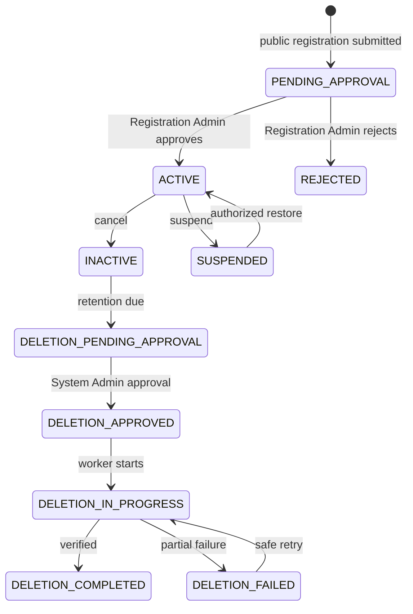
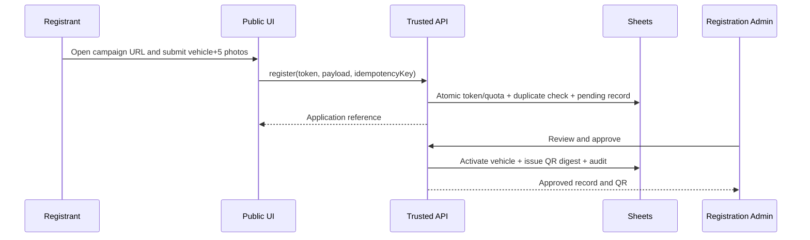

# P6 Vehicle Contact — Approved Business Requirements Baseline (Interview R01–R26)
Document ID: P6VC-BR-026 | Date: 2026-11-17 | Status: BUSINESS DECISIONS RECORDED; SECURITY/LEGAL/DEPLOYMENT GATES OPEN
Scope: Phase 1. This document supersedes conflicting *proposed* business assumptions in older Phase-1 drafts. It does not waive the Master Web/GAS security blueprints or constitute a production release authorization.

## Actors and permissions
- Anonymous registrant: submit vehicle application only through valid campaign registration URL; no account required.
- Staff/viewer: authenticated, authorized QR lookup and plate+province search across all organizations; sees phone and all five photos immediately on successful authorized vehicle detail; log lookup/contact access; no mandatory reason entry.
- Owner with account: may propose vehicle changes; changes remain pending until Registration Admin approves. Anonymous owner requires a verified, secure ownership/claim process before changes; not automatically authorized by knowing vehicle identifiers.
- Registration Admin: review/approve/reject all organizations' registrations; edit approved vehicles directly with before/after audit; issue/manage QR as granted. Does not approve retention deletion.
- System Admin: create/suspend accounts, manage roles, organization master, settings, campaign tokens, suspend/revoke QR, reset passwords, and exclusively approve retention deletion. Registration approval is a separate permission, not implicit in System Admin.

## Business invariants
1. A vehicle application is not active until Registration Admin approval. Vehicle QR is issued only after approval.
2. Plate+province is the business duplicate key; immutable vehicle_id is the primary key. Plate changes retain vehicle QR for the same physical vehicle, subject to duplicate check and audit.
3. Mandatory vehicle data: plate, province, plate type, vehicle type, brand, model, color, organization/affiliation, relationship to vehicle, primary contact name and phone. One primary contact per vehicle.
4. Five mandatory photo slots: FRONT, REAR, LEFT, RIGHT, FRONT_ANGLE; at least one image must visibly contain readable plate. Admin verifies. Image metadata must not contain public personal contact fields.
5. Organization master supports hierarchical POLICE Region 6 units and flat EXTERNAL entities; Admin can add/disable. Organization selection is a dropdown; never hard-code an unverified roster.
6. Shared campaign token is embedded in public registration link; has start/end time, admin revocation and maximum *successfully submitted applications* quota, including pending. Atomic quota enforcement under LockService. No automatic quota refund on rejection unless separately approved. Store token digest only; avoid token in logs/referrer.
7. Vehicle QR uses opaque random token, digest stored server-side; QR has no embedded PII. Replacement revokes prior token immediately and issues new; never two active tokens. System Admin and Registration Admin may suspend/revoke. Revoked QR fails closed.
8. Staff can search across all orgs via QR or plate+province. Authorized staff may see phone immediately without reason prompt; audit every lookup and contact read. No public directory.
9. Public registration, owner change requests, Admin direct edits and QR operations must use explicit state transitions, concurrency control, audit and idempotent retry strategy.

## Authentication and sessions
- Accounts are created by System Admin only; no self-signup. Username+password and Google sign-in (personal Gmail or Workspace) are allowed only for pre-provisioned/linked accounts.
- Google OIDC verified identity uses stable subject (sub), not email alone; account linking by Admin with ownership proof or user after authenticated local login. No automatic account creation on Google sign-in.
- Admin issues temporary password; forced change before protected API access. Forgotten password: System Admin issues new temporary password, no self-service recovery.
- Password attempts are rate-limited without permanent account lock. Do not disclose username existence.
- Absolute session lifetime default 480 minutes; idle timeout in minutes configurable by System Admin (default NOT YET APPROVED). Config changes affect new sessions only, using policy snapshot.
- Concurrent sessions on multiple devices allowed. Account suspension immediately invalidates all sessions including Google login sessions. Server-side session revocation checked on each protected request. Reset-password session revocation is a security recommendation requiring implementation-policy confirmation.

## Photo storage: explicit risk acceptance
- User selected Google Drive *parent folder* shared Anyone with the link, including five vehicle photos. This deliberately permits anyone holding a working folder/file link to access content outside application login, including cancelled vehicle images retained pending deletion.
- The application still restricts photo URL discovery in its UI to authorized staff; that does NOT make the underlying Drive images private. Never claim otherwise.
- Verify actual Drive inheritance, embeddable image URLs and mobile browser behavior with a staging test; shared folder does not guarantee an  direct link.
- No forced private archive or per-file privacy conversion. Avoid public filenames containing PII; no sensitive metadata in public folder.

## Retention/deletion
- Cancel vehicle -> INACTIVE, QR invalid immediately; retain vehicle data and five photos during configurable retention interval.
- When due, scheduler creates DELETION_PENDING_APPROVAL and notifies System Admin; no automatic deletion.
- Only System Admin approves; then worker deletes Sheets records and Drive photos with durable job journal, idempotent retries, failure reconciliation and verification. Audit minimal necessary events retained under separate configurable period.
- Retention periods must be constrained by an approved lawful retention schedule. Legal holds must prevent deletion. Deletion must not erase required audit evidence.
- Cancelled photos remain Anyone with the link until deletion per explicit R25 decision; residual exposure is accepted but must be visible in deployment risk register.

## UML state sketches

## Logical data model (additions to canonical schema; migration required)
- vc_users(user_id, username_normalized, password_hash, password_change_required, status, org_id, created_at)
- vc_user_identities(identity_id, user_id, provider, provider_sub, linked_at)
- vc_roles / vc_user_roles / vc_role_permissions
- vc_sessions(session_id, user_id, token_digest, issued_at, expires_at, idle_timeout_minutes, last_seen_at, revoked_at)
- vc_org_units(org_id, org_type, parent_org_id, name, status)
- vc_campaigns(campaign_id, token_digest, starts_at, ends_at, max_submissions, submitted_count, revoked_at)
- vc_registration_requests(request_id, vehicle_id, campaign_id, status, submitted_at, reviewed_by, reviewed_at)
- vc_change_requests(change_id, vehicle_id, proposed_delta, status, reviewed_by, reviewed_at)
- vc_retention_jobs(job_id, vehicle_id, due_at, status, approved_by, approved_at, attempts, last_error)
- vc_settings(setting_key, value, updated_by, updated_at)
- Existing vc_vehicles, vc_vehicle_contacts, vc_qr_tokens, vc_vehicle_photos, vc_lookup_audit, vc_change_audit require versioned migration.
All physical column definitions must be generated from a separately reviewed schema revision; this list is a logical ERD, not a migration already applied.

## RBAC minimum matrix
| Operation | Anonymous | Staff | Registration Admin | System Admin |
|---|---|---|---|---|
| Campaign vehicle submit | Valid campaign link | Valid campaign link | Valid campaign link | Valid campaign link |
| Cross-org vehicle lookup/contact/photos | No | Yes | Only with lookup permission | Only with lookup permission |
| Approve registration / owner change | No | No | Yes | Only with separately assigned permission |
| Direct edit active vehicle | No | No | Yes | Only with separately assigned permission |
| Revoke/suspend QR | No | No | Yes | Yes |
| Account/roles/settings/org master | No | No | No | Yes |
| Approve retention deletion | No | No | No | Yes |
| Audit read | No | No | Permission-specific | Permission-specific |

## API contract groups (design, not enabled endpoints)
auth.login, auth.google, auth.change-password, auth.logout, auth.session; campaigns.validate, campaigns.create/revoke; registrations.submit, registrations.review; vehicles.lookup, vehicles.detail, vehicles.update, vehicles.cancel; changes.submit/review; qr.resolve, qr.issue, qr.revoke; photos.upload/list; users.create/suspend/reset, orgs.list/manage, settings.get/update; retention.due/list/approve/execute; audit.query. Each requires explicit DTO schema, permission, rate limit, error envelope and audit policy. Public registration and auth ingress must be non-bypassable.

## Test acceptance matrix
- Registration: campaign expired/revoked/quota exhausted, simultaneous final-slot submit, duplicate plate+province, missing one photo, unreadable plate admin rejection, malicious upload, replay idempotency.
- Approval: unauthorized approver, race with duplicate, QR only after approval, reject/no quota refund assumption.
- QR: old token immediately rejected after rotation; suspended/cancelled vehicle denied; two active QR invariant.
- Lookup: unauthenticated, suspended staff, wrong role, cross-org success, audit lookup and contact read, no reason prompt.
- Auth: temporary password forced change, admin reset, Google verified sub linkage, unknown Google denied, idle/absolute expiry, multi-device, immediate global suspension, rate limiting, direct GAS URL bypass.
- Photos: 5 slots, parent-folder inherited sharing, frontend image render Android/iOS, outside-login link access documented as expected risk.
- Retention: due notification, only System Admin approval, legal hold, no deletion pre-approval, partial Drive/Sheets failure and retry, audit kept independently.
- Migration: schema version, backup, lock, journal, resume, rollback/reconciliation, dry-run, preservation of legacy data.

## Non-negotiable engineering release gates
G1: Prove non-bypassable authentication/authorization at GAS execution boundary, including direct deployment URL. GAS web app identity and credential hashing must be explicitly threat-modelled; no production local-password auth until reviewed implementation exists.
G2: Review lawful basis, notice, data access and public-folder risk; legal retention policy and legal holds.
G3: Review physical schema and forward-only migration/backup against actual Sheet headers; never destructively auto-migrate.
G4: Automated unit/integration/negative contract tests and live staging HTTP smoke; evidence with SHA, run logs and endpoint version. Historic bootstrap smoke is not feature completion.
G5: Deploy only to approved staging with synthetic data, then obtain production release approval.

## Implementation work packages
WP01 Canonical schema and migration engine; WP02 auth/session/RBAC and secure ingress; WP03 campaign/public registration/photos; WP04 approval/change workflow; WP05 QR and lookup/contact; WP06 organization/admin; WP07 retention/audit; WP08 frontend screens; WP09 automated tests/staging verification. No protected feature is marked DONE before verified security gate and test evidence.
