# P6 Vehicle Contact — Data Model ER Diagram (25 Logical Sheets)

**Document ID:** P6VC-ER-001 | **Date:** 2026-11-22 | **Classification:** CURRENT DATA-MODEL REFERENCE, not production/schema approval.
**Authority:** [database.schema.json](../schema/database.schema.json) (`schemaVersion 0.3.0-draft`, `PROPOSED_NOT_BUSINESS_APPROVED`), [Phase 1 Sheets architecture](PHASE1_GOOGLE_SHEETS_DATA_ARCHITECTURE.md), [Code Map](CODE_MAP_20261121.md).
**Companion:** [World-Class Test Suite Plan](WORLD_CLASS_TEST_SUITE_PLAN_20261122.md).

## 1. Reading rules — Sheets is not an RDBMS

- One Spreadsheet file = one logical database; **one worksheet/tab = one logical table**. There are **25 `vc_*` tables** in the canonical schema.
- Relationships below are **logical foreign keys enforced in GAS application code** (existence + status + ownership checks before write). Google Sheets has **no FK constraints, no transactions, no joins**.
- **Owner directive: avoid cross-sheet joins.** Runtime reads use a **single bounded per-sheet snapshot** (`SheetStore.list`) plus in-memory filtering. Detail is fetched on demand by ID. The ER diagram expresses *meaning*, not a query plan.
- `entity_id` in `vc_change_audit` and `vc_operation_journal` is **polymorphic** (vehicle/user/organization/request/job, discriminated by `entity_type`/`operation`); it is intentionally **not** drawn as a strict FK.
- `actor_id`/`submitted_by`/`approved_by`/`owner_user_id` reference `vc_users.user_id` but may be empty for system/anonymous or legacy rows; code validates on new writes.
- Photo binaries live in **Google Drive**, never in cells. `vc_photo_staging` rows are **promoted** to `vc_vehicle_photos` on registration approval (same `photo_id`, `STAGED → CLAIMED`); this is a lifecycle transition, not a join.
- Schema status is `PROPOSED_NOT_BUSINESS_APPROVED`; additive forward-only migrations are journaled in `vc_migration_journal`. Column rename/type-change/removal requires manual approval.

## 2. ER diagram (Mermaid)

```mermaid
erDiagram
  vc_organizations {
    string organization_id PK
    string name
    string org_type
    string parent_id FK
    string status
  }
  vc_users {
    string user_id PK
    string username_normalized
    string password_hash
    string password_salt
    string org_id FK
    string status
  }
  vc_user_identities {
    string identity_id PK
    string user_id FK
    string provider
    string provider_sub
  }
  vc_roles {
    string role_id PK
    string name
    string status
  }
  vc_user_roles {
    string assignment_id PK
    string user_id FK
    string role_id FK
    string status
  }
  vc_role_permissions {
    string assignment_id PK
    string role_id FK
    string permission
    string status
  }
  vc_user_permissions {
    string assignment_id PK
    string user_id FK
    string permission
    string status
  }
  vc_sessions {
    string session_id PK
    string user_id FK
    string token_digest
    string status
    string expires_at
  }
  vc_security_events {
    string event_id PK
    string username_digest
    string status
  }
  vc_vehicles {
    string vehicle_id PK
    string plate_normalized
    string province_code
    string plate_type
    string organization_id FK
    string owner_user_id FK
    string status
    int version
  }
  vc_vehicle_contacts {
    string contact_id PK
    string vehicle_id FK
    string phone_e164
    boolean is_primary
    string status
  }
  vc_vehicle_photos {
    string photo_id PK
    string vehicle_id FK
    string slot
    string storage_ref
    string status
    int version
  }
  vc_qr_tokens {
    string qr_id PK
    string vehicle_id FK
    string token_digest
    string status
  }
  vc_campaigns {
    string campaign_id PK
    string token_digest
    int max_submissions
    int submitted_count
    string status
  }
  vc_photo_staging {
    string photo_id PK
    string campaign_id FK
    string slot
    string storage_ref
    string status
  }
  vc_registration_requests {
    string request_id PK
    string vehicle_id FK
    string campaign_id FK
    string status
    string idempotency_key
  }
  vc_change_requests {
    string change_id PK
    string vehicle_id FK
    string submitted_by FK
    string status
  }
  vc_retention_jobs {
    string job_id PK
    string vehicle_id FK
    string approved_by FK
    string due_at
    string status
    boolean legal_hold
  }
  vc_lookup_audit {
    string audit_id PK
    string actor_id
    string vehicle_id FK
    string result
    string correlation_id
  }
  vc_change_audit {
    string audit_id PK
    string actor_id
    string entity_type
    string entity_id
    string action
    string correlation_id
  }
  vc_operation_journal {
    string event_id PK
    string operation
    string entity_id
    string actor_id
    string status
  }
  vc_idempotency {
    string key PK
    string operation
    string actor_id
    string request_digest
    string status
  }
  vc_reference_values {
    string reference_id PK
    string catalog
    string code
    string parent_code FK
    string status
  }
  vc_settings {
    string key PK
    string value
  }
  vc_migration_journal {
    string migration_id PK
    string schema_version
    string status
    string backup_ref
  }

  vc_organizations ||--o{ vc_organizations : "parent_id hierarchy"
  vc_organizations ||--o{ vc_users : "org_id"
  vc_organizations ||--o{ vc_vehicles : "organization_id"
  vc_users ||--o{ vc_user_identities : "user_id"
  vc_users ||--o{ vc_user_roles : "user_id"
  vc_roles ||--o{ vc_user_roles : "role_id"
  vc_roles ||--o{ vc_role_permissions : "role_id"
  vc_users ||--o{ vc_user_permissions : "user_id"
  vc_users ||--o{ vc_sessions : "user_id"
  vc_users ||--o{ vc_vehicles : "owner_user_id"
  vc_users ||--o{ vc_change_requests : "submitted_by"
  vc_users ||--o{ vc_retention_jobs : "approved_by"
  vc_vehicles ||--o{ vc_vehicle_contacts : "vehicle_id"
  vc_vehicles ||--o{ vc_vehicle_photos : "vehicle_id"
  vc_vehicles ||--o{ vc_qr_tokens : "vehicle_id"
  vc_vehicles ||--o{ vc_lookup_audit : "vehicle_id"
  vc_vehicles ||--o{ vc_change_requests : "vehicle_id"
  vc_vehicles ||--o{ vc_retention_jobs : "vehicle_id"
  vc_vehicles ||--o{ vc_registration_requests : "vehicle_id nullable"
  vc_campaigns ||--o{ vc_registration_requests : "campaign_id"
  vc_campaigns ||--o{ vc_photo_staging : "campaign_id"
  vc_reference_values ||--o{ vc_reference_values : "parent_code MODEL to BRAND"
```

## 3. Domain clusters and lifecycle

| Cluster | Tables | Lifecycle / invariant enforced in code |
|---|---|---|
| Identity & access | `vc_users`, `vc_user_identities`, `vc_roles`, `vc_user_roles`, `vc_role_permissions`, `vc_user_permissions`, `vc_sessions`, `vc_security_events` | PBKDF2 hash+salt only (no plaintext); digest-only sessions; server-authoritative RBAC; login lockout events; role assignment journaled (B2b WIP) |
| Organization | `vc_organizations` | Self-referencing hierarchy; **B1 ancestor-cycle guard** rejects self/direct/arbitrary cycles |
| Vehicle master | `vc_vehicles`, `vc_vehicle_contacts`, `vc_vehicle_photos`, `vc_qr_tokens` | Unique ACTIVE plate+province under ScriptLock; optimistic `version`; one primary active contact; five photo slots; QR digest-only, revoke/replace lifecycle |
| Registration intake | `vc_campaigns`, `vc_photo_staging`, `vc_registration_requests`, `vc_idempotency`, `vc_reference_values` | Campaign token + quota; five STAGED photos → CLAIMED on submit; idempotent replay; reference catalog enforcement (LEGACY/ENFORCED) |
| Change workflow | `vc_change_requests` | OWNER proposes `proposed_delta`; REGISTRATION_ADMIN approves; ownership server-checked |
| Retention | `vc_retention_jobs` | `due_at`, two-person approval, `legal_hold`, worker-only execute; **destructive execution disabled by default** |
| Audit & recovery | `vc_lookup_audit`, `vc_change_audit`, `vc_operation_journal`, `vc_migration_journal` | Redacted summaries; deterministic audit IDs; PREPARED/APPLIED/ROLLED_BACK/RECOVERY_REQUIRED journal; forward-only migration journal |
| Configuration | `vc_settings` | Key/value system settings; restricted values; admin-managed |

## 4. Test-data implications (for the test-suite plan)

- **Reset/init must respect lifecycles.** Prefer `vehicles.cancel` (retire) + `campaigns.revoke` + `users.suspend` to preserve audit/retention relations. A full synthetic truncate is allowed only under an explicit DEV gate, with backup + journal + schema preserved (see [Test Suite Plan §6](WORLD_CLASS_TEST_SUITE_PLAN_20261122.md)).
- **No cross-sheet join in fixtures or assertions.** Build per-sheet snapshots; assert relations by ID in memory.
- **Restricted columns** (`password_hash`, `password_salt`, `token_digest`, `phone_e164`, `storage_ref`, `application_json`, `proposed_delta`, `result_json`, `detail_json`, `redacted_summary`, `value`) must never appear in logs, reports, QR codes or browser state.
- **Polymorphic audit/journal** rows require `entity_type`/`operation` discriminators in test assertions; do not assume a single FK target.
- **Reference catalog** self-parent (`MODEL → BRAND`) must be validated for orphan/cycle in seed and enforcement tests.

## 5. Authority and exclusions

This diagram reflects the canonical schema and current code relationships. It does **not** approve the schema for production, decide D-E1 (bounded Sheets vs indexed store), or ratify PDPA/security. Schema changes remain additive forward-only with manual approval and a migration journal entry.