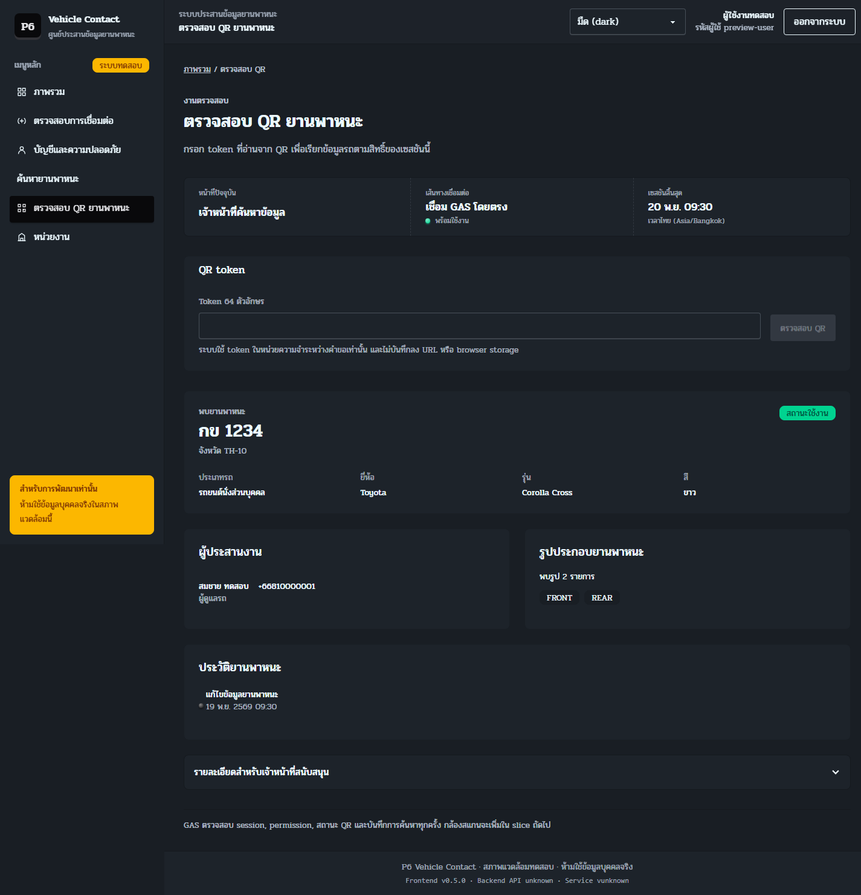
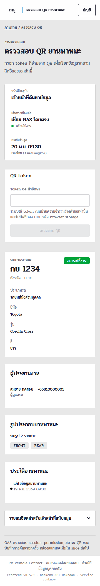

# FE-QR-RESOLVE-01 — Authenticated QR Resolve Evidence

**Review date:** 2026-11-20 (Asia/Bangkok)  
**Branch:** `codex/p6vc-e2e-primary-workflow-20261120`  
**Release candidates:** Frontend `0.5.0`; Backend API `0.4.0` (`apiVersion: v1`)

## Delivered vertical slice

```text
permission-driven menu / route
  -> QrResolvePage
  -> useQrResolve state machine
  -> qrResolveRepository port
  -> strict Cloudflare qr.resolve DTO
  -> GAS session + vehicle.lookup authorization
  -> shared authorized vehicle/contact/photo/history result
```

- route `/app/vehicles/qr` requires the GAS-returned `vehicle.lookup` permission for navigation UX
- the Worker accepts exact authenticated DTOs for `qr.resolve`, `vehicles.lookup` and `vehicles.history`; malformed or client-role-bearing requests do not reach GAS
- QR token must be 64 hexadecimal characters, is held only in memory, uses a password input and is cleared from the visible form before the request result is shown
- no QR token is stored in URL, local storage, session storage, browser evidence or logs
- the response uses the same fail-closed mapper and result component as plate lookup; contacts, photo metadata and history remain permission-gated
- states cover idle, loading, invalid, no active match, forbidden, unauthenticated, recoverable error, error and success
- camera capture is intentionally outside this slice; manual token entry is the safe fallback and contract proof for the next mobile scanner slice

## Automated evidence

| Gate | Result |
|---|---|
| Frontend unit/contract tests | PASS — 27 files, 126 tests |
| Frontend production build | PASS — Vite, 121 modules |
| Frontend dependency audit | PASS — 0 vulnerabilities |
| Cloudflare Worker tests | PASS — 27/27 |
| GAS primary lifecycle/RBAC subset | PASS — 22/22; 5 roles x 44 protected operations |
| SSOT validators | PASS — 0 errors; 50/50 API operations |
| Browser matrix | PASS — desktop dark 1440px and mobile corporate 360px |
| axe-core | PASS — 0 violations |
| Horizontal overflow | PASS — 0 cases |

Machine-readable browser results: [browser-evidence.json](evidence/fe-qr-resolve-20261120/browser-evidence.json)





## Release boundary

This evidence proves source/build/browser behavior with synthetic data. GitHub Pages and Cloudflare Worker must be deployed after merge before the route works live through the selected Worker transport. No GAS source change is required for this slice. Camera decoding, physical Android/iOS acceptance, safe registration-photo preview, approval recovery and a controlled mutating primary-journey UAT remain separate gates.

## Live deployment evidence

Verified on 2026-11-20 (Asia/Bangkok) after PR #62 merged at `c4d1ea252768987436957ba4357f8afcd63b8f64`:

- GitHub Pages workflow `44659033213` completed successfully from the merge commit
- live frontend HTML and JavaScript returned HTTP 200; the deployed bundle contains Frontend `0.5.0`, route `vehicles/qr` and menu label **ตรวจสอบ QR ยานพาหนะ**
- Cloudflare Worker version `70ddcb7c-cbb5-4502-848c-370351a9b915` is deployed with the approved frontend origin and GAS endpoint routing variables
- live `system.health` through Frontend gateway -> Worker -> GAS returned `ok: true`, API `v1`, Backend `0.4.0` and status `ready`
- a live `qr.resolve` request without a session was rejected at the Worker boundary with HTTP 403 and canonical `INVALID_SESSION_PAYLOAD`

No password, session token or raw QR token was used or recorded by the deployment probes. An authenticated QR match remains part of controlled synthetic primary-journey UAT.
