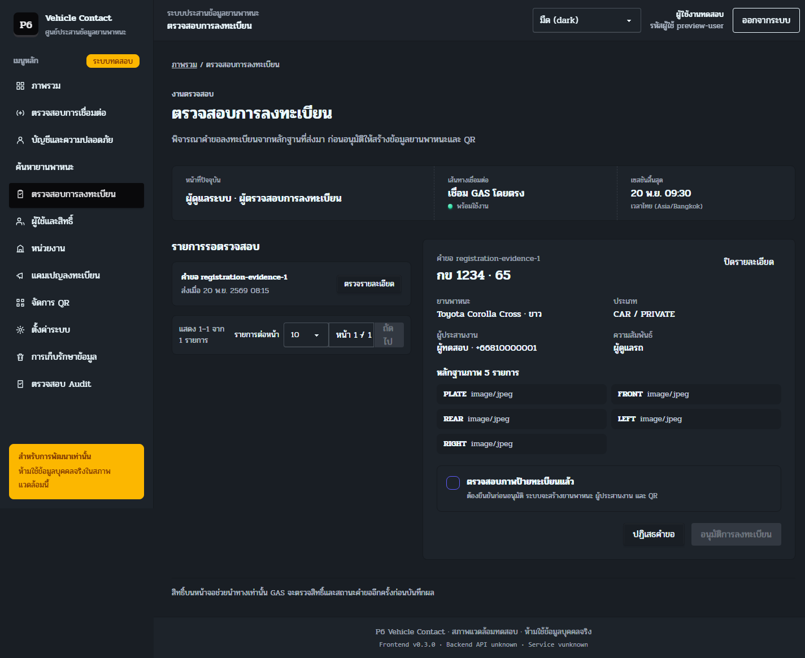
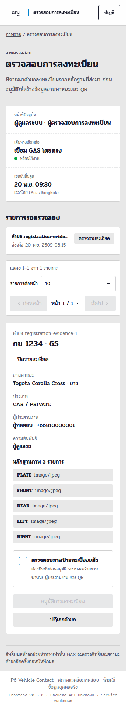

# FE-REGISTRATION-ADMIN-01 — Registration Review Evidence

**Review date:** 2026-11-20 (Asia/Bangkok)

**Branch:** `codex/p6vc-registration-review-20261120`

**Release candidates:** Frontend `0.3.1`; Backend API `0.4.0` (`apiVersion: v1`)

## Root cause corrected

The authenticated `admin` account had the exact server roles `SYSTEM_ADMIN` + `REGISTRATION_ADMIN`, but the permission-matched `registration-review` catalog entry had no route. The sidebar therefore hid it and the dashboard classified it as planned work. In addition, the Cloudflare frontend allowlist omitted `registrations.detail` and `registrations.review`.

## Delivered vertical slice

```text
registration-review route
  -> RegistrationReviewPage
  -> useRegistrationReview state machine
  -> registrationReviewRepository port
  -> GAS registration review adapter
  -> Cloudflare strict operation/DTO allowlist
  -> GAS authorization and business rules
```

- permission-driven menu and protected route use `vehicle.registration.approve`
- pending queue uses server pagination with page sizes `1, 5, 10, 15, 25, 50, 100`
- detail mapping allowlists vehicle/contact/photo metadata and drops Drive `storageRef`
- approval requires an explicit plate-photo verification acknowledgement and confirmation dialog
- rejection uses a separate explicit confirmation
- timeout/network uncertainty never retries a write automatically
- an approval QR token is kept in memory and shown once; it is not stored in browser storage
- Cloudflare allows only the exact `registrations.listPending`, `registrations.detail` and `registrations.review` DTO fields

## Automated evidence

| Gate | Result |
|---|---|
| Frontend unit/contract tests | PASS — 25 files, 117 tests |
| Frontend production build | PASS — Vite, 113 modules |
| Frontend dependency audit | PASS — 0 vulnerabilities |
| GAS full regression | PASS — actor registration approval/change workflows, 5 roles × 44 protected operations, compiled GAS VM authentication 19/19 and lifecycle 21/21 |
| Cloudflare Worker tests | PASS — 25/25 including registration DTO allowlist |
| Repository SSOT | PASS — 0 errors, 0 link warnings |
| Use-case SSOT | PASS — 20 diagrams, 50/50 operations |

## Browser evidence

Machine-readable results: [browser-evidence.json](evidence/fe-registration-review-20261120/browser-evidence.json)

- desktop dark: `1440x900`, zero axe violations, zero horizontal overflow
- mobile corporate: `360x800`, zero axe violations, zero horizontal overflow
- the first mobile capture found insufficient contrast on photo MIME metadata; `text-base-content/60` was narrowed to `text-base-content/75` and the matrix was recaptured successfully





## Release boundary

No GAS source change is required for this slice; Backend API `0.4.0` already implements and authorizes all three operations. GitHub Pages and the Cloudflare Worker must be deployed from the merged source before the live menu and Worker-mediated review flow can be accepted. Production security, privacy and real-person data approval remain separate gates.

