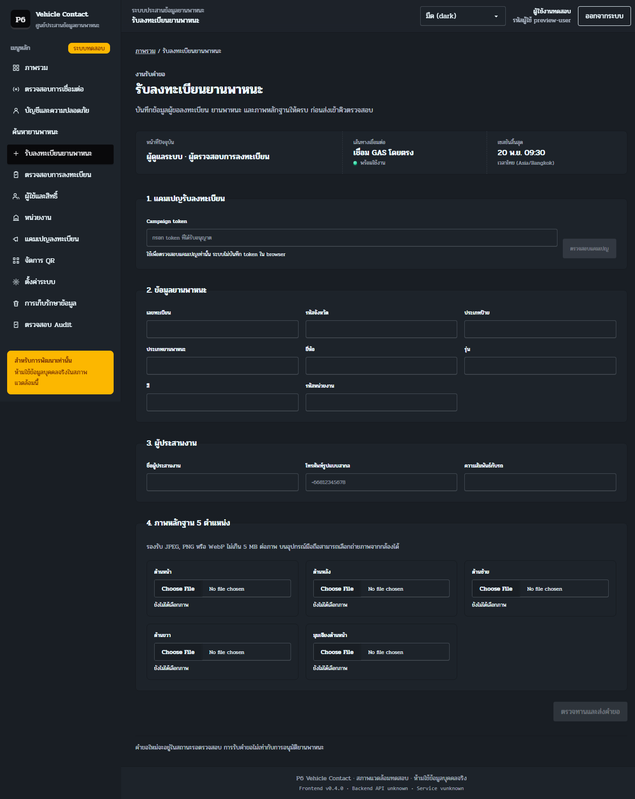
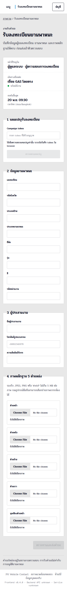

# FE-REGISTRATION-INTAKE-01 — Assisted Vehicle Registration Evidence

**Review date:** 2026-11-20 (Asia/Bangkok)

**Branch:** `codex/p6vc-registration-intake-20261120`

**Release candidates:** Frontend `0.4.0`; Backend API `0.4.0` (`apiVersion: v1`)

## User-visible correction

The combined `SYSTEM_ADMIN` + `REGISTRATION_ADMIN` account previously had vehicle lookup and registration review, but no route for receiving a new registration. This slice adds a separate Thai-first menu and page named **รับลงทะเบียนยานพาหนะ**. Receiving a request remains distinct from approving it.

## Delivered vertical slice

```text
registration-intake route
  -> RegistrationIntakePage
  -> useRegistrationIntake state machine
  -> registrationIntakeRepository port
  -> campaign validation + five bounded photo uploads
  -> registrations.submit with one in-memory idempotency key
  -> pending review queue
```

- route/menu requires the server-returned `vehicle.registration.approve` permission for navigation UX
- campaign token is entered as a password field, used only in memory and never persisted
- fields cover plate/province, vehicle, organization and contact details required by Backend API `0.4.0`
- exactly five responsive native file inputs use the canonical `FRONT`, `REAR`, `LEFT`, `RIGHT`, `FRONT_ANGLE` slots
- client accepts JPEG/PNG/WebP up to 5 MB each; GAS remains the signature/MIME/size authority
- successful staged photo IDs are retained only in composable memory so a recoverable retry does not re-upload completed slots
- one idempotency key is retained in memory across an uncertain submit and cleared only after success/reset
- write timeout/network uncertainty is never retried automatically
- Cloudflare validates exact public campaign operation DTOs, permits at most 7,000,000 base64 characters for one photo, and retains the 8 MiB overall request ceiling used by GAS

## Automated evidence

| Gate | Result |
|---|---|
| Frontend unit/contract tests | PASS — 26 files, 122 tests |
| Frontend production build | PASS — Vite, 117 modules |
| Frontend dependency audit | PASS — 0 vulnerabilities |
| Cloudflare Worker tests | PASS — 26/26 including bounded public campaign intake |
| GAS regression | PASS — unchanged Backend API `0.4.0`; current full suite covers five-photo staging, idempotent registration submit, compensation and approval lifecycle |
| Browser matrix | PASS — desktop dark 1440px and mobile corporate 360px |
| axe-core | PASS — 0 violations |
| Horizontal overflow | PASS — 0 cases |

Machine-readable browser results: [browser-evidence.json](evidence/fe-registration-intake-20261120/browser-evidence.json)





## Release boundary

No GAS source change is required. GitHub Pages and Cloudflare Worker must be deployed after merge before this menu works live through the selected Worker transport. Development deployment is not production approval; real-person data, campaign issuance, media access policy, privacy and operational UAT remain separate gates.

## Live deployment evidence

Verified on 2026-11-20 (Asia/Bangkok) after PR #59 merged at `a773ce539724f9d8cb93d8c5e2c27f9cb97269d8`:

- GitHub Pages workflow `44656520542` completed successfully from the merge commit
- live frontend HTML and JavaScript returned HTTP 200
- the deployed JavaScript contains Frontend `0.4.0`, route `registrations/new` and menu label **รับลงทะเบียนยานพาหนะ**
- Cloudflare Worker version `c9f82155-da58-4350-bbc7-6ba94d5181a6` is deployed with the frontend origin and GAS endpoint routing variables
- live `system.health` through Frontend gateway -> Worker -> GAS returned `ok: true`, `apiVersion: v1`, Backend `0.4.0` and status `ready`
- live `campaigns.validate` with a deliberately invalid synthetic token reached GAS and returned canonical `CAMPAIGN_INVALID`; this proves the deployed public-operation allowlist without creating or changing records

The five-photo upload and registration write remain pending controlled operational UAT with a valid development campaign token. They were not invoked by the deployment probe because those operations mutate data.

