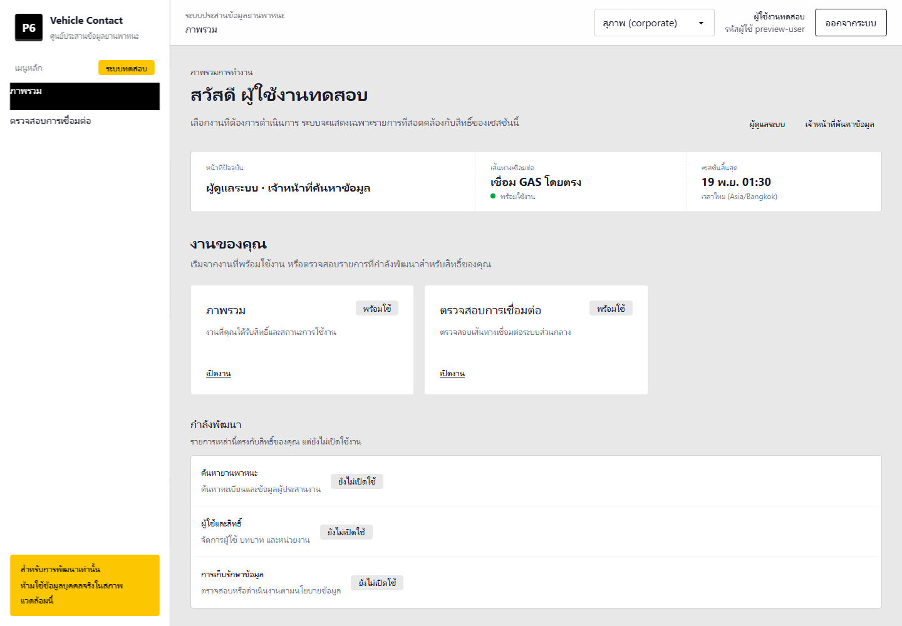
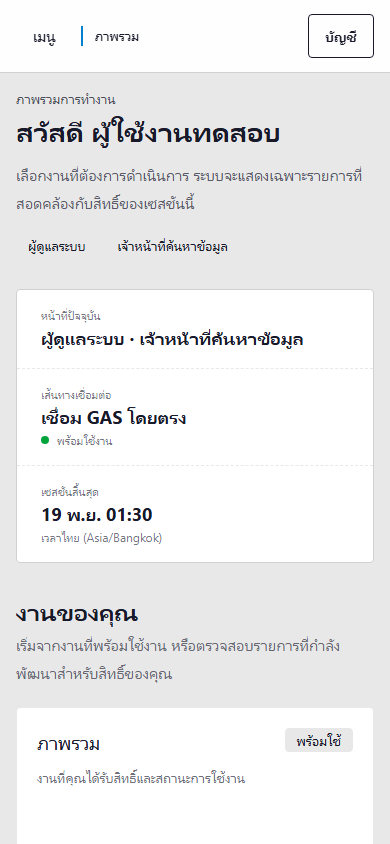
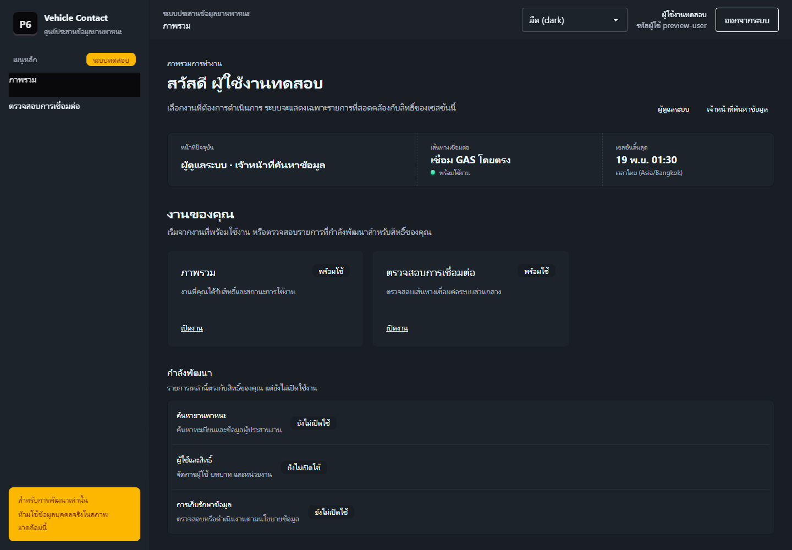

# FE-SHARED-01 — Shared Shell Compliance Evidence

**Review date:** 2026-11-19 (Asia/Bangkok)

**Implementation commit:** `0623252`

**Branch:** `codex/p6vc-fe-shared-shell-20261118`

**Environment:** Local Vite development server with `VITE_UI_PREVIEW=true`; synthetic identity and permissions only

**Browser:** Microsoft Edge 157.0.4341.60, headless Chromium DevTools Protocol

**Role and permission fixture:** synthetic multi-role `SYSTEM_ADMIN` + `STAFF`; permission union supplied directly by the development-only fixture

## 1. Observed facts

- shared shell, dashboard, connection-support page and sign-out dialog were rendered from commit `0623252`
- desktop corporate viewport `1440×1000` had `scrollWidth = clientWidth = 1440`
- mobile corporate viewport `390×844` had `scrollWidth = clientWidth = 390`
- dark desktop viewport `1440×1000` had `scrollWidth = clientWidth = 1440`
- axe-core 4.14.1 reported zero violations in corporate and dark themes; five contrast checks per theme remained `incomplete` because DaisyUI components use background images and were inspected visually
- sign-out dialog moved focus to “ยกเลิก” when opened and returned focus to “ออกจากระบบ” after cancellation
- frontend unit tests passed `16/16`; Vite production build passed
- complete GAS backend regression passed, including 5 roles × 44 protected-operation RBAC checks and compiled GAS VM acceptance
- repository SSOT validation passed with 0 errors and 0 link warnings
- full `npm audit` and production-only audit reported 0 vulnerabilities at the time recorded
- Windows Computer Use could not initialize its kernel; visual review used local headless Edge instead and does not claim Computer Use evidence

## 2. Visual evidence

### Desktop — corporate

### Mobile — corporate

### Desktop — dark

Machine-readable layout, accessibility and focus evidence: [browser-evidence.json](evidence/fe-shared-01-20261119/browser-evidence.json)

## 3. Compliance result

| Gate | Result | Evidence | Follow-up |
|---|---|---|---|
| G1 User task/content | PASS | Removed developer-facing component/transport explanations from dashboard and support page; Thai task language used | Recheck each role page |
| G2 Authority/privacy | PASS | Navigation now consumes GAS-derived permissions; `auth.session` returns authoritative permission union; synthetic preview only | Deploy the updated GAS contract before production frontend release |
| G3 DaisyUI/theme | PASS | Native drawer/navbar/menu/stats/card/list/modal patterns; 35-theme registry test; corporate and dark visual evidence | Expand representative visual set when Project Owner selects production default theme |
| G4 Responsive | PASS | 390px and 1440px show no horizontal page overflow; mobile drawer shell retained | Add tablet evidence with first role page |
| G5 Typography/hierarchy | PASS | Pridi token weights, task-first hierarchy and operational context strip visually reviewed | Independent design review remains recommended |
| G6 Accessibility | PASS | axe-core: 0 violations in corporate/dark; visible focus CSS; native dialog; focus-return evidence | Five automated contrast checks per theme required manual review because of DaisyUI background images |
| G7 Interaction/state | PASS | sign-out confirmation focus contract passed; actions remain disabled while busy | Add session-expiry browser acceptance after GAS deployment |
| G8 Engineering | PASS | frontend 16 tests, production build, backend regression, SSOT/link validation, diff check and dependency audit passed | CI must reproduce repository tests on PR head |
| G9 Visual review | PASS | screenshots above; mobile header defect and DaisyUI `.form-control` namespace collision were found and corrected during review | Independent human reviewer not yet recorded |
| G10 Release | BLOCKED | Frontend Pages, assets and Worker CORS/health passed; authenticated browser acceptance against the updated GAS contract is not available | Push/version/publish the approved GAS source, then run authenticated acceptance and rollback verification |

## 4. Deployment evidence after merge

- PR [#45](https://github.com/idev006/MT-Agency-Super-App-Framework/pull/45) merged as `1af91ccf1bed053938d0d4a96378a4201da28e45`
- main-branch backend validation [run 44369818511](https://github.com/idev006/MT-Agency-Super-App-Framework/actions/runs/44369818511) passed
- Pages SSOT build/deploy [run 44369818576](https://github.com/idev006/MT-Agency-Super-App-Framework/actions/runs/44369818576) passed
- repository Pages setting was still `build_type: legacy` with `/docs` as source, so GitHub launched a second automatic Jekyll deployment that overwrote the custom artifact and caused a 404
- Pages setting was changed to `build_type: workflow`, as defined by the [official GitHub Pages REST API](https://docs.github.com/en/rest/pages/pages); this leaves the SSOT workflow as the sole deployer
- recovery deployment [run 44370178332](https://github.com/idev006/MT-Agency-Super-App-Framework/actions/runs/44370178332) passed
- [live frontend](https://idev006.github.io/MT-Agency-Super-App-Framework/apps/vehicle-contact/frontend/) returned HTTP 200; its JavaScript and CSS assets both returned HTTP 200
- Worker health from the GitHub Pages origin returned HTTP 200 with the matching `Access-Control-Allow-Origin`
- health data reported `bootstrap`, proving the public GAS `/exec` still targets an older deployment; this is not evidence for the new `auth.session.permissions` contract

## 5. Known release dependency

The deployed GAS version must include the updated `auth.session` response with `permissions`, `displayName` and `organizationId`. Until then the frontend fails closed: shared routes remain visible, while permission-specific navigation is withheld rather than inferred from role names.

The GAS workflow performs `clasp push --force` and version creation only after the exact manual confirmation `PUSH_VEHICLE_GAS`. It overwrites the target Apps Script source and does not publish a Web App deployment automatically. No GAS push or Web App publication was performed as part of FE-SHARED-01.

## 6. Reviewer separation

This is implementation self-review evidence, not an independent organizational accessibility, security, privacy or UX approval. Project Owner and designated human reviewers retain release authority.
