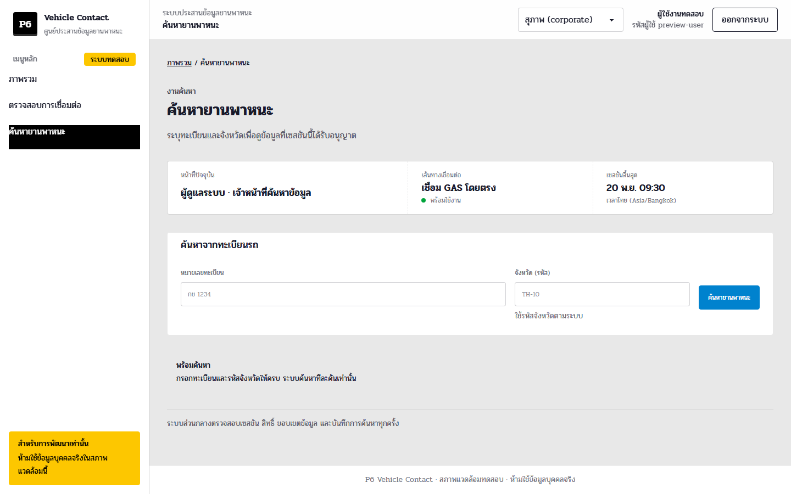
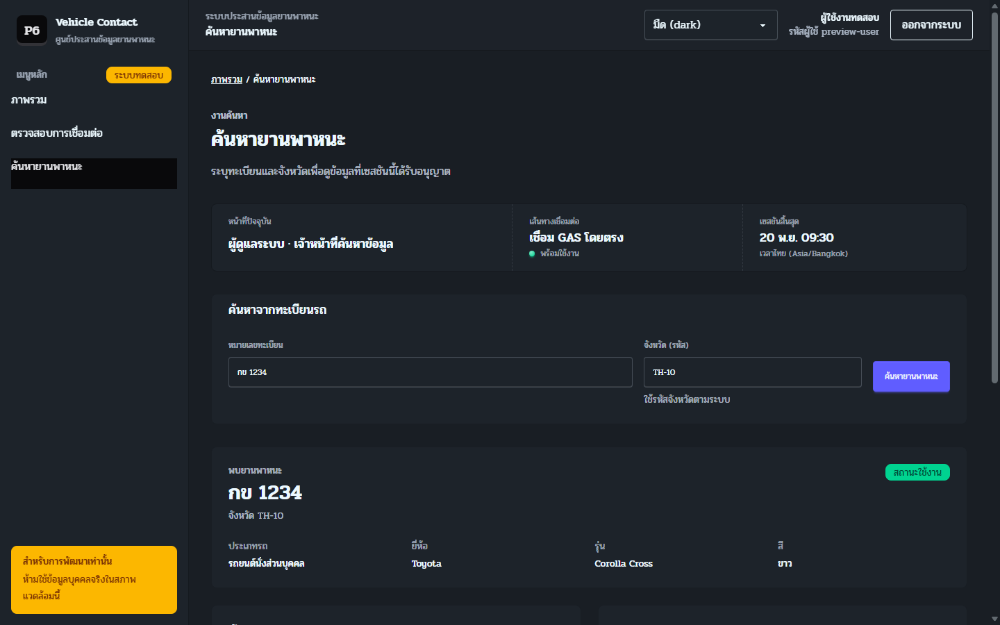
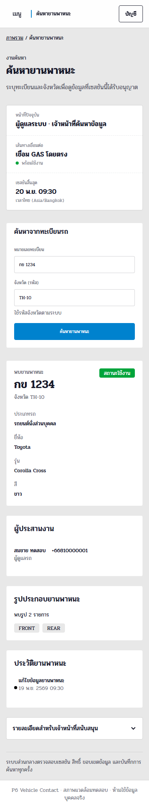

# FE-STAFF-01 — Vehicle Search Compliance Evidence

**Review date:** 2026-11-19 (Asia/Bangkok)

**Implementation commit:** `48bea05dfa5bc92d516b47d0682a8534e282a5ee`

**Branch:** `codex/p6vc-staff-vehicle-search-20261119`

**Environment:** Local Vite development server with `VITE_UI_PREVIEW=true`; synthetic identity, vehicle, contact, photo metadata and history only

**Browser:** Microsoft Edge headless via Chrome DevTools Protocol

**Role and permission fixture:** synthetic multi-role `SYSTEM_ADMIN` + `STAFF`; permissions include `vehicle.lookup`, `vehicle.contact.read`, `vehicle.photos.read` and `vehicle.history.read`

## 1. Delivered vertical slice

```text
vehicle-search route
  -> VehicleSearchPage
  -> useVehicleSearch explicit state machine
  -> vehicleSearchRepository application port
  -> GAS vehicle search repository adapter
  -> protected session facade
  -> Cloudflare Worker or GAS transport
```

- route and menu require the `vehicle.lookup` permission returned by `auth.session`
- router permission checks improve navigation UX only; GAS remains the authorization authority
- the adapter calls `vehicles.lookup` and calls `vehicles.history` only when the session permission union includes `vehicle.history.read`
- contact and photo metadata from `vehicles.lookup` are discarded client-side unless the corresponding session permissions exist
- photo `storageRef`, raw audit actor data and raw backend errors are not exposed to the page
- the page implements idle, loading, empty, forbidden, unauthenticated, recoverable error, fatal error and success states
- search is single-record plate/province lookup; the UI provides no mass-enumeration control

## 2. Confirmed backend contract

| Operation | Required permission | Request | Frontend use |
|---|---|---|---|
| `vehicles.lookup` | `vehicle.lookup` | `{ plate, province }` | primary lookup; `null` means no active match |
| `contacts.read` | `vehicle.contact.read` | `{ vehicleId }` | contract verified; no redundant call because lookup already returns permitted contacts |
| `photos.list` | `vehicle.photos.read` | `{ vehicleId }` | contract verified; no redundant call because lookup already returns permitted photo metadata |
| `vehicles.history` | `vehicle.history.read` | `{ vehicleId }` | optional follow-up after a successful lookup |

Backend regression confirms session authorization, duplicate-active-vehicle denial, lookup audit, conditional contact/photo disclosure and role-permission boundaries. The frontend does not infer these permissions from a role name.

## 3. Automated evidence

- frontend Vitest: `9` files, `30/30` tests passed
- Vite production build passed with the GitHub Pages base path
- frontend full and production-only `npm audit`: `0` vulnerabilities
- Cloudflare Worker contract tests: `23/23` passed
- GAS `npm test`: exit code `0`, including actor acceptance, 5 roles x 44 protected-operation RBAC checks, staging fixture validation and compiled GAS VM acceptance
- repository SSOT validation: `0` errors and `0` link warnings
- use-case SSOT validation: `20` diagrams and `50/50` unique v1 operations passed
- staged diff secret-pattern scan passed; no password, session token, bridge key or private key was added

## 4. Browser evidence

### Desktop — corporate — idle



### Desktop — dark — success



### Mobile — corporate — success



Machine-readable layout, accessibility and keyboard-order evidence: [browser-evidence.json](evidence/fe-staff-vehicle-search-20261119/browser-evidence.json)

Observed browser results:

- desktop corporate `1440x900`: `scrollWidth = clientWidth = 1440`
- desktop dark `1440x900`: `scrollWidth = clientWidth = 1425` after the vertical scrollbar was present
- mobile corporate `390x844`: `scrollWidth = clientWidth = 390`
- axe-core reported zero violations in all three cases
- color-contrast checks left one incomplete rule per case because DaisyUI uses generated backgrounds; screenshots were visually inspected
- keyboard order was plate input -> province input -> submit button
- the first visual run found insufficient corporate-theme contrast in the breadcrumb and success badge; both defects were corrected with semantic DaisyUI/Tailwind classes before the passing run

## 5. Compliance result

| Gate | Result | Evidence | Follow-up |
|---|---|---|---|
| G1 User task/content | PASS | Thai-first single-record search, directional empty/error copy and one primary action | Recheck terminology with operational STAFF reviewer |
| G2 Authority/privacy | PASS | Permission metadata, protected session facade, backend regression and fail-closed adapter mapping | Live GAS deployment remains required |
| G3 DaisyUI/theme | PASS | Native fieldset/input/button/card/alert/skeleton/list/timeline/collapse; no new custom CSS; corporate/dark evidence | Representative saturated/muted themes remain covered structurally by the existing 35-theme test |
| G4 Responsive | PASS | 390px and 1440px evidence shows no horizontal overflow; mobile result uses a single-column flow | Add 360px physical-device review during environment acceptance |
| G5 Typography/hierarchy | PASS | Existing Pridi tokens, task-first hierarchy and shared operational context strip | Independent design review remains recommended |
| G6 Accessibility | PASS | axe zero violations; persistent labels; keyboard focus order recorded; semantic form and live status region | Independent assistive-technology review remains recommended |
| G7 Interaction/state | PASS | Explicit state machine, retry only for read failures, no double submit while loading, request ID in support details | Verify session-expiry redirect against the published GAS contract |
| G8 Engineering | PASS | PageTemplate, application port, adapter, composable tests, production build, audits, backend/Worker regression and SSOT validation passed | CI must reproduce checks on PR head |
| G9 Visual review | PASS | Three screenshots; contrast defects were found, corrected and retested | Independent human reviewer not yet recorded |
| G10 Release | BLOCKED | Local synthetic acceptance only; public GAS still reports `bootstrap` and lacks the published `auth.session.permissions` contract | Project Owner must authorize GAS push with `PUSH_VEHICLE_GAS`, then publish a Web App deployment and run authenticated acceptance |

## 6. Release boundary

No GAS push, Apps Script version creation, Web App publication or credential-bearing live test was performed. The frontend is source-review complete and fails closed when the deployed session contract does not provide permissions. It is not approved for real personal data until the separate environment, security, privacy and operational approvals are complete.

## 7. Reviewer separation

This document records implementation self-review. It is not independent organizational accessibility, security, privacy or UX approval. Project Owner and designated human reviewers retain merge and release authority.
