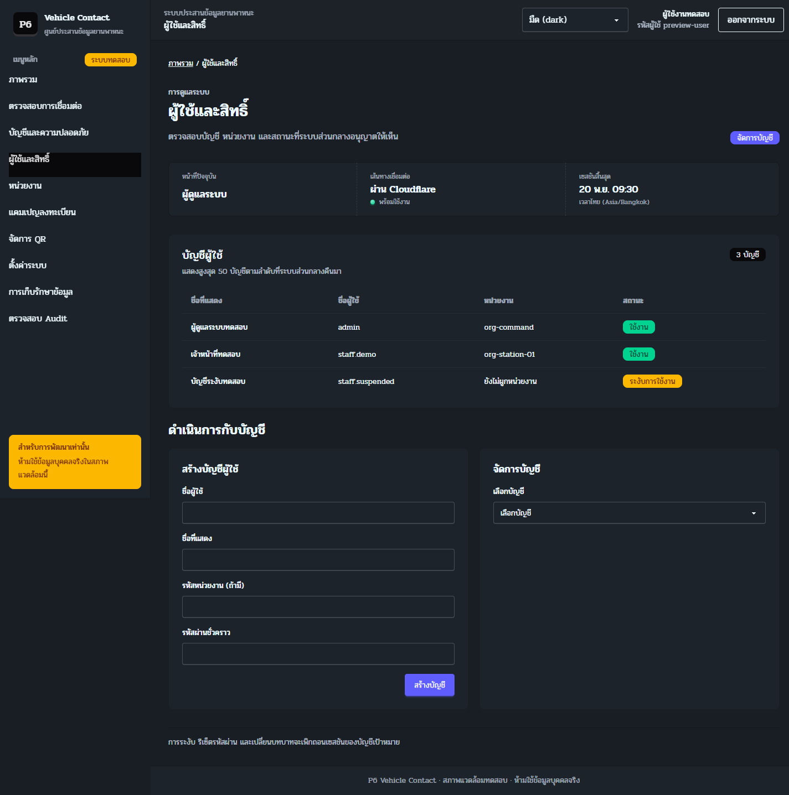
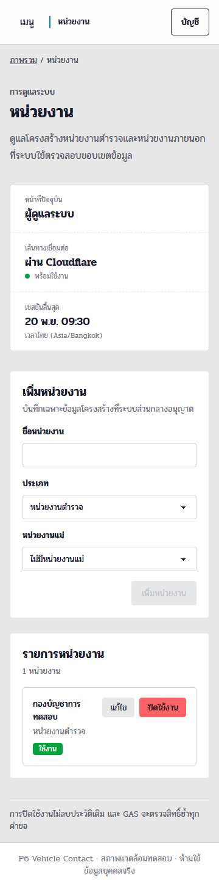
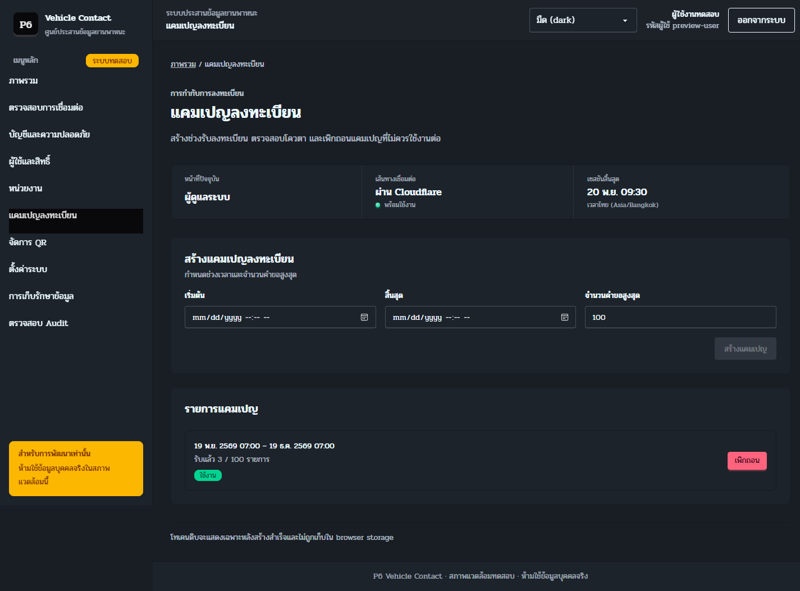
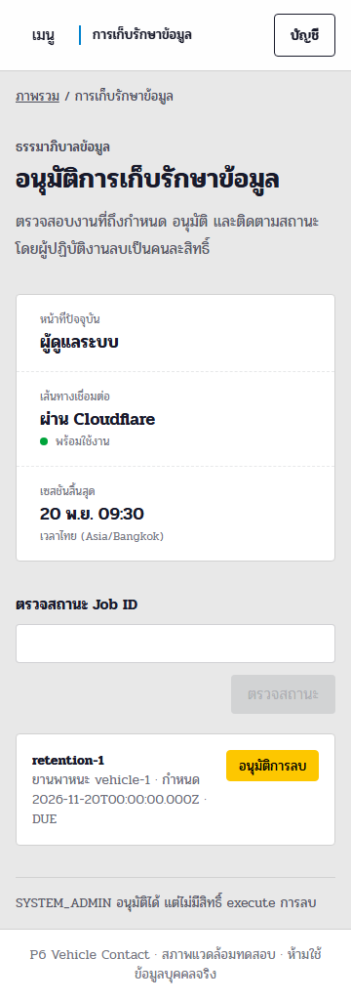

# FE-SYSTEM-ADMIN-COMPLETE — Contract-First Delivery Evidence

**Review date:** 2026-11-19 (Asia/Bangkok)

**Implementation commit:** `4872d25`

**Workflow consolidation commit:** `36cdbf5`
**Branch:** `codex/p6vc-system-admin-complete-20261119`

## Delivered use cases

The SYSTEM_ADMIN capability catalog now contains real routes rather than planned placeholders:

| Page | Operations wired through the shared GAS contract |
|---|---|
| บัญชีและความปลอดภัย | `auth.changePassword`, `auth.linkGoogle` |
| ผู้ใช้และสิทธิ์ | `users.create/list/update/suspend/resetPassword/assignRoles` |
| หน่วยงาน | `organizations.list/create/update/disable` |
| แคมเปญลงทะเบียน | `campaigns.create/list/revoke` |
| จัดการ QR | `qr.issue/revoke/replace` |
| ตั้งค่าระบบ | `system.config.get/update` |
| การเก็บรักษาข้อมูล | `retention.listDue/approve/jobStatus` |
| ตรวจสอบ Audit | `audit.query/export` |

Each page follows `route → page → composable → application port → GAS adapter → session.callProtected`. GAS remains authoritative for permissions, resource state and business rules.

## Backend and transport alignment

- `users.list` now returns the active role list required to safely prefill role replacement
- permission SSOT for `retention.listDue` now matches runtime `retention.read`
- Cloudflare `/api/frontend` has an explicit operation and DTO-field allowlist for every delivered operation
- protected operations require a valid server session token; arbitrary operations and fields remain denied
- campaign and QR raw tokens exist in memory only and are shown once
- SYSTEM_ADMIN can approve retention but cannot execute deletion

## Workflow cleanup

Repository workflow definitions were reduced from nine to four:

1. `Validate P6 Vehicle Contact`
2. `Build and deploy Pages from SSOT`
3. `Deploy P6 Vehicle Contact GAS (manual only)`
4. `P6VC Live Acceptance (manual only)`

Historical GitHub workflow records remain visible until disabled after merge; run history is retained for audit.

## Automated evidence

- frontend: `21` files, `88/88` tests passed
- Cloudflare Worker: `24/24` tests passed
- GAS full build and test chain: passed, including compiled GAS VM Editor authentication `19/19` and lifecycle `21/21`
- GitHub Pages-base Vite build: passed
- dependency audit: `0` vulnerabilities
- repository SSOT: `0` errors, `0` link warnings
- use-case SSOT: `20` diagrams, `50/50` API operations
- non-test diff credential-assignment scan: passed

## Browser evidence

Machine-readable evidence: [browser-evidence.json](evidence/fe-system-admin-complete-20261119/browser-evidence.json)

- 8 routes × desktop dark + mobile corporate = `16` cases
- mobile viewport: `360x800`
- axe-core: `0` violations after contrast remediation
- horizontal overflow: `0`
- visual review corrected shared breadcrumb contrast and destructive-button contrast

Representative evidence:

## Compliance gates

| Gate | Result | Evidence / boundary |
|---|---|---|
| G1–G3 task, authority, DaisyUI | PASS | Thai-first pages, permission routes, native components |
| G4 responsive | PASS | 16 cases, 360px minimum, zero overflow |
| G5–G6 hierarchy/accessibility | PASS | visual review and axe zero violations |
| G7 interaction integrity | PASS | destructive confirmation, uncertain write state, no automatic write retry |
| G8 engineering | PASS | ports/adapters/composables, 88 frontend tests, full GAS/Worker tests |
| G9 visual review | PASS | dark/corporate route matrix inspected |
| G10 live release | BLOCKED | source must merge, then GAS and Cloudflare Worker must be deployed before authenticated live acceptance |

## Remaining environment dependency

Google linking is wired to the reviewed `auth.linkGoogle` contract, but the current development UI accepts a one-time Google ID token. Production-quality Google Identity Services acquisition and an approved client ID remain a release dependency; the page labels this boundary and does not persist the token.

No GAS push, GAS Web App publication, Cloudflare Worker deployment or real-data mutation was performed by this branch.
