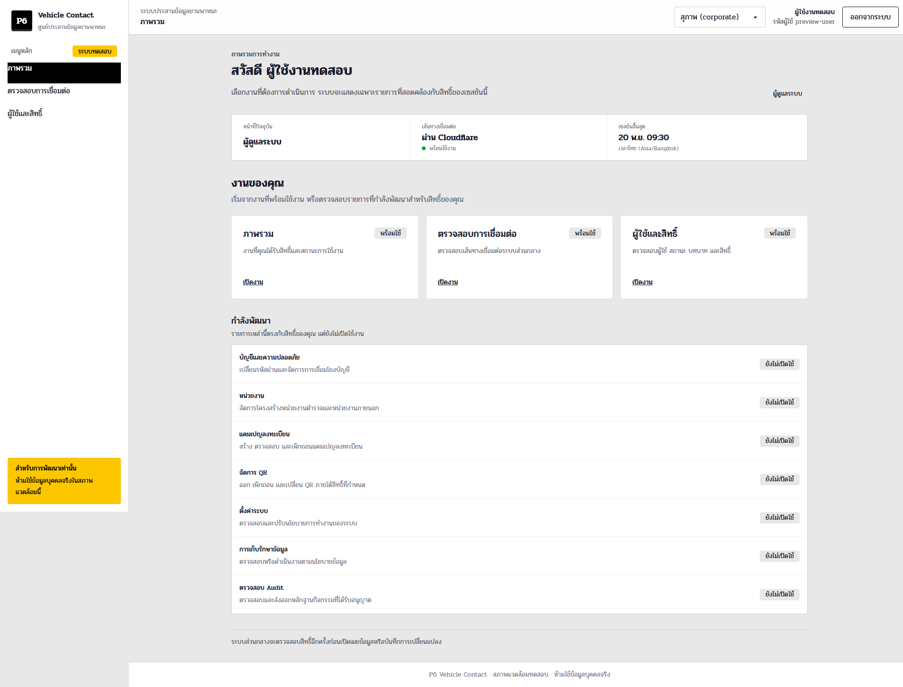
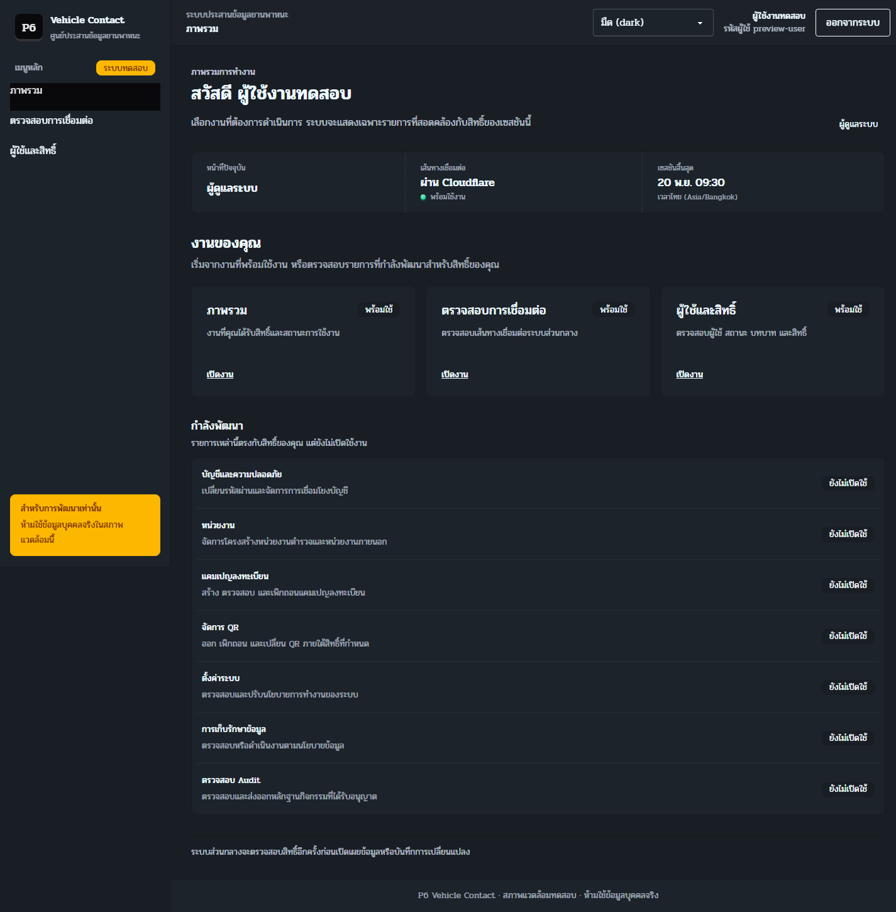
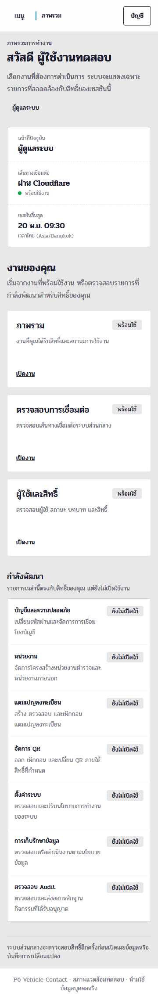

# FE-SYSTEM-ADMIN-NAVIGATION-01 — Permission Coverage Evidence

**Review date:** 2026-11-19 (Asia/Bangkok)

**Implementation commit:** `3549dea`

**Branch:** `codex/p6vc-system-admin-navigation-20261119`

**Environment:** Local Vite preview with a synthetic `SYSTEM_ADMIN` session injected before application bootstrap

**Browser:** Microsoft Edge headless via Chrome DevTools Protocol

## 1. Delivered scope

- the capability registry now covers account security, users, organizations, campaigns, QR governance, system settings, retention and audit
- every entry is selected from session `permissions`; no role name grants navigation
- only implemented routes are clickable: overview, connection check and the read-only user directory
- planned capabilities are presented as `ยังไม่เปิดใช้` without routes or dead links
- `SYSTEM_ADMIN` does not receive vehicle search, registration review or owner work unless GAS returns the separate permissions
- the user-directory description no longer conflates user management with organization administration
- the planned-work list adapts at 360px without compressing its status badge into vertical text

## 2. Permission-to-navigation coverage

| Navigation group | Permission source | Current UI state |
|---|---|---|
| บัญชีและความปลอดภัย | `session.authenticated` | Planned |
| ผู้ใช้และสิทธิ์ | `users.manage` | Read-only route available |
| หน่วยงาน | `organizations.read`, `organizations.manage` | Planned |
| แคมเปญลงทะเบียน | `campaigns.manage` | Planned |
| จัดการ QR | `qr.manage` | Planned |
| ตั้งค่าระบบ | `system.settings.read`, `system.settings.manage` | Planned |
| การเก็บรักษาข้อมูล | `retention.read`, `retention.delete.approve`, `retention.worker` | Planned; execution remains worker-only |
| ตรวจสอบ Audit | `audit.read` | Planned |

The cross-contract unit test imports the GAS `ROLE_PERMISSIONS.SYSTEM_ADMIN` baseline and passes it to the frontend registry. This is test-time drift detection only; runtime authorization remains with GAS.

## 3. Automated evidence

- frontend Vitest: `13` files, `54/54` tests passed
- Vite production build passed
- frontend dependency audit reported `0` vulnerabilities
- targeted GAS actor/RBAC regression: `12/12` tests passed, including 5 roles x 44 protected operations
- repository SSOT validation: `0` errors and `0` link warnings
- use-case SSOT validation: `20` diagrams and `50/50` unique v1 operations passed
- diff credential-assignment pattern scan passed

## 4. Browser evidence

### Desktop wide — corporate

### Desktop — dark

### Mobile — corporate

Machine-readable evidence: [browser-evidence.json](evidence/fe-system-admin-navigation-20261119/browser-evidence.json)

- corporate desktop `1920x1080`: `scrollWidth = clientWidth = 1905` (vertical scrollbar occupies the remaining viewport width)
- dark desktop `1440x900`: `scrollWidth = clientWidth = 1425`
- corporate mobile `360x800`: `scrollWidth = clientWidth = 360`
- axe-core reported zero violations in all three cases
- planned navigation count is seven and `plannedLinkCount = 0`
- the first mobile review exposed a compressed status badge; the responsive grid was corrected and the evidence rerun

## 5. Compliance result

| Gate | Result | Evidence | Follow-up |
|---|---|---|---|
| G1 User task/content | PASS | Thai-first capability labels and explicit planned-state copy | Deliver each planned item as a separate vertical slice |
| G2 Authority/privacy | PASS | Session permission registry; role string alone yields no admin menu | GAS remains authoritative for all operations |
| G3 DaisyUI/theme | PASS | Native card, list and badge patterns in corporate and dark themes | Retain theme matrix for new pages |
| G4 Responsive | PASS | 360, 1440 and 1920 evidence has no horizontal overflow | Continue 360px minimum for each slice |
| G5 Typography/hierarchy | PASS | Existing Pridi hierarchy and shared dashboard structure reused | None for this scope |
| G6 Accessibility | PASS | Axe zero violations; planned items are non-interactive content | Add keyboard evidence when planned items become actions |
| G7 Interaction/state | PASS | No unfinished capability is exposed as a clickable route | Mutations require explicit state machines and confirmation |
| G8 Engineering | PASS | Cross-contract tests, build, audit, RBAC and SSOT validations passed | CI must reproduce on PR head |
| G9 Visual review | PASS | Corporate/dark/mobile screenshots inspected after responsive remediation | Independent human review remains recommended |
| G10 Release | BLOCKED | Branch is not yet merged or deployed to GitHub Pages | Merge only after CI, then verify live assets and authenticated dashboard |

## 6. Release boundary

This change improves honest use-case visibility; it does not implement the planned operations. No backend permission, GAS source, GAS version or Web App deployment is changed. High-impact user, campaign, QR, retention and audit operations remain unavailable until their own tested vertical slices are delivered.

## 7. Reviewer separation

Three delegated reviews independently checked SSOT coverage, navigation behavior and evidence requirements. This remains engineering self-review and does not replace Project Owner, security, privacy or organizational UX approval.
