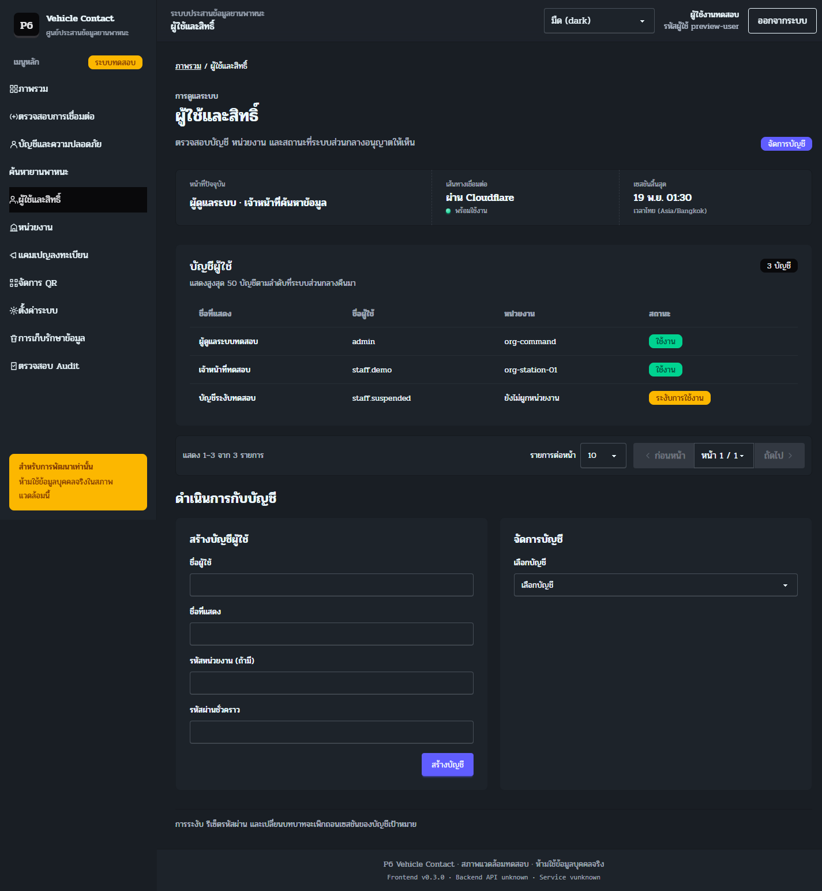
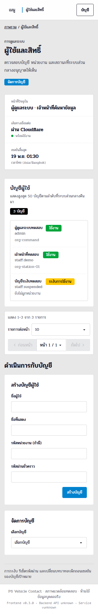
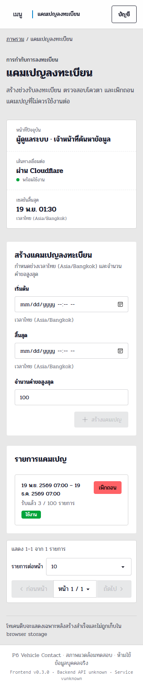

# SYSTEM_ADMIN pagination and responsive input evidence

**Review date:** 2026-11-19 (Asia/Bangkok)

**Branch:** `codex/p6vc-pagination-controls-20261119`

**Release candidates:** Frontend `0.3.0`; Backend API `0.4.0` (`apiVersion: v1`)

**Environment:** local production build with synthetic SYSTEM_ADMIN identity and non-personal fixtures

## Scope and contract

- server pagination contract covers `users.list`, `organizations.list`, `campaigns.list`, `registrations.listPending`, `changes.listPending`, `retention.listDue` and `audit.query`
- the only accepted page sizes are `1, 5, 10, 15, 25, 50, 100`; unsupported sizes fail closed with `INVALID_PAGINATION`
- response metadata is `{ items, total, page, pageSize, totalPages }`
- SYSTEM_ADMIN pages for users, organizations, campaigns, retention and audit provide direct page and page-size controls
- the frontend first requests the new server contract; during deployment ordering only, it retries the bounded legacy `limit: 100` read contract when an older gateway or GAS deployment rejects the new fields
- authorization and network failures never activate the compatibility fallback
- campaign start/end inputs use native `datetime-local`, responsive DaisyUI/Tailwind layout and explicit Asia/Bangkok conversion
- audit and retention timestamps render in Asia/Bangkok; audit export states its 100-record bound in the UI
- navigation uses dependency-free inline SVG icons with accessible text labels

## Automated evidence

| Gate | Result |
|---|---|
| Frontend unit/contract tests | PASS — 24 files, 109 tests |
| Frontend production build | PASS — Vite, 109 modules |
| GAS build and regression | PASS — pagination contract, actor acceptance, RBAC 5 roles × 44 operations, compiled GAS VM auth 19/19 and lifecycle 21/21 |
| Cloudflare Worker tests | PASS — 24/24; `page` and `pageSize` forwarded by the allowlist |
| Browser matrix | PASS — 8 SYSTEM_ADMIN pages × desktop dark/mobile corporate = 16 cases |
| axe-core | PASS — 0 violations; duplicate dialog title IDs corrected and recaptured |
| Horizontal overflow | PASS — 0 cases at 360px and 1440px |
| Refresh/navigation | PASS — no refresh or navigation failure |
| Diff whitespace | PASS — `git diff --check` |

Machine-readable browser results: [browser-evidence.json](evidence/fe-system-admin-pagination-20261119/browser-evidence.json)

## Representative visual evidence

### Users — desktop dark

### Users — mobile corporate

### Campaign datetime — mobile corporate

## Release boundary

This evidence validates source and local integration; it does not claim that Backend API `0.4.0` is live. The checked-in GAS source still requires the exact owner confirmation `PUSH_VEHICLE_GAS`, a successful manual GAS workflow, and publication of the created Apps Script version to the Web App deployment. The Cloudflare Worker source must also be deployed before relying on the new payload allowlist.

No credential, password, session token or bridge key is stored in this evidence.
