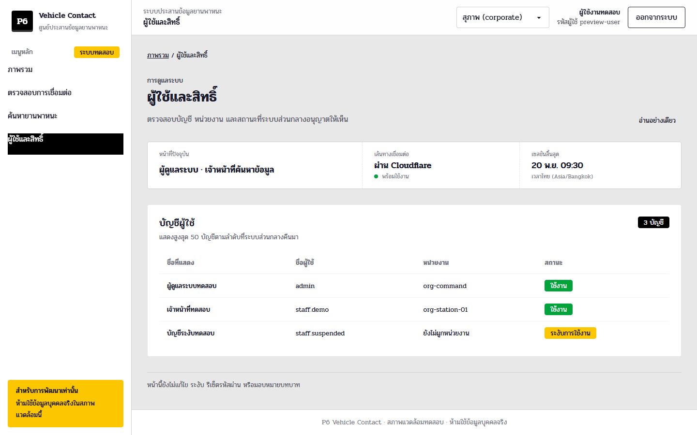
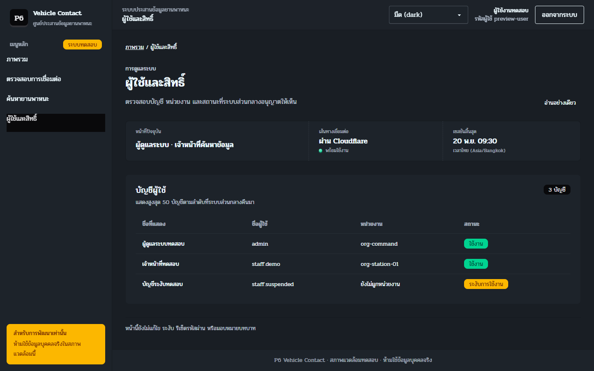
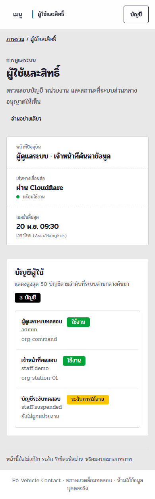

# FE-SYSTEM-ADMIN-USERS-01 — User Directory Compliance Evidence

**Review date:** 2026-11-19 (Asia/Bangkok)

**Implementation commit:** `d8ec5bcdc00c468aa4c43079116cc93add6e6b86`

**Branch:** `codex/p6vc-system-admin-users-20261119`

**Environment:** Local Vite development server with a synthetic session and `users.list` response injected before application bootstrap

**Browser:** Microsoft Edge headless via Chrome DevTools Protocol

**Permission fixture:** `users.manage` returned by the synthetic `auth.session` contract

## 1. Delivered vertical slice

```text
user-directory route
  -> UserDirectoryPage
  -> useUserDirectory explicit state machine
  -> userDirectoryRepository application port
  -> GAS user-directory repository adapter
  -> protected session facade
  -> Cloudflare Worker or GAS transport
```

- menu and route require `users.manage`; the frontend check is navigation UX, not authorization
- the adapter calls `users.list` with a bounded limit of `50`
- response mapping allowlists `userId`, `username`, `displayName`, `organizationId` and `status`
- unapproved fields such as password hashes and roles are discarded
- the UI does not infer roles because `users.list` does not return role assignments
- desktop uses a native DaisyUI table and mobile uses a native list presentation
- idle/loading, empty, forbidden, unauthenticated, recoverable error, fatal error and success states are explicit
- the slice is deliberately read-only; create, edit, suspend, password reset and role assignment remain separate high-impact slices

## 2. Confirmed backend contract

| Operation | Required permission | Request | Response used |
|---|---|---|---|
| `users.list` | `users.manage` | `{ limit: 50 }` | user ID, username, display name, organization ID and status |

Backend acceptance confirms SYSTEM_ADMIN access and denial for REGISTRATION_ADMIN/STAFF. The live GAS Web App remains an older deployment, so local contract evidence is not live authenticated acceptance.

## 3. Automated evidence

- frontend Vitest: `13` files, `47/47` tests passed
- Vite production build with the GitHub Pages base path passed
- frontend dependency audit reported `0` vulnerabilities
- Cloudflare Worker contract tests: `23/23` passed
- targeted GAS actor/RBAC regression: `12/12` tests passed, including 5 roles x 44 protected operations
- repository SSOT validation: `0` errors and `0` link warnings
- use-case SSOT validation: `20` diagrams and `50/50` unique v1 operations passed
- staged diff secret-pattern scan passed

## 4. Browser evidence

### Desktop — corporate



### Desktop — dark



### Mobile — corporate



Machine-readable evidence: [browser-evidence.json](evidence/fe-system-admin-users-20261119/browser-evidence.json)

- corporate desktop `1440x900`: `scrollWidth = clientWidth = 1440`
- dark desktop `1440x900`: `scrollWidth = clientWidth = 1440`
- corporate mobile `390x844`: `scrollWidth = clientWidth = 390`
- axe-core reported zero violations in all three cases
- generated DaisyUI backgrounds left automated contrast checks incomplete; screenshots were visually inspected

## 5. Compliance result

| Gate | Result | Evidence | Follow-up |
|---|---|---|---|
| G1 User task/content | PASS | Thai-first read-only user directory and accurate scope copy | Add mutation actions only in separately tested slices |
| G2 Authority/privacy | PASS | `users.manage` metadata, protected call and response-field allowlist | GAS remains authoritative for every request |
| G3 DaisyUI/theme | PASS | Native card/table/list/badge/alert/skeleton/collapse; no custom CSS added | Maintain theme matrix for mutation dialogs |
| G4 Responsive | PASS | 390px list and 1440px table show no horizontal overflow | Add 360px physical-device review before release |
| G5 Typography/hierarchy | PASS | Existing Pridi hierarchy and OperationalContextStrip reused | Independent design review remains recommended |
| G6 Accessibility | PASS | axe zero violations; table headings and live state region | Add keyboard/dialog evidence with first mutation slice |
| G7 Interaction/state | PASS | Explicit read states and safe retry; no write controls | Mutations require confirmation and session-impact copy |
| G8 Engineering | PASS | PageTemplate, port, adapter, composable, contract tests, build, audit and SSOT checks passed | CI must reproduce on PR head |
| G9 Visual review | PASS | Corporate/dark/mobile screenshots inspected | Independent human reviewer not yet recorded |
| G10 Release | BLOCKED | Synthetic local data only; public GAS deployment does not expose the current session/permission contract | Publish the authorized GAS Web App version, then run authenticated acceptance |

## 6. Release boundary

No GAS push, Apps Script version creation, Web App publication or real-person data access occurred. The slice is source-review complete but is not the complete SYSTEM_ADMIN actor: user mutations, organizations, settings, campaigns, retention approval and audit review remain future vertical slices.

## 7. Reviewer separation

This is implementation self-review evidence, not independent organizational accessibility, security, privacy or UX approval. Project Owner and designated human reviewers retain merge and release authority.
