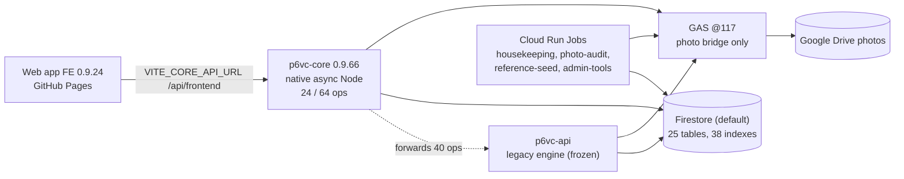

# Handoff — ส่งต่องานให้แชทถัดไป (2026-11-28)

**Document ID:** P6VC-HANDOFF-20261128 | **Date:** 2026-11-28 (Asia/Bangkok) | **Live:** backend **0.9.66** / FE **0.9.24** (core `/` reports `backendVersion 0.9.66`, checked 2026-11-28)
**Status:** CURRENT HANDOFF — จุดเริ่มของแชทใหม่. ความจริงปัจจุบันอยู่ที่ [CURRENT_DELIVERY_STATUS.md](CURRENT_DELIVERY_STATUS.md); prompt มาตรฐานสำหรับ AI ตัวถัดไปมี **ชุดเดียว** ที่ [PROJECT_HANDOVER.md](PROJECT_HANDOVER.md) §1 (ไฟล์นี้อ้างอิง ไม่ทำสำเนา)

## 1. เริ่มแชทใหม่อย่างไร

วางข้อความนี้ในแชทใหม่ (repo root = `F:\programming\police6\p6-vehicle-contact`):

```text
อ่าน apps/vehicle-contact/docs/HANDOFF_NEXT_SESSION_20261128.md แล้วทำตาม prompt ใน PROJECT_HANDOVER.md §1
งานแรก: ขอการยืนยันจาก owner เรื่องลบ p6vc-api (ส่วนที่เหลือของ N4) — ทุก merge / deploy ขอ OK owner รอบนั้น
```

ลำดับการอ่าน (ตาม PROJECT_HANDOVER §1): `CLAUDE.md` → `.mt-studio/project.yaml` → [CURRENT_DELIVERY_STATUS.md](CURRENT_DELIVERY_STATUS.md) → [PROJECT_HANDOVER.md](PROJECT_HANDOVER.md) → [ROADMAP.md](ROADMAP.md) → [KANBAN_BOARD.md](KANBAN_BOARD.md) → [NODE_CORE_FINISH_PLAN.md](NODE_CORE_FINISH_PLAN.md) → [generated/DATA_ACCESS_MAP.md](generated/DATA_ACCESS_MAP.md) + [generated/CHANGE_CHECKLIST.md](generated/CHANGE_CHECKLIST.md) → [DECISION_LOG.md](DECISION_LOG.md)

## 2. ภาพรวมตอนส่งต่อ



| เรื่อง | สถานะ |
|---|---|
| `main` | N1b + N2 + N3 + N4 PR 1 merged และ deploy แล้ว (0.9.72) — core ตอบ **64/64** |
| PR #348 | merge แล้ว — bridge เป็น default ของ deploy (พิสูจน์แล้ว: "Pushed 2 files") |
| PR docs refresh + handoff (ไฟล์นี้) | branch `docs/p6vc-status-handoff-main` สร้างจาก `main` (ไม่ขึ้นกับ #348) — docs only ไม่ต้อง deploy runtime; Pages build เองเมื่อ merge. แทน PR #349 (ซ้อนบน #348) |
| หลักฐานล่าสุด | ทุก slice (0.9.67–0.9.72): live suite ผ่าน core **112/112** + DATA_PROOF 7/7 ที่สดกว่า suite — ตัวเลขใน CURRENT_DELIVERY_STATUS §2 |
| Cloudflare Worker | ลบแล้ว (W1) — ไม่มีขั้นตอน Worker อีกต่อไป |
| GAS | @117 = `MediaBridge.gs` + `appsscript.json`; rollback target @116; trigger เก่าถูก owner ลบแล้ว |

## 3. สิ่งที่เสร็จในรอบล่าสุด (2026-11-27 → 28)

| งาน | PR | ผล |
|---|---|---|
| N1a: vehicles.list, qr.markPrinted, system.config.*, system.reset.* บน core | #316 #318 #321 #323 | done, proven 0.9.60 |
| N4a: browser เรียก core ตรง | #324 | done |
| N1b PR 1–2: qr.history, vehicles.listMine | #326 #328 | proven 0.9.61–0.9.62 |
| R10: reference seed เป็น core job | #331–#333 | DRY_RUN ผ่าน (COUNT 645); recovery ยังกันไว้ |
| R03: กฎรูปถ่าย (admin ตั้ง, เครื่องผู้ใช้ทำตาม) | #334 #335 | BE 0.9.64 + FE 0.9.24, owner ตรวจบนมือถือแล้ว |
| T1 / L1 / W1: code map + LSP, รัน localhost, ลบ Worker | #339 #340 #341 #342 | done |
| R11: first admin / reset รหัส admin เป็น core job | #344 #346 #347 | RESET_PREVIEW proven live (ไม่เขียนอะไร) |
| G1: GAS = photo bridge เท่านั้น | (push @117) + #348 | live proven; #348 merged |
| Docs refresh + handoff นี้ | PR จาก `docs/p6vc-status-handoff-main` | แก้เวอร์ชัน/สถานะค้างใน CURRENT_DELIVERY_STATUS, PROJECT_HANDOVER, ROADMAP, NODE_CORE_FINISH_PLAN; ป้าย "Current state" บน ARCHITECTURE_SSOT, FRONTEND_ARCHITECTURE; DOCS_INDEX read-first เพิ่มไฟล์นี้ |

## 4. งานถัดไป (ตามลำดับ)

1. **N4 ส่วนที่เหลือ** ([#255](https://github.com/idev006/MT-Agency-Super-App-Framework/issues/255)) — ต้องได้คำยืนยันจาก owner ก่อน (ย้อนกลับยาก): เอา p6vc-api ออกจาก deploy chain → ลบ service p6vc-api → ย้าย rule ที่ core ยัง import จาก `backend/gas/src` เข้า core → ลบโค้ด legacy (legacy acceptance tests ยังเป็น spec)
2. R10 recovery gate [#303](https://github.com/idev006/MT-Agency-Super-App-Framework/issues/303) · R04 [#297](https://github.com/idev006/MT-Agency-Super-App-Framework/issues/297) (dry run ก่อน)
3. go-live: R14 / R16 / R17 (owner)

## 5. รอ owner (ไม่ใช่งาน engineering)

- R14 capacity: เลือก min-instances / ค่าใช้จ่าย สำหรับ 100 คน login พร้อมกัน ([#306](https://github.com/idev006/MT-Agency-Super-App-Framework/issues/306))
- R16 สวิตช์ก่อน production: ปิด `P6VC_SYSTEM_RESET`, ป้องกัน secret pepper, ตัดสินใจ Google login, Drive storage, legal/PDPA ตอน go-live ([#307](https://github.com/idev006/MT-Agency-Super-App-Framework/issues/307))
- R17 ใช้ retention ใหม่กับ log เก่า (preview + ยืนยัน) ([#308](https://github.com/idev006/MT-Agency-Super-App-Framework/issues/308))
- R11 APPLY (reset รหัส admin จริง) — ทำเมื่อ owner ต้องการเท่านั้น; owner สร้าง secret `p6vc-admin-temp-password` เอง (PROJECT_HANDOVER §5b)
- ตรวจหน้าจอ live หลังแต่ละ deploy (AI ไม่พิมพ์รหัสผ่านในเว็บที่ host อยู่)

## 6. กฎที่ต้องจำ (ย่อ — ฉบับเต็ม PROJECT_HANDOVER §1 / §8)

- ตอบ owner เป็นภาษาไทย สั้น ๆ; ปิดท้ายด้วย "สิ่งที่ owner ต้องทำ"
- ทุก merge และทุก deploy ต้องได้ OK จาก owner สำหรับรอบนั้น (prompt owner 2026-11-28 เข้มกว่า VC-ADR-052 ที่เคยอนุมัติครั้งเดียว — ยึดข้อนี้). VC-ADR-052 เดิม — **ไม่รวม** ข้อมูลจริง, การลบถาวร, `system.reset.execute`, การสร้าง version ใหม่ของ `p6vc-auth-pepper`
- ห้าม merge เมื่อ CI แดง; ห้ามบอก PASS โดยไม่มีหลักฐานอิสระ (live suite ผ่าน core + DATA_PROOF ที่ startedAt ใหม่กว่า suite)
- deploy: `P6VC_OWNER_OK=MERGE_AND_DEPLOY scripts/p6vc-deploy-backend.sh <sha> "<desc>" [--indexes]` — Firestore indexes **ก่อน** backend เสมอ; ไม่มี Worker
- live suite: ตั้ง **ทั้ง** `P6VC_API_BASE_URL` และ `P6VC_GAS_EXEC_URL` = URL ของ core (`.env` default ชี้ GAS)
- secret: ชื่อเท่านั้น ห้ามอ่าน/พิมพ์/commit ค่า
- หลังแก้โค้ดที่ย้าย table access / op / count: `node scripts/gen-system-maps.mjs` แล้ว commit; issue เปลี่ยนสถานะ: `node scripts/gen-kanban.mjs`
- ปิด dev server local (`p6vc-core-dev` :8787, `p6vc-frontend-local` :5175) ก่อนรัน `npm run check` ใน backend/gas
- ใช้ git worktree แยกสำหรับแต่ละงาน — checkout หลักอาจถูก session อื่นสลับ branch ระหว่างทำงาน (เกิดขึ้นจริง 2026-11-28)

## 7. ตรวจเร็ว ๆ ก่อนเริ่มงาน

```bash
git fetch origin main && git log --oneline -5 origin/main
gh pr list --state open
gh issue list --label status:in-progress
curl -s https://p6vc-core-46858005337.asia-southeast3.run.app/ | head -c 300   # backendVersion
node scripts/gen-system-maps.mjs --check && node scripts/validate-ssot.mjs && node scripts/validate-usecase-ssot.mjs
```
