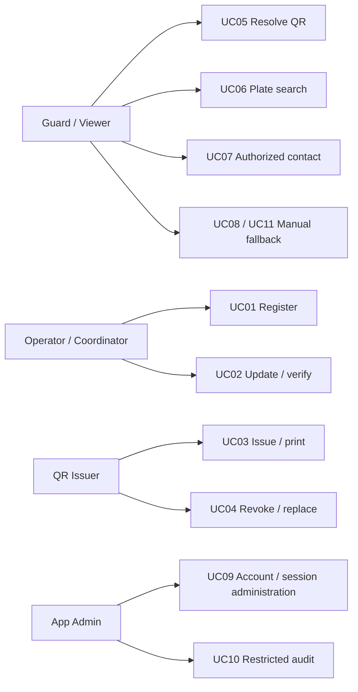
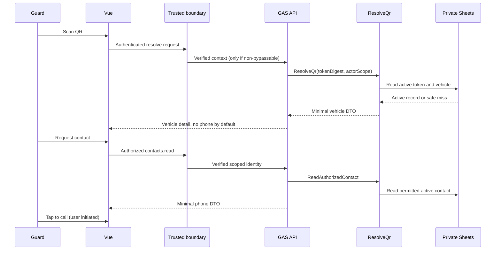

# P6 Vehicle Contact — Implementation Specification, Phase 1
**Document ID:** P6VC-IMPL-001 | **Revision:** 0.1 draft | **Date:** 2026-11-17
**Status:** ENGINEERING-READY FOR SYNTHETIC DEVELOPMENT; PRODUCTION GATES OPEN.
**Authority:** [SA Baseline](SYSTEM_ANALYST_BASELINE_PHASE1.md), [GAS API Spec](GAS_API_SPEC.md), [Canonical Schema](../schema/database.schema.json), [Master GAS Blueprint](../../../blueprint/MASTER_GAS_BACKEND_API_BLUEPRINT.md), [Master Web Blueprint](../../../blueprint/MASTER_WEB_APP_BLUEPRINT.md). If this specification conflicts with these authorities, stop and file an ADR/decision; do not silently override.

## Objective and boundaries
Enable authorized guards to resolve an existing registered vehicle by QR or normalized Thai plate/province, view only permitted contact information and manually initiate a call. Registration, correction, QR issuance/revocation, user/session enforcement, audit and human fallback complete the Phase-1 workflow. The registered contact is not proof of legal ownership. No public contact directory, visitor/pass exchange, parking entitlement, OCR or automatic dialing.

## Actor → Use Case → API → component → acceptance traceability
| UC | Actor | API v1 group.action (proposed until secured) | App use case | Minimum acceptance |
|---|---|---|---|---|
| UC01 Register | Operator / authorized registrant | vehicles.register | RegisterVehicle | validate plate/province/contact, reject duplicate active vehicle, audit |
| UC02 Verify/update | Operator/coordinator | vehicles.update; contacts.update | UpdateVehicleContact | optimistic version check, stale contact hidden, audit |
| UC03 Issue/print QR | QR issuer | qr.issue | IssueQr | opaque random token; digest only persisted; printer-friendly link contains no PII |
| UC04 Revoke/replace | QR issuer | qr.revoke; qr.issue | RotateQr | revoked token rejected; audit and no token disclosure |
| UC05 Resolve QR | Guard/viewer | qr.resolve | ResolveQr | valid active token maps to one active vehicle; revoked/unknown safe denial |
| UC06 Plate search | Guard/viewer | vehicles.lookup | SearchVehicle | normalized plate+province, bounded results, no phone enumeration |
| UC07 View/call | Guard with separate contact permission | contacts.read | ReadAuthorizedContact | verified identity, resource scope, phone permission; explicit user tap |
| UC08 Missing record | Guard | client fallback, no privileged bypass | HandleNoMatch | show manual SOP and correlation ID; never invent contact |
| UC09 Sign in/out | Protected users | auth.sign-in/sign-out/session (provider-specific; not enabled) | Authenticate/Authorize | trusted server session; expiry, revocation, no client-role trust |
| UC10 Audit | Admin/auditor | audit.restricted-report (future protected) | RecordAudit | minimal append-only records; restricted read; no secrets |
| UC11 Outage/correction | Guard/coordinator | client fallback + authorized update | HandleOutage | offline/no network SOP; conflict-safe correction |
| UC12 Visitor/pass | Future actors | NONE | NONE | explicitly absent from Phase 1 frontend and router |

**UML Use Case view (proposed projection of approved SA table, not evidence that historic diagrams were formally signed off):**

## Cross-cutting security invariants
- All protected operations require independently verified identity/session, permission, resource scope and safe audit. QR possession, request payload role, a browser secret or a gateway with bypassable privileged GAS URL are never authentication.
- `system.health` may be public but must reveal no data/configuration. Protected API groups stay **disabled** until D-01 and D-02 have verified implementation and negative tests.
- Username/password: choose approved credential provider and server-side session implementation before coding a live sign-in handler. Password hashes, session secrets, rotation, rate limiting, reset, logout and expiry are mandatory design work, not assumptions about GAS.
- All data access is through injected repositories. No domain imports of SpreadsheetApp/DriveApp/ContentService.
- PII fields and phone disclosure: default deny; contact read uses distinct `vehicle.contact.read` permission; restrict audit access; redact log payloads.
- Every mutation needs conflict handling, validation, idempotency key policy and audit. Sheets is not ACID; test concurrency and partial-write recovery.

## Logical sequence — authorized QR contact

## State models (candidate; business validation required)
- Vehicle: `PENDING_REVIEW → ACTIVE → INACTIVE`; `ACTIVE → SUSPENDED`; reactivation requires approved verification. Actual allowed transitions are a D-03 decision.
- QR: `ISSUED → ACTIVE → REVOKED`; no transition from REVOKED to ACTIVE. New QR has a new token and audit entry.
- Migration: `PREPARED → BACKED_UP → APPLYING → VERIFYING → APPLIED`; failure before apply → FAILED; after partial write → RECOVERY_REQUIRED; manual reconciliation required.
- Session: `ACTIVE → EXPIRED/REVOKED`; no reactivation of same session identifier.

## Data contracts and persistence
Physical columns, order and types MUST come from `schema/database.schema.json` (currently `0.1.0-draft`, business approval pending); never infer from example payloads. IDs are opaque stable identifiers, not row indexes. Logical relationships: vehicle 1:N contacts, QR tokens, photo metadata, lookup/change audits. Sheets cannot enforce PK/FK/unique; implement and test in application/repository. Do not add account/password/session sheets without D-01 approval. Photo count, source access and retention remain D-04/D-05 OPEN.

## Frontend screen acceptance
1. Login/session, safe QR return path, session-expired handling.
2. Scan/search with camera permission, front/back selection, manual entry, no-match and ambiguous-match states.
3. Vehicle detail with safe masked/no-contact state, separate contact permission, explicit tap-to-call.
4. Registration/edit with validation, duplicate/conflict handling.
5. QR issue/revoke/print with role checks and no embedded PII.
6. Admin/audit screens restricted by server permissions; frontend hiding alone is insufficient.
7. Mobile Android/iOS physical tests; accessibility and network outage fallback.

## Definition of Done per UC
Document request/response DTOs; implement use case and port adapter; add normal/invalid/unknown/unauthorized/concurrent/dependency-failure tests as applicable; verify safe audit; record CI commit/run, staging endpoint/version, test data and UAT outcome. **Code present is not done; a unit test is not live E2E.**

## Open decisions and stop conditions
D-01 approved auth provider and non-bypassable GAS ingress; D-02 RBAC, scope and phone visibility; D-03 schema and state policy; D-04 photo minimum/storage; D-05 PDPA lawful basis, notices, retention and computer-traffic-log applicability; D-06 staging and production release ownership. Work may proceed with synthetic adapters but not real PII or protected API activation. Use [SA Baseline](SYSTEM_ANALYST_BASELINE_PHASE1.md) as the authoritative decision list.
