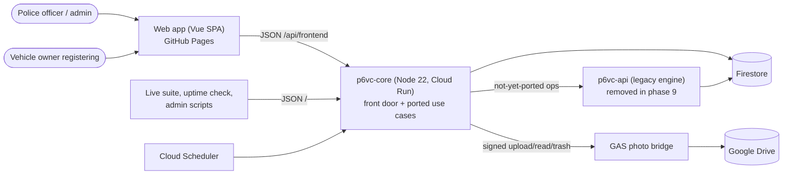

# Node core architecture (VC-ADR-046)

Owner (2026-11-27): proposed FE `[UI, view, controller, stub]` ⇄ BE `[stub, facade, business logic, data access, database]` and asked
for the most suitable form, studied from reliable sources. This file is the target structure of `backend/core` and the rules CI
will enforce. The migration steps are in [NODE_CORE_MIGRATION_PLAN.md](NODE_CORE_MIGRATION_PLAN.md).

## 1. Choice: multi-tier, Clean Architecture inside each tier, contract-first between tiers

| Source | What we take from it |
|---|---|
| Microsoft Azure Architecture Center, *N-tier architecture style* | **Layers are logical, tiers are physical**; several layers may share one tier. Each layer calls only layers below it. → the owner's FE/BE split = tiers; the boxes inside = layers. |
| Robert C. Martin, *The Clean Architecture* (2012) | **Dependency Rule:** source dependencies point **inwards** only; inner circles (policies) know nothing of outer ones (mechanisms). → business logic never imports HTTP, Firestore or Drive code. |
| Alistair Cockburn, *Hexagonal Architecture / Ports and Adapters* (2005) | The core defines **ports**; technology sits in **adapters** plugged into them — driving (HTTP, scheduler) and driven (Firestore, photo bridge). → swap the GAS-shaped REST store for the Firestore Node SDK without touching use cases. |
| Martin Fowler, *Strangler Fig Application*; Azure / AWS *Strangler fig pattern* | Grow the new system around the old one and move functions one by one (transform → coexist → eliminate) instead of a big-bang rewrite. → `p6vc-core` front door + routing table + legacy fallback. |
| Google Cloud, *Cloud Run maximum concurrent requests* | Default 80 requests per instance; set 1 **only** when the code cannot handle parallel requests; one instance gives **no isolation** between concurrent requests. → the core must be async and keep **no per-request state in module globals**. |
| Simon Brown, *C4 model* | Describe the system at four zoom levels: context, containers, components, code. → the views below. |

The owner's proposal maps onto this one-to-one; the two refinements are (a) business logic split into **application** (use-case
order: permission, transaction, audit) and **domain** (pure rules, no I/O — testable alone, reusable by the web app), and
(b) data access behind a **port** defined by the core, so dependencies point inwards rather than strictly downwards.

## 2. C4 level 1–2 — context and containers


## 3. C4 level 3 — layers inside each container
```
WEB APP (frontend/src)                         CORE (backend/core/src)
 UI          components/, pages/                http/         driving adapter: server, /api/frontend gateway, /   (= BE stub)
 View        views/, layouts/, router/          facade/       64 operations: route, DTO, permission, envelope     (= facade)
 Controller  features/ (composables), stores/   application/  use cases, one folder per operation group           (= business logic: flow)
 Application application/ (FE use cases)        domain/       pure rules (moved from backend/gas/src/domain, ph.9)(= business logic: rules)
 Domain      domain/ (FE rules)                 ports/        Store, MediaStore, Clock, Ids, Hash — interfaces only
 Stub        infrastructure/api + repositories  adapters/     driven: firestore/ (SDK store) + outbound/ (Integration Manager, §5) (= data access)
                   ⇅  contracts/ (api-inventory, DTO, permissions, trusted endpoints) — one source for both tiers
```

## 4. Rules (CI-checked from phase 2)
1. **Dependency Rule** (import graph test, same technique as `scripts/gen-system-maps.mjs`):
   `domain` imports nothing outside `domain`; `application` imports only `domain` and `ports`; `facade` imports `application`,
   `domain`, contracts; only `adapters` and `http` may import Node built-ins for I/O, `fetch`, or `@google-cloud/*`;
   `http` composes everything (composition root). A wrong arrow fails CI.
2. **Async all the way:** ports return promises; no sync shim (`sync-fetch.mjs` is legacy only).
3. **Concurrency-safe:** no per-request data in module-level variables; process caches only for read-mostly data with a TTL
   (log policy 60 s, reference data) and keyed by value, never by request.
4. **Cross-cutting concerns as decorators on ports** (Log Manager on the Store port, print state), not inside use cases.
5. **Contract-first:** the API list, DTO fields and permissions come from `contracts/`; the web-app stub is generated from them
   after the backend move (phase 9+), replacing hand-written repositories.
6. **One operation group per folder** in `application/` (officer path, auth, registration, vehicles+QR, changes, admin) — files
   stay small without a line cap.

## 5. Outbound integrations — the Integration Manager (VC-ADR-047)
Owner (2026-11-27): keep photos in the owner's Drive through the GAS bridge (option D, VC-ADR-034 confirmed), and "nodejs
จึงควรมี โค้ดส่วนที่ทำหน้าที่เป็นผู้เรียก (Manager หรือ อื่นๆ) ไปยัง api ต่างๆ ที่จะเกิดขึ้นในอนาคต".

**Today the legacy engine calls 4 external systems from 4 places, each with its own timeout / retry / error handling:**
Firestore REST + Google token exchange (`FirestoreRestGateway`), Google `tokeninfo` for Google sign-in (`GasSecurity`),
the GAS photo bridge (`media-bridge-client`), and — in the core — the legacy engine (`legacy-client`).

**Patterns used** (sources in §6): *Gateway* (Fowler) — one object per external system holds all its awkwardness and can be
swapped for a stub; *Anti-Corruption Layer* (Azure) — the gateway translates the outside model and errors into ours;
*Retry* and *Circuit Breaker* (Azure resilience patterns) — applied once, in the manager, not in every caller; *Ports and
Adapters* — use cases see only a port.

```
application/ (use case)  ──calls──▶  ports/  MediaStore · IdentityVerifier · LegacyEngine · Notifier(future) · …
                                        ▲ implemented by
adapters/outbound/
  gateways/        media-bridge.mjs · google-identity.mjs · legacy-engine.mjs · <future>.mjs    (one per external system: ACL)
  manager.mjs      Integration Manager: builds every gateway from the registry below; one place for policy
  http-client.mjs  the ONLY place that calls fetch(): timeout, retry (idempotent calls only, backoff + jitter),
                   circuit breaker per integration, requestId passed on, structured log (name, status, ms — never bodies
                   or secrets), counters for the health view
  signers/         hmac-media-bridge.mjs (VC-ADR-034 signature) · google-oidc.mjs (Cloud Run → Cloud Run, later) · api-key
adapters/firestore/  the Firestore Node SDK store (its own transport; the manager only sets its timeouts and retries)
contracts/outbound-integrations.v1.json   ONE list: name, endpoint id (contracts/trusted-endpoints.v1.json), timeoutMs,
                   retry {max, onStatus}, breaker {failures, openMs}, which operations are idempotent, secret env NAMES
```

**Rules (CI-checked with the Dependency Rule test):**
1. Only `adapters/outbound/http-client.mjs` may call `fetch`; only gateways may import it; use cases import ports only.
2. Every integration is listed once in `outbound-integrations.v1.json`; its URL must be a trusted endpoint (no URL in code).
3. Retry only idempotent calls (read, trash, health); never retry an upload or a write without an idempotency key.
4. A gateway maps every outside failure to one of our codes (`UPSTREAM_UNAVAILABLE`, `UPSTREAM_REJECTED`, `UPSTREAM_TIMEOUT`)
   — no outside message reaches a user.
5. Secrets only from the environment (Secret Manager), by name in the registry; never logged.
6. Each gateway has a contract test against a local fake server (as `core-proxy.test.mjs` does for the legacy engine).

**Adding a future API** = one registry entry + one trusted endpoint + one gateway (+ a port if it is a new kind of thing) + its
contract test. No use case touches HTTP.

## 6. Sources
- Microsoft Azure Architecture Center — N-tier architecture style: https://learn.microsoft.com/en-us/azure/architecture/guide/architecture-styles/n-tier
- Robert C. Martin — The Clean Architecture (2012): https://blog.cleancoder.com/uncle-bob/2012/08/13/the-clean-architecture.html
- Alistair Cockburn — Hexagonal Architecture: https://alistaircockburn.com/Articles/Hexagonal-Architecture
- Microsoft — Strangler Fig pattern: https://learn.microsoft.com/en-us/azure/architecture/patterns/strangler-fig
- AWS Prescriptive Guidance — Strangler fig pattern: https://docs.aws.amazon.com/prescriptive-guidance/latest/cloud-design-patterns/strangler-fig.html
- Google Cloud — Cloud Run maximum concurrent requests: https://docs.cloud.google.com/run/docs/about-concurrency
- Simon Brown — The C4 model: https://c4model.com/
- Martin Fowler — Gateway (2021): https://www.martinfowler.com/articles/gateway-pattern.html
- Microsoft — Anti-corruption Layer pattern: https://learn.microsoft.com/azure/architecture/patterns/anti-corruption-layer
- Microsoft — Microservices design patterns (Retry, Circuit Breaker for interservice calls): https://learn.microsoft.com/azure/architecture/microservices/design/patterns
