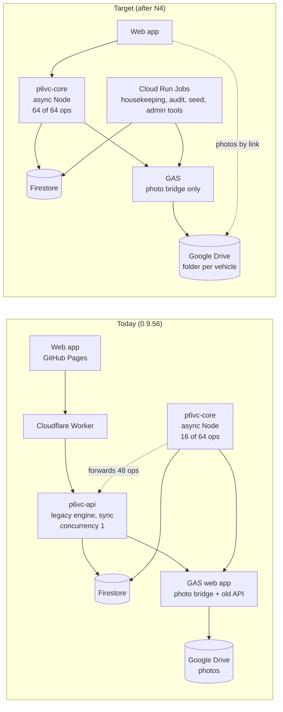
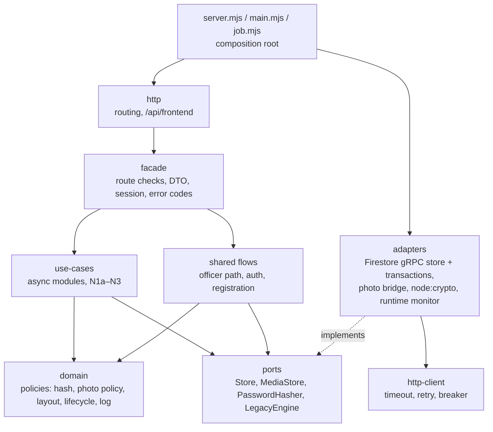
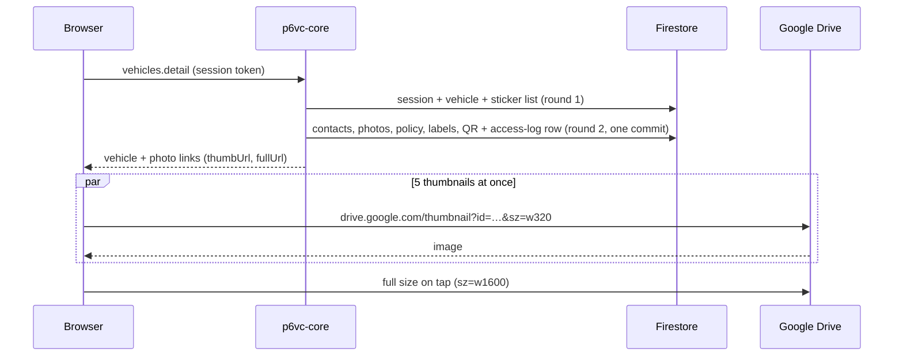
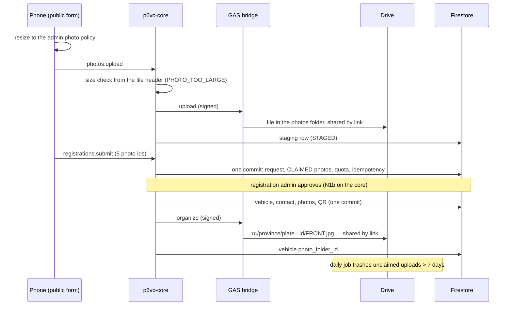
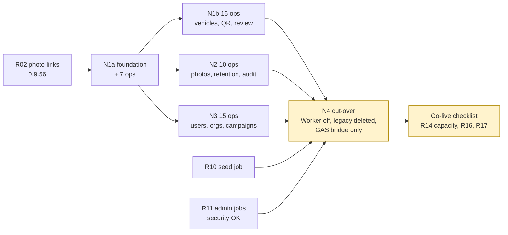

# Node core — finish: the whole backend as native async Node.js (VC-ADR-051)

**Progress (2026-11-28, refreshed):** 24/64 operations live on the core at backend 0.9.66 (N1a done; N1b PRs 1–2 done; Worker
deleted — W1; GAS = photo bridge only — G1). Current status: [CURRENT_DELIVERY_STATUS.md](CURRENT_DELIVERY_STATUS.md); the
"Today (0.9.56)" diagram below is the starting point, kept for history. `system.health` remains on the legacy engine until N4 so the deploy smoke still
checks the published backend version end to end. Owner clarification: map code with LSP; target runtime is the native async
Node core, Firestore and the GAS API for Google Drive photos, without Cloudflare Worker.

Owner, 2026-11-27: *"อย่าเสียเวลายื้อเลย เราควรเปลี่ยนโค้ด backend core ให้เป็น nodejs 100% เพื่อใช้ประสิทธิภาพของมันได้อย่างเต็มที่"*
→ approach change proposed → *"อนุมัติให้ดำเนินการ โดยคุณและทีมต้องวิเคราะห์ วางแผนการดำเนินการ เพื่อให้ tracking ได้"*.

## What changes in the approach
Until now each operation moved as a **shared flow** (one generator both engines run) and was proven byte-identical on both
engines — safe but slow (6 waves, 16 of 64 operations). From here: **the legacy engine is frozen** (no new shared flows,
no dual-engine parity per operation). The remaining use cases are rewritten as **native async modules in
`backend/core/src/use-cases/`** (async/await, independent reads in parallel with `Promise.all`, transactions on the core
store), moved in a few large groups, then the legacy engine and the GAS API are deleted.

**Unchanged:** every merge and every deploy needs the owner's OK; every deploy is proven by the live suite through the core
(126 tests covering all 64 operations) + DATA_PROOF fresher than the suite; until N4 any group can be switched back to the
legacy engine (remove its operations from the core's operation table and redeploy the core).

## Analysis (2026-11-27)

| Module (backend/gas/src/application/…) | Lines | Store call sites | Transactions | Journal | Operations left |
|---|---|---|---|---|---|
| use-cases/VehicleOperations.js (+ ChangeReviewOperation, QrExport/QrHistoryOperation) | 355 | 65 | 1 | 8 | 16 |
| use-cases/MediaRetentionOperations.js | 153 | 33 | 2 | 1 | 10 |
| use-cases/IdentityOperations.js (users.*) | 152 | 32 | 4 | 7 | 7 |
| use-cases/AdministrationOperations.js | 106 | 19 | 5 | 0 | 8 |
| use-cases/VehicleListOperations.js | 123 | 9 | 2 | 0 | 2 |
| use-cases/SystemResetOperations.js, settings/SettingsRegistry.js, system.health | 161 | 12 | 1 | 0 | 5 |
| **total** | ≈ 1,050 | 170 | 15 | 16 | **48** |

Cross-cutting rules the core must also apply on every write: the **Log Manager** (already on the core store) and the
**QR print-state rule** (VC-ADR-042: a new ACTIVE QR resets the print state — `withPrintStateStore`), plus the sticker
decorations of registrations.detail / review, vehicles.update / list / listMine, qr.export (folded into the use cases).
Known performance debts fixed on the way: registration approval reads the WHOLE vc_vehicles table (→ query by plate).

**Test strategy:** the ~900 legacy acceptance tests are the specification. A script **generates** async copies of them
(`h.call(` → `await h.call(`, …) that run against the core facade over an async in-memory store with the same seeds, fake
Drive and fake security; a check (CI) fails if a generated copy is stale. So the core is held to the same tests without
hand-kept duplicates.

## The work (one issue each, milestone "Node core (VC-ADR-046)")

| # | Scope | Operations | Done when |
|---|---|---|---|
| **N1a** | foundation: async test harness + generated async acceptance tests; async store rules (print state); the core's use-case table; vehicles.list, qr.markPrinted, system.config.get/update, system.reset.*; system.health remains on legacy until N4 | 6 in N1a + health at N4 | generated tests for the six N1a operations pass on the core; live suite 126/126 through the core with these answered by the core |
| **N1b** | vehicles, QR, change requests, registration review (VehicleOperations + ChangeReview + QR export/history), approval duplicate check by plate | 16 | same, + approve → vehicle / contact / photos / QR rows read back; photo folder organized |
| **N2** | photos.list / replace, registrations.photo, retention.*, audit.query / export | 10 | same, + retention on synthetic DEV only, dry run first |
| **N3** | users.* (one hash rule, revocation), organizations.*, campaigns.create / list / revoke | 15 | same, + audit rows read back |
| **N4** | cut-over: the web app calls the core's /api/frontend directly (Worker retired), p6vc-api deleted, legacy use-case code deleted, GAS = photo bridge only (needs R10 / R11 jobs), shared code settled in the core | – | live suite + DATA_PROOF + live UI; GAS bundle ≈ bridge files only; no forwarding path left |

Order: N1a → N1b → N2 → N3 → (R10, R11) → N4. Each item: PR(s) → owner OK → deploy → proof → evidence in DECISION_LOG
→ issue closed → ROADMAP status updated.

## Blueprint (diagrams)

### 1. Today → target

### 2. Inside the core (dependencies point inwards; only the http-client calls out)

### 3. An officer opens a vehicle (after N4)

### 4. A photo's life

### 5. Work order and gates

Every box: PR → owner OK → deploy → live suite + DATA_PROOF + read-back → evidence → issue closed.
