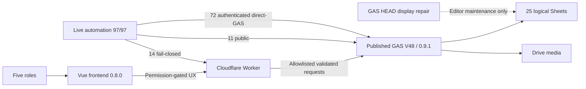
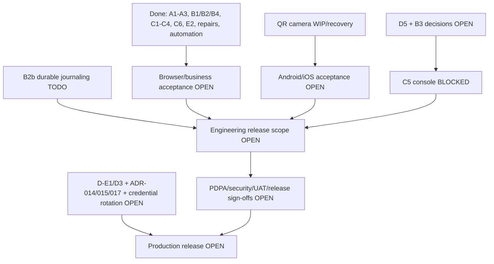

# P6 Vehicle Contact — Project Handover / Next AI

**Document ID:** P6VC-HANDOVER-001
**Last verified:** 2026-11-22 08:23 Asia/Bangkok
**Source/content baseline:** PR **#110**, merged `main` @ **`bf3553d`**
**Purpose:** concise continuation brief. Start with [CURRENT_DELIVERY_STATUS.md](CURRENT_DELIVERY_STATUS.md); this handover supplies precedence, safety, exact next actions and a ready-to-paste prompt.

## 1. Ready-to-paste next-AI prompt

```text
Take over P6 Vehicle Contact in idev006/MT-Agency-Super-App-Framework. Read apps/vehicle-contact/docs/CURRENT_DELIVERY_STATUS.md first, then PROJECT_MANAGEMENT_PLAN_20261121.md and PRODUCTION_READINESS_PLAN_20261121.md. Use last verified 2026-11-22 08:23 Asia/Bangkok and PR #110 merged main bf3553d as the documented baseline, but inspect current git status, fetch and verify the remote main SHA, and inspect Issues and CI before changing anything.

Verified snapshot: published GAS Web App V48 backend 0.9.1; frontend 0.8.0; Worker version 20180237-7441-481a-9540-e7ca2c9c79eb; offline GAS npm check PASS. Live DEV automation passed 97/97 = 11 public direct-GAS + 14 Worker fail-closed + 72 authenticated direct-GAS, covering 56/56 operations and all five roles with cleanup 7/7. Do not describe the authenticated stage as all-through-Worker. DEV reset logically retired 11 and created 10 ACTIVE vehicles, each with 1 contact/5 photos/QR MATCH, cleanup 2/2; post-seed audit passed 25/25 Sheets with zero visible errors and zero repairs. Display-error follow-up maintenance source is GAS HEAD only; published API remains V48. Live report sourceCommit f14458d is not the merge/content baseline.

Completed engineering slices: A1-A3, B1/B2/B4, C1-C4, C6, E2, display repair and live automation. Continue either (1) QR camera recovery from the documented protected stash, integrating current main and adding direct adapter-cleanup tests before physical Android/iOS acceptance, or (2) B2b durable journaling/compensation for registrationReview and assignRoles with fault/restart tests. C5 RETENTION_WORKER console is BLOCKED on human D5+B3 decisions and is not in progress; do not implement or enable destructive retention while blocked.

Keep PDPA/security/UAT/release, browser/business/device acceptance, D-E1/D3/D5/B3, VC-ADR-014/015/017 and credential rotation OPEN unless a named human supplies actual approval evidence. Optional protected GitHub P6VC_TEST_USERNAME/P6VC_TEST_PASSWORD secrets are only for future manual full-suite runs, not a blocker for the completed local run.

Follow all runbooks and scope your changes to the requested slice. Never expose endpoints, credentials, tokens or PII. The GitHub Actions GAS source-push workflow requires the exact per-push owner phrase PUSH_VEHICLE_GAS; a separately owner-authorized assistant clasp self-deploy path may be used within its approved scope. Source push/version creation is separate from Web App publication. Keep source, deployment, live test transport, human acceptance and production approval distinct in every report.
```

## 2. Document precedence and conflict handling

Use each authority for its own concern; do not let an old narrative override newer verified evidence.

1. **Current canonical code, explicit owner decisions and named approvals** govern implementation and authorization now. Fetch and verify the remote `main` SHA, then inspect Issues and CI before work.
2. **[CURRENT_DELIVERY_STATUS.md](CURRENT_DELIVERY_STATUS.md)** is the current verified runtime/evidence snapshot and resume point.
3. **[PROJECT_MANAGEMENT_PLAN_20261121.md](PROJECT_MANAGEMENT_PLAN_20261121.md)** owns slice state/dependencies; **[PRODUCTION_READINESS_PLAN_20261121.md](PRODUCTION_READINESS_PLAN_20261121.md)** owns release gates.
4. **Approved requirements, blueprints, canonical schema and [DECISION_LOG.md](DECISION_LOG.md)** govern business/architecture policy. An implemented engineering decision is not automatically a ratified security/PDPA decision.
5. **Dated evidence and runbooks** prove only their recorded date, source, deployment and test scope. Current counts supersede old counts for the current board without erasing history.
6. **This handover and [app README](../README.md)** are navigation aids, not competing requirements or deployment evidence.

If sources conflict, record the conflict and request the required human decision; do not silently change business policy, schema or permissions. GitHub source is canonical; generated `.gs`, `_site/` and deployed artifacts are not parallel source trees.

## 3. Current snapshot

| Area | Verified state |
|---|---|
| Runtime | GAS Web App **V48 / 0.9.1**; Frontend **0.8.0**; Worker **`20180237-7441-481a-9540-e7ca2c9c79eb`**. |
| Inventory | **56 operations**, **25 Sheets**, five roles. |
| Offline/live | Offline GAS check PASS; live **97/97**, **56/56**, cleanup 7/7. Authenticated 72 cases are direct-GAS; Worker has separate 14-case live fail-closed proof. |
| DEV data | 11 retired logically, 10 new ACTIVE, each 1 contact/5 photos/QR MATCH; cleanup 2/2. |
| Sheets audit | 25/25 complete, zero visible errors before/after and zero repairs after seed. |
| Publication nuance | Display-error repair source is GAS HEAD only; published API remains V48. `f14458d` is report provenance, not baseline. |
| Release | **Not production-ready. All human sign-offs are OPEN.** |

Primary evidence: [live automation/reset/audit](LIVE_API_AUTOMATION.md), [C6 registry](C6_ADMIN_VEHICLE_REGISTRY_EVIDENCE_20261121.md), [E2 authorization](E2_WORKER_FAILCLOSED_EVIDENCE_20261121.md), [Sheets repair/runbook](GAS_NUMBERFORMAT_DISPLAY_CORRUPTION_INCIDENT_20261121.md), [E1 design](E1_INDEXED_DATASTORE_MIGRATION_DESIGN_20261121.md), and [E3 dossier](E3_PRODUCTION_SIGNOFF_DOSSIER_20261121.md).

## 4. Runtime handoff diagram

No endpoint, credential or session value is needed to understand the flow.



GAS remains the authorization authority; frontend permissions are navigation/UX only. The diagram does not imply that all authenticated automation passed through the Worker.

## 5. Work and gate state diagram



## 6. Exact next actions

1. **Reconcile before editing:** inspect current branch/status, fetch and verify the remote `main` SHA, then inspect the relevant Issue and checks. Treat the snapshot above as last-verified, not a substitute for current inspection.
2. **QR path:** verify and recover the stash using §7; integrate latest `main`, inspect the diff, add direct adapter-cleanup tests, run focused/offline suites, then obtain physical Android/iOS acceptance. Do not drop the stash prematurely.
3. **B2b path:** add durable PREPARED/recovery semantics for `registrationReview` and `assignRoles`, prove restart/fault idempotency, and update the [recovery runbook](OPERATION_JOURNAL_RECOVERY_RUNBOOK_20261121.md) and evidence.
4. **C5:** leave **BLOCKED** until D5+B3 are explicitly ratified. Only then build the permission-gated console and perform synthetic two-person/`legal_hold` rehearsal; never enable real-data destructive retention.
5. **Acceptance:** arrange named-human browser/business review of gallery/copy, C1–C4 and C6 plus QR device review. API automation is not UAT.
6. **Release:** resolve D-E1/D3/D5/B3 and VC-ADR-014/015/017 as applicable, rotate credentials, complete PDPA/security/UAT review, then follow the [release sequence](PRODUCTION_READINESS_PLAN_20261121.md#4-release-sequence--no-date-commitment). Final release approval remains OPEN.

## 7. QR protected-stash recovery

The documented local WIP reference is:

```text
stash@{0}: On codex/p6vc-qr-camera-scanner-20261120: wip: qr camera scanner before reference catalog
```

Verify the stash still exists. Use the `FETCH_HEAD` written by the immediately preceding fetch; do not substitute a potentially stale local `origin/main`. Then:

```powershell
git fetch origin main
git switch -c codex/p6vc-qr-camera-scanner-resume FETCH_HEAD
git stash apply 'stash@{0}'
```

Resolve against Frontend **0.8.0 or later**. Do not drop the stash until recovered changes are safely committed and pushed. Earlier WIP had pinned `html5-qrcode 2.3.8`, 12/12 focused tests, build and dependency audit PASS; direct cleanup tests and physical device acceptance were not thereby completed.

## 8. Safety rules

- Keep endpoints, credentials, session tokens, raw responses with PII and secret-bearing logs out of chat, commits, Issues and evidence.
- Obtain authorization before live mutation. Live automation is synthetic DEV only under its exact write guard; cleanup failures fail the run.
- The GitHub Actions GAS source-push workflow requires exact per-push **`PUSH_VEHICLE_GAS`**. A separately owner-authorized assistant `clasp` self-deploy path may be used within its approved scope; both require authorization and evidence.
- Record source push, GAS source-version creation, Web App publication, Worker deployment and Pages deployment separately; verify health/behavior after publication.
- No unapproved schema migration, production catalog `ENFORCED` mode, destructive retention or production release.
- Preserve least privilege, server-side identity/ownership, bounded Sheets reads, no cross-sheet joins and fail-closed DTO/Worker behavior.
- Never self-approve PDPA/security/UAT/release, ADRs, business scope or device acceptance. Never relabel blocked C5 as in progress.
- Optional GitHub protected test secrets are for future manual runs only; their absence does not invalidate the completed local evidence.

## 9. Essential source and runbook map

- [Code map](CODE_MAP_20261121.md) · [56-operation use-case SSOT](use-cases/README.md) · [canonical 25-Sheet schema](../schema/database.schema.json)
- [Live API automation](LIVE_API_AUTOMATION.md) · [GAS deployment](GAS_GITHUB_ACTIONS_DEPLOYMENT.md) · [Web App manifest incident](GAS_CLASP_WEBAPP_MANIFEST_INCIDENT_20261121.md)
- [Operation journal recovery](OPERATION_JOURNAL_RECOVERY_RUNBOOK_20261121.md) · [Sheets display repair](GAS_NUMBERFORMAT_DISPLAY_CORRUPTION_INCIDENT_20261121.md)
- [A2/A3 historical live evidence](LIVE_DEV_E2E_EVIDENCE_20261121.md) · [B2 journal evidence](BACKEND_JOURNAL_RECOVERY_EVIDENCE_20261121.md)
- [Agile Kanban](AGILE_KANBAN.md) · [requirements traceability](REQUIREMENTS_TRACEABILITY.md)

Report each next slice with exact PR/SHA, tests and transport, component/deployment versions, evidence link, residual blocker and named approver where applicable.
