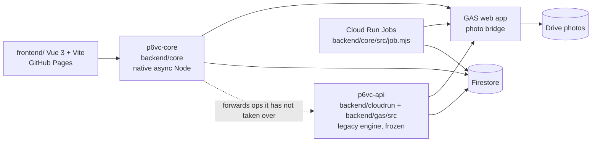

# P6 Vehicle Contact — Project Handover / Next AI

**Document ID:** P6VC-HANDOVER-001
**Last verified live:** 2026-11-28 (Asia/Bangkok) — backend 0.9.63 / FE 0.9.23. The core answers 24/64 operations; N4a direct browser route is live and publicly verified. R10 reference seed core job has a successful live DRY_RUN. A bridge-only GAS candidate is local only.
**Status:** current. Read [CURRENT_DELIVERY_STATUS.md](CURRENT_DELIVERY_STATUS.md) (what runs, last proof) with this page (how to work, next steps).

## 1. Ready-to-paste next-AI prompt

```text
You take over P6 Vehicle Contact (repo idev006/MT-Agency-Super-App-Framework, app apps/vehicle-contact) as senior engineer /
tech lead. Answer the owner in Thai, concisely; end every answer with a section "สิ่งที่ owner ต้องทำ".

Read first, in order: CLAUDE.md (repo root) → .mt-studio/project.yaml (commands, deploy order, proof gates, gotchas) →
apps/vehicle-contact/docs/CURRENT_DELIVERY_STATUS.md → PROJECT_HANDOVER.md (this) → ROADMAP.md → NODE_CORE_FINISH_PLAN.md →
the generated maps docs/generated/DATA_ACCESS_MAP.md + CHANGE_CHECKLIST.md → DECISION_LOG.md (VC-ADR-046..054).
Then verify the live state yourself: git fetch origin main; gh pr list; gh issue list --label status:in-progress; CI.

Where things stand: backend 0.9.63 is live and proven. The Node core (p6vc-core) answers 24 of 64 operations live and forwards the rest to
the frozen legacy engine (p6vc-api). The owner decided (VC-ADR-051) to move the whole backend to native async Node:
N1a and N4a complete → N1b → N2 → N3 → finish R10/R11 → N4 cut-over. R10 core job DRY_RUN is proven; R11 needs the owner's security decision. Each DEV item = small PRs → green CI →
deploy → proof → evidence in DECISION_LOG → ROADMAP + issue updated.

Hard rules (owner): VC-ADR-052's 2026-11-28 one-time DEV approval covers subsequent synthetic-DEV merges/deploys and clasp;
never merge with
red CI; never claim PASS without independent evidence (live suite through the core + DATA_PROOF fresher than the suite,
Firestore read-back); synthetic DEV data only; never read, print or commit secrets (SA key, pepper, tokens, passwords — env
var NAMES only); never create a new version of / lose secret p6vc-auth-pepper; permanent deletes need a dry run + the
owner's confirmation; deploy order: Firestore indexes before the backend; the unused Worker service is retired in N4; do not type passwords into the hosted web app (the owner checks screens); PDPA must not
block development (legal at go-live).
```

## 2. Document precedence

1. Code on `main` + the owner's explicit decisions (in chat; recorded in [DECISION_LOG.md](DECISION_LOG.md)).
2. Generated, CI-checked facts: [DATA_ACCESS_MAP](generated/DATA_ACCESS_MAP.md), [CHANGE_CHECKLIST](generated/CHANGE_CHECKLIST.md), `contracts/`, `schema/database.schema.json`, `.mt-studio/project.yaml`.
3. [CURRENT_DELIVERY_STATUS.md](CURRENT_DELIVERY_STATUS.md) (now) → [ROADMAP.md](ROADMAP.md) (order, status) → [NODE_CORE_FINISH_PLAN.md](NODE_CORE_FINISH_PLAN.md) (how).
4. Dated evidence / older plans (`*_20261121.md`, `HANDOFF_FIRESTORE_*`, `PROJECT_MANAGEMENT_PLAN_*` …): true only for their date. Sheets-era and GAS-runtime-era statements are superseded.

If two sources disagree, the higher one wins; fix the lower one in the same PR or say so to the owner.

## 3. How the code is laid out



| Path | What |
|---|---|
| `backend/core/src/facade/operations.mjs` | which ops the core answers: `FLOWS` (shared generator flows) + `USE_CASES` (native async) — an op in both refuses to start |
| `backend/core/src/use-cases/` | native async use cases (N1a+): `vehicle-list.mjs`, `settings.mjs`, `print-state.mjs` (QR print-state rule on the core store) |
| `backend/core/src/adapters/` | Firestore gRPC store + transactions, photo bridge client, node:crypto hasher, runtime monitor |
| `backend/core/tests/` | core tests; `support/core-harness.mjs` = the legacy acceptance harness with the core in front; `generated/` = async copies of legacy tests (do not edit) |
| `backend/core/scripts/gen-core-acceptance.mjs` | writes `tests/generated/` (list `FILES`); `--check` runs inside `npm test` (CI) |
| `backend/gas/src/` | legacy engine + shared code still used by the core: `domain/policies`, `application/flows`, pure rules exported from `application/use-cases/*` |
| `backend/gas/tests/` | ~900 legacy tests = the behaviour specification |
| `scripts/gen-system-maps.mjs` | the generated maps + ratchet (`--check` in CI) |
| `scripts/p6vc-deploy-backend.sh` | the deploy chain (refuses without `P6VC_OWNER_OK=MERGE_AND_DEPLOY`) |

Owner clarification 2026-11-28: use LSP to map code; the target backend is native async Node in `p6vc-core`, with Firestore for data and the GAS API for Google Drive photos, **without Cloudflare Worker**. FE 0.9.23 now calls the core directly; the Worker service is still deployed but unused by the browser and is retired in N4.

## 4. How to move an operation to the core (the N1a pattern)

1. Read the legacy use case and its tests; split its rules into **pure exported functions** in the legacy module (legacy tests must pass unchanged) — no copied rules.
2. Write the async use case in `backend/core/src/use-cases/` (independent reads in one `readMany` round; writes in one `writeMany` batch or `sequence` transaction). Register it in `USE_CASES`.
3. Add the legacy acceptance test file(s) to `FILES` in `gen-core-acceptance.mjs`, run `node scripts/gen-core-acceptance.mjs`; they now run through the core. A harness call inside a non-test callback is refused — restructure the test, don't hand-edit the copy.
4. Focused core tests (round counts, all-or-nothing, engine = core) in `tests/use-cases-*.test.mjs`. Tests that used a ported op as a "forwarded" example must switch to an op still on the legacy engine.
5. Bump the version in the 3 backend files (`.mt-studio/project.yaml` versioning), note in `expected-live-version.json`, DECISION_LOG entry "BUILT, not deployed", ROADMAP status; `node scripts/gen-system-maps.mjs`.
6. Checks: core `npm test`, legacy `npm run check`, frontend `npx vitest run`, `node scripts/gen-system-maps.mjs --check`, `node scripts/validate-ssot.mjs`, `node scripts/validate-usecase-ssot.mjs`.
7. PR → CI green → DEV merge/deploy under VC-ADR-052's existing owner approval → section 5.

## 5. Deploy and prove (DEV approval recorded in VC-ADR-052)

```bash
git checkout main && git fetch origin main && git merge --ff-only FETCH_HEAD
P6VC_OWNER_OK=MERGE_AND_DEPLOY scripts/p6vc-deploy-backend.sh <short sha> "<desc>" [--indexes]   # run in background, ~15–20 min
# proof (from apps/vehicle-contact/backend/gas; ~2–10 min):
CORE=https://p6vc-core-46858005337.asia-southeast3.run.app
P6VC_API_BASE_URL=$CORE P6VC_GAS_EXEC_URL=$CORE P6VC_ALLOW_FIRESTORE_DEV_PROBE=RUN_SYNTHETIC_FIRESTORE_PROBE \
  node scripts/run-live-api-suite.mjs --require-authenticated --require-data-proof
```
PASS only when: `LIVE_SUITE status PASS 126/126`, `LIVE_SUITE_TARGET` = the core, DATA_PROOF `startedAt` later than the
AUTHENTICATED_FULL_INVENTORY `finishedAt` (`test-results/p6vc-live-api-suite.json`, `p6vc-firestore-readback-proof.json`),
`/` shows the new version, and the moved ops answer `x-p6vc-answered-by: core`. Then: DECISION_LOG "DEPLOYED, PROVEN" with
the numbers, ROADMAP, a comment on the issue — in a small docs PR (merge needs the owner's OK too).
Other proofs: dual call `backend/core/scripts/ported-compare-live.mjs`, load `backend/core/scripts/load-test.mjs`
(gates in `.mt-studio/project.yaml`; owner bar: 100 simultaneous logins, 0 errors).
Rollback: remove the op from `USE_CASES` / `FLOWS` and redeploy the core (the legacy engine answers again); Cloud Run
`rollback-vehicle-cloudrun.yml`; GAS `clasp update-deployment <id> -V <previous>`.

## 6. Next actions

1. **G1 #329** — review [GAS_BRIDGE_REDUCTION_PLAN.md](GAS_BRIDGE_REDUCTION_PLAN.md): a local one-file bridge candidate is tested, but the remote 60-file GAS project remains until R10/R11 editor jobs, old trigger and proof-chain dependencies are resolved. Remote source removal requires a reviewed dry run and separate owner confirmation.
2. **N1b #312** — PRs 1–2 (`qr.history`, `vehicles.listMine`) are proven on 0.9.61–0.9.62. Move the remaining vehicles, QR, change requests and registration review to native async Node in small PRs. Fix approval's whole-table vehicle read using plate + province.
3. N2 (#313), N3 (#314), finish R10 recovery gate (#303), R11 (#304, owner security review), N4 (#255).
4. Photos R03 (#296), R04 (#297, dry run first). Go-live R14 / R16 / R17 are owner decisions.

## 7. Working notes (things that bit before)

- Git Bash heredocs eat backslashes: write files with the Write/Edit tools or python (`chr(92)`), not `cat <<EOF` for code.
- Do not `git stash` while a background test run is going; long commands → background + wait for the notification.
- The local `.env` points `P6VC_GAS_EXEC_URL` at GAS `/exec`: set BOTH target vars to the core for the live suite.
- Generated maps must be regenerated after any change that moves a table access, an operation or a count; a test literal like `x.length, 64` is picked up as an operation count — avoid it.
- Squash merges: `git branch --merged` does not show merged branches; use the PR state (`gh pr list --state all --head <branch>`).
- `.claude/launch.json` has the frontend preview servers (`p6vc-frontend` :5173, `p6vc-frontend-preview` :5174).

## 8. Safety rules (summary — the owner's rules in section 1 win)

Synthetic DEV data only · secrets never read, printed or committed (names only) · VC-ADR-052 covers DEV merges/deploys/clasp
without repeated requests, but permanent deletes and `system.reset.execute` are outside its scope · no PASS without independent evidence · the system reset stays off
outside its test · real-data go-live is blocked until R16 and legal sign-off.
