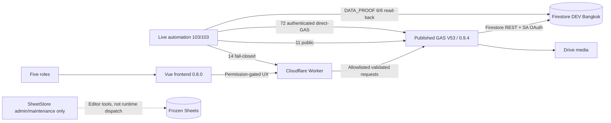
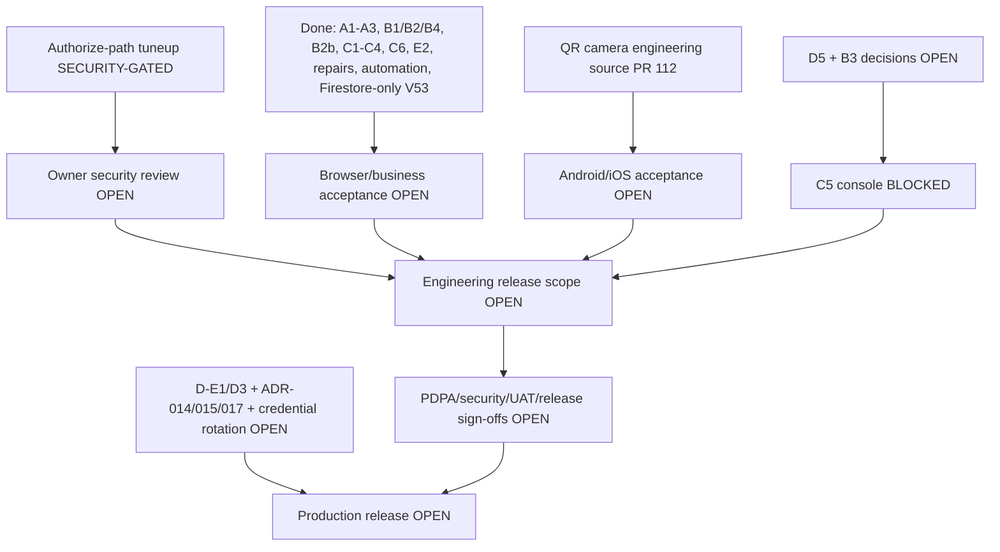

# P6 Vehicle Contact — Project Handover / Next AI

**Document ID:** P6VC-HANDOVER-001
**Last verified:** 2026-11-23 Asia/Bangkok (**V53 / 0.9.4 Firestore-only — Slice G+F deployed + G6 re-verify GREEN 103/103**)
**Runtime baseline:** PR **#148** merged `main` @ **`ed79bb5`** (Slice G, VC-ADR-026; includes Slice F #147) · live source **`78d3064`** · docs **`84fefbb`** (backend 0.9.4)
**Historical baselines (superseded):** V52/0.9.3 PR **#139** @ `0cc74ba` (Firestore SoR + Sheets warm shadow) · handoff PR **#111** @ `ad7630e` · source/content PR **#110** @ `bf3553d`
**Purpose:** concise continuation brief. Start with [CURRENT_DELIVERY_STATUS.md](CURRENT_DELIVERY_STATUS.md); this handover supplies precedence, safety, exact next actions and a ready-to-paste prompt.

## 1. Ready-to-paste next-AI prompt

```text
Take over P6 Vehicle Contact in idev006/MT-Agency-Super-App-Framework. Read apps/vehicle-contact/docs/CURRENT_DELIVERY_STATUS.md first, then PROJECT_MANAGEMENT_PLAN_20261121.md and PRODUCTION_READINESS_PLAN_20261121.md. Latest verified baseline: runtime PR #148 merged main ed79bb5 (Slice G, VC-ADR-026), live source 78d3064, docs 84fefbb (backend 0.9.4); but inspect current git status, fetch and verify the remote main SHA, and inspect Issues and CI before changing anything. QR camera engineering source is delivered in PR #112 from d92e08c; physical Android/iOS acceptance remains open.

Verified snapshot (2026-11-23): live GAS Web App V53 backend 0.9.4 = FIRESTORE-ONLY runtime (persistence{engine:firestore,dualWrite:false}); the Sheets runtime data path is RETIRED (VC-ADR-026) — SheetStore is kept only for admin/maintenance tools (BootstrapAdmin, AdminPasswordReset, StagingAcceptanceProbe) and schema/seed/repair utilities; frozen Sheet DATA is kept, NOT deleted. Frontend 0.8.0; Worker version 20180237-7441-481a-9540-e7ca2c9c79eb; offline GAS check 215/215 PASS. G6 verify-live-publish chain GREEN 103/103 = 11 public direct-GAS + 14 Worker fail-closed + 72 authenticated direct-GAS (56/56 ops, all five roles, cleanup 7/7) + DATA_PROOF 6/6 independent Firestore read-back (plate TST26897003, divergenceOpen 0). Do not describe the authenticated stage as all-through-Worker. Latency p50 8.6 s / p95 18.5 s / max 36.9 s, p95 -17.2% vs the Firestore-only baseline, budget OK. HONEST: the first post-publish verify run FAILED 22/72 on a transient registrations.review 40 s abort cascade (cold-start variance, NOT a regression — F/G do not touch the review path); the clean re-run passed 103/103. Historical: V48/0.9.1, V50/0.9.2, V51 first-suite latency failure, V52/0.9.3 dual-write cutover + monitoring window are superseded, retained in dated evidence.

Completed engineering slices: A1-A3, B1/B2/B4, B2b durable journaling (published, carried in V50+), C1-C4, C6, E2, display repair, live automation, QR camera source recovery (PR #112 / d92e08c; focused QR/resolve 16/16, Frontend 192/192), Firestore F1-F4 + Phase 3 cutover, dual-write monitoring window early-exit + clear (Firestore-only), Slice A test-automation tooling (G1+G2+G6: DATA_PROOF stage + latency guard + verify-live-publish chain), Slice F (lookup-audit round-trip fix) + Slice G (Firestore-only runtime dispatch) DEPLOYED + LIVE-VERIFIED on V53/0.9.4. Physical Android/iOS QR acceptance remains OPEN. Next engineering step: the authorize-path round-trip TUNEUP (SessionService.authorize ~6 round-trips/API is the dominant detail-page cost; session/permission caching + last_seen write masking) — this touches auth/revocation and is SECURITY-GATED, requiring owner review before implementation; it is NOT self-approvable. Then test-plan Slices B-E (VC-ADR-024): B nightly public-smoke cron 02:00 Bangkok, C live concurrency/idempotency, D FE axe-core a11y, E live RBAC negative sample + gated residue prune. C5 RETENTION_WORKER console is BLOCKED on human D5+B3 decisions and is not in progress; do not implement or enable destructive retention while blocked.

Keep PDPA/security/UAT/release, browser/business/device acceptance, D-E1/D3/D5/B3, VC-ADR-014/015/017 and credential rotation OPEN unless a named human supplies actual approval evidence. Real-data go-live (#55) stays BLOCKED (named legal-counsel + DPO sign-off; owner fiat is intent, not legal approval). Optional protected GitHub P6VC_TEST_USERNAME/P6VC_TEST_PASSWORD secrets are only for future manual full-suite runs, not a blocker for the completed local run.

Follow all runbooks and scope your changes to the requested slice. Never expose endpoints, credentials, tokens or PII. NEVER take_snapshot on the GAS editor Script Properties page (it leaks secret values); evaluate_script may read property NAMES only. The GitHub Actions GAS source-push workflow requires the exact per-push owner phrase PUSH_VEHICLE_GAS (prior phrase does not carry over); a separately owner-authorized assistant clasp self-deploy path may be used within its approved scope. Source push/version creation is separate from Web App publication. Any GAS/FE runtime source change voids live evidence and requires a full G6 re-verify; tooling-only changes (scripts/, tests/, workflows/) do not. Keep source, deployment, live test transport, human acceptance and production approval distinct in every report.
```

## 2. Document precedence and conflict handling

Use each authority for its own concern; do not let an old narrative override newer verified evidence.

1. **Current canonical code, explicit owner decisions and named approvals** govern implementation and authorization now. Fetch and verify the remote `main` SHA, then inspect Issues and CI before work.
2. **[CURRENT_DELIVERY_STATUS.md](CURRENT_DELIVERY_STATUS.md)** is the current verified runtime/evidence snapshot and resume point.
3. **[PROJECT_MANAGEMENT_PLAN_20261121.md](PROJECT_MANAGEMENT_PLAN_20261121.md)** owns slice state/dependencies; **[PRODUCTION_READINESS_PLAN_20261121.md](PRODUCTION_READINESS_PLAN_20261121.md)** owns release gates.
4. **Approved requirements, blueprints, canonical schema and [DECISION_LOG.md](DECISION_LOG.md)** govern business/architecture policy. An implemented engineering decision is not automatically a ratified security/PDPA decision.
5. **Dated evidence and runbooks** prove only their recorded date, source, deployment and test scope. Current counts supersede old counts for the current board without erasing history.
6. **This handover and [app README](../README.md)** are navigation aids, not competing requirements or deployment evidence.

If sources conflict, record the conflict and request the required human decision; do not silently change business policy, schema or permissions. GitHub source is canonical; generated `.gs`, `_site/` and deployed artifacts are not parallel source trees.

## 3. Current snapshot

| Area | Verified state |
|---|---|
| Runtime | GAS Web App **V53 / `backendVersion` 0.9.4** = **Firestore-only runtime** (`persistence{engine:firestore,dualWrite:false}`, health-verified); Sheets runtime dispatch **RETIRED** (VC-ADR-026), `SheetStore` kept for admin/maintenance only; Frontend **0.8.0**; Worker **`20180237-7441-481a-9540-e7ca2c9c79eb`**. |
| Inventory | **56 operations**, **25 logical tables** (Firestore collections; Sheets schema retained for maintenance), five roles. |
| Offline/live | Offline GAS check **215/215**; G6 chain **103/103**, **56/56**, cleanup 7/7, DATA_PROOF 6/6. Authenticated 72 cases are direct-GAS; Worker has separate 14-case live fail-closed proof. |
| Firestore cutover | **DONE + Firestore-only (synthetic DEV):** Phase 3 GREEN → monitoring window early-exit → dual-write cleared → **Slice G+F deployed V53/0.9.4 + G6 re-verify GREEN 103/103** (DATA_PROOF 6/6, plate `TST26897003`, `divergenceOpen=0`, latency p95 −17.2% budget OK). Production/real-data cutover BLOCKED (#55). |
| DEV data | 11 retired logically, 10 new ACTIVE, each 1 contact/5 photos/QR MATCH; cleanup 2/2. Frozen Sheet DATA kept (not deleted). |
| Sheets audit | Historical 25/25 seed audit + post-suite dual-store audit (2,464/2,464) retained as dated evidence; current data proof = independent Firestore read-back (DATA_PROOF stage), Sheets no longer the runtime SoR. |
| Publication nuance | Live V53 was created by CI (owner `PUSH_VEHICLE_GAS`, run 45144571780) and published by owner-authorized clasp `update-deployment -V 53`; CI never publishes. Rollback is now **version-based** (redeploy prior GAS deployment + Firestore backups) — the engine-flip-to-Sheets rollback is retired (shadow stale post-flip). |
| Release | **Not production-ready. All human sign-offs are OPEN.** |

Primary evidence: [live automation/reset/audit](LIVE_API_AUTOMATION.md), [C6 registry](C6_ADMIN_VEHICLE_REGISTRY_EVIDENCE_20261121.md), [E2 authorization](E2_WORKER_FAILCLOSED_EVIDENCE_20261121.md), [Sheets repair/runbook](GAS_NUMBERFORMAT_DISPLAY_CORRUPTION_INCIDENT_20261121.md), [E1 design](E1_INDEXED_DATASTORE_MIGRATION_DESIGN_20261121.md), and [E3 dossier](E3_PRODUCTION_SIGNOFF_DOSSIER_20261121.md).

## 4. Runtime handoff diagram

No endpoint, credential or session value is needed to understand the flow.



GAS remains the authorization authority; frontend permissions are navigation/UX only. The runtime data path is Firestore-only (VC-ADR-026); `SheetStore` survives only for admin/maintenance editor tools, not HTTP dispatch. The diagram does not imply that all authenticated automation passed through the Worker.

## 5. Work and gate state diagram



## 6. Exact next actions

1. **Reconcile before editing:** inspect current branch/status, fetch and verify the remote `main` SHA, then inspect the relevant Issue and checks. Treat the snapshot above as last-verified, not a substitute for current inspection.
2. **QR path:** engineering source is delivered in PR #112; obtain named-human physical Android/iOS acceptance after reviewed Pages publication and keep it separate from offline evidence.
3. **Firestore-only path — DONE** (Phase 3 GREEN → monitoring window early-exit → dual-write cleared → Slice G+F deployed V53/0.9.4 + G6 re-verify GREEN 103/103; B2b durable journaling published V49→V50). Next engineering item: **authorize-path round-trip tuneup** (`SessionService.authorize` ≈6 round-trips/API; session/permission caching + `last_seen` write masking) — **SECURITY-GATED, owner review required before implementation, NOT self-approvable**. Then test-plan **Slices B–E** (VC-ADR-024): B nightly public-smoke cron 02:00 Bangkok · C live concurrency/idempotency · D FE axe-core a11y · E live RBAC negative sample + gated residue prune (`PRUNE_SYNTHETIC_SUITE_RESIDUE`). Rollback is now **version-based** (redeploy prior GAS deployment + Firestore backups); the engine-flip-to-Sheets rollback is retired. Update the [rollback runbook](FIRESTORE_CUTOVER_ROLLBACK_RUNBOOK.md) + evidence when any runtime source changes (a runtime change voids live evidence → full G6 re-verify).
4. **C5:** leave **BLOCKED** until D5+B3 are explicitly ratified. Only then build the permission-gated console and perform synthetic two-person/`legal_hold` rehearsal; never enable real-data destructive retention.
5. **Acceptance:** arrange named-human browser/business review of gallery/copy, C1–C4 and C6 plus QR device review. API automation is not UAT.
6. **Release:** resolve D-E1/D3/D5/B3 and VC-ADR-014/015/017 as applicable, rotate credentials, complete PDPA/security/UAT review, then follow the [release sequence](PRODUCTION_READINESS_PLAN_20261121.md#4-release-sequence--no-date-commitment). Final release approval remains OPEN.

## 7. QR recovery outcome

The protected stash was verified and recovered onto freshly fetched remote `main` @ `ad7630e`. Historical package conflicts were resolved by retaining Frontend **0.8.0** and the exact `html5-qrcode 2.3.8` pin. Recovered source was committed at `d92e08c` and pushed in PR **#112**; focused QR/resolve tests pass 16/16, direct adapter cleanup is covered, Frontend passes 192/192, and build/audit pass. See [QR camera recovery evidence](QR_CAMERA_RECOVERY_EVIDENCE_20261122.md).

Do not reapply the historical stash over this delivery. Physical Android/iOS camera acceptance remains OPEN.

## 8. Safety rules

- Keep endpoints, credentials, session tokens, raw responses with PII and secret-bearing logs out of chat, commits, Issues and evidence.
- Obtain authorization before live mutation. Live automation is synthetic DEV only under its exact write guard; cleanup failures fail the run.
- The GitHub Actions GAS source-push workflow requires exact per-push **`PUSH_VEHICLE_GAS`**. A separately owner-authorized assistant `clasp` self-deploy path may be used within its approved scope; both require authorization and evidence.
- Record source push, GAS source-version creation, Web App publication, Worker deployment and Pages deployment separately; verify health/behavior after publication.
- No unapproved schema migration, production catalog `ENFORCED` mode, destructive retention or production release.
- Preserve least privilege, server-side identity/ownership, bounded Sheets reads, no cross-sheet joins and fail-closed DTO/Worker behavior.
- Never self-approve PDPA/security/UAT/release, ADRs, business scope or device acceptance. Never relabel blocked C5 as in progress.
- Optional GitHub protected test secrets are for future manual runs only; their absence does not invalidate the completed local evidence.

## 9. Essential source and runbook map

- [Code map](CODE_MAP_20261121.md) · [56-operation use-case SSOT](use-cases/README.md) · [canonical 25-Sheet schema](../schema/database.schema.json)
- [Live API automation](LIVE_API_AUTOMATION.md) · [GAS deployment](GAS_GITHUB_ACTIONS_DEPLOYMENT.md) · [Web App manifest incident](GAS_CLASP_WEBAPP_MANIFEST_INCIDENT_20261121.md)
- [Operation journal recovery](OPERATION_JOURNAL_RECOVERY_RUNBOOK_20261121.md) · [Sheets display repair](GAS_NUMBERFORMAT_DISPLAY_CORRUPTION_INCIDENT_20261121.md)
- [A2/A3 historical live evidence](LIVE_DEV_E2E_EVIDENCE_20261121.md) · [B2 journal evidence](BACKEND_JOURNAL_RECOVERY_EVIDENCE_20261121.md)
- [Agile Kanban](AGILE_KANBAN.md) · [requirements traceability](REQUIREMENTS_TRACEABILITY.md)

Report each next slice with exact PR/SHA, tests and transport, component/deployment versions, evidence link, residual blocker and named approver where applicable.
