# P6 Vehicle Contact — System Map (แผนที่ระบบ)

**Document ID:** P6VC-SYSTEM-MAP-001 | **Date:** 2026-11-26 (Asia/Bangkok) | **Source baseline:** `main` @ `f128a78` (PR #225) | **Backend:** `0.9.34` | **Frontend:** `0.9.16` | **API ops:** 63
**Status:** CURRENT MAP — สร้างจาก source code โดยตรง (อ่านโค้ด ไม่เดา). ใช้แทนส่วนภาพรวมของ [CODE_MAP_20261121.md](CODE_MAP_20261121.md) (ค้างที่ BE 0.9.3 / FE 0.8.0). เป็นเครื่องมือนำทาง ไม่ใช่การอนุมัติ release/security
**Related:** layer rules → [ARCHITECTURE_SSOT.md](ARCHITECTURE_SSOT.md) · ER/fields → [DATA_MODEL_ER_DIAGRAM_20261122.md](DATA_MODEL_ER_DIAGRAM_20261122.md) · sequence ต่อ use case → [use-cases/](use-cases/README.md) · config names → [SCRIPT_PROPERTIES.md](SCRIPT_PROPERTIES.md) · ADR → [DECISION_LOG.md](DECISION_LOG.md)

> **กฎความลับ:** เอกสารนี้มีเฉพาะ **ชื่อ** ของ secret / env / variable เท่านั้น ห้ามใส่ค่าจริง (pepper, bridge secret, clasp auth, password, token, URL ที่เป็นความลับ)
>
> **วิธีรักษาให้สด:** เมื่อเพิ่ม/ลบ API op, route, collection หรือ workflow ให้แก้ส่วนที่เกี่ยวข้องในไฟล์นี้ใน PR เดียวกัน (ดู §8 "จะแก้ X ต้องแตะไฟล์ไหน"). ตัวเลขที่ต้องตรงกับโค้ด: 63 ops ใน inventory, 62 handlers ใน `OperationController` (ไม่นับ `system.health`)

---

## สารบัญ

1. [ภาพรวมบริบท (C4 Level 1)](#1-ภาพรวมบริบท-c4-level-1)
2. [Container และการ deploy](#2-container-และการ-deploy)
3. [แผนที่ Backend (layers + ops)](#3-แผนที่-backend-layers--ops)
4. [แผนที่ Frontend (route → page → feature → repository → op)](#4-แผนที่-frontend)
5. [Workflow หลัก (flowcharts)](#5-workflow-หลัก)
6. [State diagrams](#6-state-diagrams)
7. [Data map (collection ↔ ops)](#7-data-map)
8. [จะแก้ X ต้องแตะไฟล์ไหน](#8-จะแก้-x-ต้องแตะไฟล์ไหน)

---

## 1. ภาพรวมบริบท (C4 Level 1)

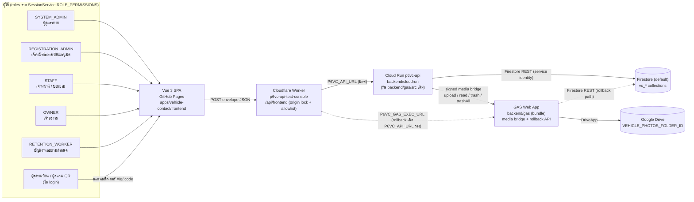

**อ่านจากโค้ด:**

| องค์ประกอบ | ไฟล์ต้นทาง | หมายเหตุ |
|---|---|---|
| Worker เลือก upstream | [`tools/p6vc-api-test-console/worker.mjs`](../../../tools/p6vc-api-test-console/worker.mjs) `upstream(env)` | ถ้า `P6VC_API_URL` ตั้งค่า → ใช้ Cloud Run (ต้องตรง `TRUSTED_CLOUD_RUN_URL`); ไม่งั้นใช้ `P6VC_GAS_EXEC_URL` (ต้องตรง `TRUSTED_GAS_URL`) = **ทาง rollback** |
| Worker ตรวจคำขอ | `worker.mjs` `FRONTEND_PAYLOAD_FIELDS`, `FRONTEND_PUBLIC_OPERATIONS`, `allowedFrontendOrigin` | origin ต้องอยู่ใน `FRONTEND_ALLOWED_ORIGINS`; op + field ต้องอยู่ใน allowlist; public op ห้ามมี `sessionToken` |
| Cloud Run | [`backend/cloudrun/runtime.mjs`](../backend/cloudrun/runtime.mjs) | ใช้ `createApplication` จาก `backend/gas/src/composition/Container.js` ตัวเดียวกับ GAS; แปลง env → Script Properties; ไม่มี session cache ข้าม instance (VC-ADR-030/033) |
| Media bridge | [`backend/cloudrun/media-bridge-client.mjs`](../backend/cloudrun/media-bridge-client.mjs) ↔ [`MediaBridgeServer.js`](../backend/gas/src/infrastructure/media/MediaBridgeServer.js) | HMAC signed (`MediaBridgeSignature.js`), รูปอยู่ใน Drive ของเจ้าของ (VC-ADR-034) |
| GAS entry | [`entrypoints/WebApp.js`](../backend/gas/src/entrypoints/WebApp.js) | `doPost`: media bridge request → `MediaBridgeServer`; อื่น ๆ → `createApplication().dispatch`. ฟังก์ชัน `*FromEditor` = เครื่องมือ admin รันใน Editor เท่านั้น ไม่ผ่าน HTTP |
| ผู้ลงทะเบียนสาธารณะ | `frontend/src/router/index.js` `/register` | ปัจจุบัน redirect ไป `registration-intake` (ต้อง login + `vehicle.registration.approve`) ตาม VC-ADR-031; API `campaigns.validate` / `photos.upload` / `registrations.submit` เป็น public op พร้อมรองรับหน้าสาธารณะในอนาคต |
| ผู้สแกน QR ไม่ login | `QrStickerLandingPage.vue` (`/q/:code`) | หน้า public ไม่เรียก API; ถ้า login แล้ว → ไป `QrResolvePage` ซึ่งเรียก `qr.resolve` (VC-ADR-032) |

**สิทธิ์ของแต่ละ role** ([`SessionService.js`](../backend/gas/src/application/security/SessionService.js)):

| Role | Permissions |
|---|---|
| SYSTEM_ADMIN | session.authenticated, system.settings.read/manage, system.reset, users.manage, organizations.read/manage, campaigns.manage, qr.manage, retention.read, retention.delete.approve, audit.read, vehicle.list, vehicle.lookup, vehicle.contact.read, vehicle.photos.read, vehicle.history.read (**ไม่มี** registration approve — VC-ADR-036) |
| REGISTRATION_ADMIN | session.authenticated, organizations.read, vehicle.registration.approve, vehicle.lookup, vehicle.list, vehicle.contact.read, vehicle.photos.read, vehicle.update, vehicle.history.read, vehicle.change.approve, qr.manage, retention.read |
| STAFF | session.authenticated, organizations.read, vehicle.lookup, vehicle.contact.read, vehicle.photos.read, vehicle.history.read |
| OWNER | session.authenticated, vehicle.change.submit, vehicle.own.read |
| RETENTION_WORKER | session.authenticated, retention.worker |

---

## 2. Container และการ deploy

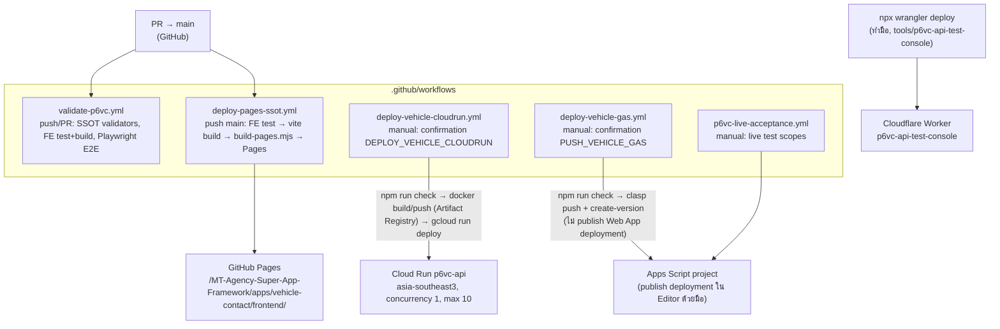

**ชื่อ secret / env / variable (ชื่ออย่างเดียว ไม่มีค่า):**

| ที่ | ชื่อ | ใช้ทำอะไร |
|---|---|---|
| GitHub repo variables | `GCP_WIF_PROVIDER`, `GCP_DEPLOYER_SA`, `P6VC_SYSTEM_RESET` | keyless auth ไป GCP; เปิด/ปิด system reset บน Cloud Run (default ปิด) |
| GitHub secrets | `P6VC_CLASPRC_JSON` | clasp auth สำหรับ GAS deploy |
| GitHub secrets (live acceptance) | `P6VC_TEST_USERNAME`, `P6VC_TEST_PASSWORD`, `P6VC_HTTP_LOGIN_PASSWORD` | บัญชีทดสอบ live |
| Workflow env (Cloud Run, ไม่ลับ) | `PROJECT_ID`, `REGION`, `SERVICE`, `REPOSITORY`, `RUNTIME_SA`, `MEDIA_BRIDGE_URL` | ปลายทาง deploy |
| Cloud Run env | `FIRESTORE_PROJECT_ID`, `FIRESTORE_DATABASE_ID` (`(default)`), `RUNTIME_SA_EMAIL`, `MEDIA_BRIDGE_URL`, `P6VC_SYSTEM_RESET`, `PORT` | อ่านใน `runtime.mjs` / `server.mjs` |
| Cloud Run secrets (Secret Manager) | `P6VC_AUTH_PEPPER` ← `p6vc-auth-pepper`, `P6VC_MEDIA_BRIDGE_SECRET` ← `p6vc-media-bridge-secret` | password pepper; HMAC ของ media bridge |
| GAS Script Properties | ดู [SCRIPT_PROPERTIES.md](SCRIPT_PROPERTIES.md) (เช่น `VEHICLE_API_ENABLED`, `VEHICLE_PHOTOS_FOLDER_ID`, `VEHICLE_RETENTION_EXECUTE_ENABLED`, `VEHICLE_SYSTEM_RESET_ENABLED`, `VEHICLE_FIRESTORE_*`, `VEHICLE_AUTH_PEPPER`) | config ของ GAS runtime |
| Worker vars (`wrangler.toml`) | `FRONTEND_ALLOWED_ORIGINS`, `P6VC_GAS_EXEC_URL`, `P6VC_API_URL`, `TEST_LOGIN_USERNAME` | origin lock + upstream |
| Worker secrets / bindings | `BRIDGE_ACCESS_KEY`, `TEST_LOGIN_PASSWORD`, `TEST_JOB_STORE`, `TEST_JOB_TTL_SECONDS` | เฉพาะ test console (`/api/run-tests`, `/api/jobs`) ไม่ใช่ทางของ SPA |
| Frontend build env | `VITE_WORKER_API_URL`, `VITE_BASE_PATH` (`VITE_UI_PREVIEW` dev เท่านั้น) | ตั้งใน workflow Pages / validate |

---

## 3. แผนที่ Backend (layers + ops)

### 3.1 Layer และทิศทาง dependency

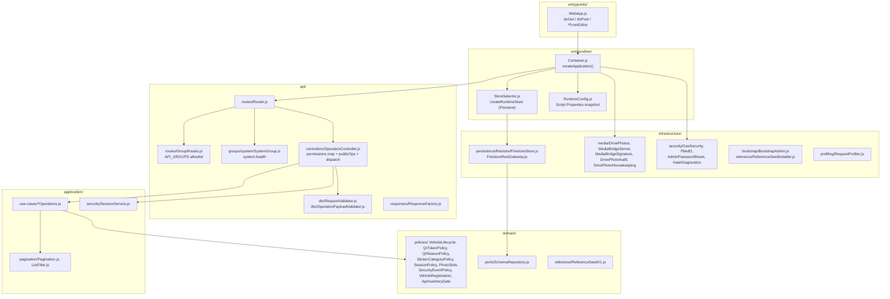

**ลำดับต่อหนึ่งคำขอ** (`Router.dispatch` → `OperationController.dispatch`):
`validateApiRequest` → `isDeclaredRoute` (GroupRoutes) → `system.health` ตอบทันที / อื่น ๆ ต้อง `POST` → `createProtectedDispatcher` (ต้อง `VEHICLE_API_ENABLED=true`) → handler มีจริง? → `validateOperationPayload` → `sessions.authorize(token, permission)` (ยกเว้น public ops) → handler → `apiSuccess` / `apiFailure` (แปลง error ให้อยู่ใน `safeErrors`)

Public ops (ไม่ต้อง session): `system.health`, `auth.login`, `auth.googleLogin`, `campaigns.validate`, `registrations.submit`, `photos.upload`

### 3.2 Use-case module ไหนเป็นเจ้าของ op ไหน

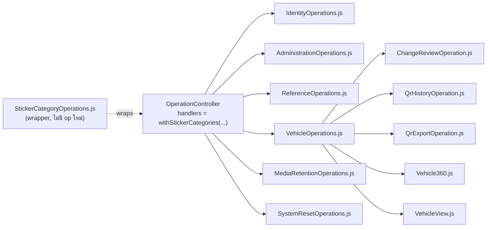

| Module | Ops (group.action) | Permission (จาก `OperationController.permissions`) |
|---|---|---|
| `api/groups/system/SystemGroup.js` (ผ่าน Router) | `system.health` | public |
| [`IdentityOperations.js`](../backend/gas/src/application/use-cases/IdentityOperations.js) | `auth.login`, `auth.googleLogin`, `auth.changePassword`, `auth.logout`, `auth.session`, `auth.linkGoogle`; `users.create`, `users.list`, `users.update`, `users.suspend`, `users.reactivate`, `users.resetPassword`, `users.assignRoles` | auth.login/googleLogin public; auth.* อื่น `session.authenticated`; users.* `users.manage` |
| [`AdministrationOperations.js`](../backend/gas/src/application/use-cases/AdministrationOperations.js) | `system.config.get`, `system.config.update`; `organizations.list/create/update/disable/enable`; `campaigns.create/list/validate/revoke` | `system.settings.read/manage`; `organizations.read/manage`; `campaigns.manage` (validate = public) |
| [`ReferenceOperations.js`](../backend/gas/src/application/use-cases/ReferenceOperations.js) | `references.registration` | `vehicle.registration.approve` |
| [`VehicleOperations.js`](../backend/gas/src/application/use-cases/VehicleOperations.js) | `registrations.submit/listPending/detail/review`; `vehicles.lookup/detail/update/cancel/history/listMine/list`; `contacts.read/update`; `changes.submit/listPending/review/listMine`; `qr.resolve/issue/revoke/replace/history/export` | submit public; registrations `vehicle.registration.approve`; vehicles `vehicle.lookup`/`vehicle.update`/`vehicle.history.read`/`vehicle.own.read`/`vehicle.list`; changes `vehicle.change.submit`/`vehicle.change.approve`; `qr.resolve`=`vehicle.lookup`, qr อื่น `qr.manage` |
| ↳ `ChangeReviewOperation.js` | `changes.review` (OCC, retry ≤4 → `BUSY`) | `vehicle.change.approve` |
| ↳ `QrHistoryOperation.js` / `QrExportOperation.js` | `qr.history` / `qr.export` (≤100 ids, audit `QR_EXPORTED`) | `qr.manage` |
| ↳ `Vehicle360.js`, `VehicleView.js` | ข้อมูลประกอบ `vehicles.detail` / `vehicles.lookup` (contacts, photos, history, labels, lookup audit) | — |
| [`MediaRetentionOperations.js`](../backend/gas/src/application/use-cases/MediaRetentionOperations.js) | `photos.upload/list/replace`; `registrations.photo`; `vehicles.photo`; `retention.listDue/listExecutable/approve/execute/jobStatus`; `audit.query/export` | upload public; `vehicle.photos.read` / `vehicle.update`; `vehicle.registration.approve`; `retention.read` / `retention.worker` / `retention.delete.approve`; `audit.read` |
| [`SystemResetOperations.js`](../backend/gas/src/application/use-cases/SystemResetOperations.js) | `system.reset.preview`, `system.reset.execute` (VC-ADR-039; ปิดอยู่ถ้า `VEHICLE_SYSTEM_RESET_ENABLED`≠true) | `system.reset` |
| [`StickerCategoryOperations.js`](../backend/gas/src/application/use-cases/StickerCategoryOperations.js) (wrapper) | ห่อ `system.config.get/update`, `campaigns.validate`, `references.registration`, `registrations.submit/detail/review`, `vehicles.update/list/listMine/detail`, `qr.export` | ตาม op ที่ห่อ |

---

## 4. แผนที่ Frontend

ทุก repository ถูกสร้างและ `provide()` ใน [`App.vue`](../frontend/src/App.vue): protected repos ใช้ `session.callProtected`, intake ใช้ `session.callPublic`. Transport = [`infrastructure/api/gas-api-client.js`](../frontend/src/infrastructure/api/gas-api-client.js) → `VITE_WORKER_API_URL`. `auth.login/session/logout` + `system.health` เรียกใน [`stores/session.js`](../frontend/src/stores/session.js). Guard ใน [`router/index.js`](../frontend/src/router/index.js): ต้อง login → `restoreSession` → บังคับเปลี่ยนรหัสถ้า `mustChangePassword` → ตรวจ `meta.requiredPermissions`.

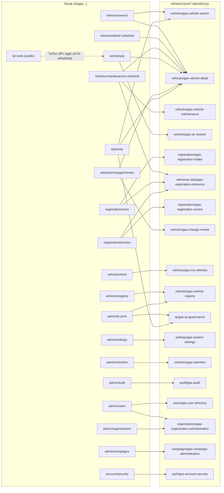

| Route name → path | Page | Feature composable / components หลัก | Repository → API ops | requiredPermissions |
|---|---|---|---|---|
| `dashboard` → `/app/dashboard` | `views/DashboardView.vue` | `usePendingWork`, `RoleMenuGrid`, `PendingWorkPanel` | (ผ่าน repos อื่น เพื่อนับงานค้าง) | — |
| `vehicle-search` → `vehicles/search` | `VehicleSearchPage` | `useVehicleSearch`, `VehicleSearchForm`, `VehicleSearchResult` | vehicle-search: `vehicles.lookup`, `vehicles.history`; vehicle-detail | `vehicle.lookup` |
| `vehicle-detail` → `vehicles/detail/:vehicleId` | `VehicleDetailPage` | `VehicleDetailPanel`, `VehicleDetailTabs`, `useVehicleDetail` | vehicle-detail: `vehicles.detail`, `vehicles.history`, `vehicles.photo` | `vehicle.lookup` |
| `vehicle-maintenance` → `vehicles/maintenance/:vehicleId` | `VehicleMaintenancePage` | `useVehicleMaintenance` | vehicle-maintenance: `vehicles.update`, `vehicles.cancel`, `contacts.update`, `photos.replace` | `vehicle.update` |
| `qr-resolve` → `vehicles/qr` | `QrResolvePage` | `useQrResolve`, `QrScannerPanel`/`useQrScanner` (html5-qrcode adapter) | qr-resolve: `qr.resolve`, `vehicles.history` | `vehicle.lookup` |
| `registration-intake` → `registrations/new` (`/register?c=` redirect มา) | `RegistrationIntakePage` | `useRegistrationIntake`, `SearchableReferenceCombobox`, brand/color fields, `image-compress` | intake (public): `campaigns.validate`, `photos.upload`, `registrations.submit`; references: `references.registration` | `vehicle.registration.approve` |
| `registration-review` → `registrations/review` | `RegistrationReviewPage` | `useRegistrationReview`, `VehicleQrImage` | review: `registrations.listPending`, `registrations.detail`, `registrations.photo`, `registrations.review` | `vehicle.registration.approve` |
| `change-review` → `vehicles/changes/review` | `ChangeReviewPage` | `useChangeReview` | change-review: `changes.listPending`, `changes.review` | `vehicle.change.approve` |
| `my-vehicles` → `vehicles/mine` | `MyVehiclesPage` | `useMyVehicles` | my-vehicles: `vehicles.listMine`, `changes.submit`, `changes.listMine` | `vehicle.change.submit` |
| `vehicle-registry` → `vehicles/registry` | `VehicleRegistryPage` | `useVehicleRegistry`, `VehicleDetailPanel` | registry: `vehicles.list` | `vehicle.list` |
| `qr-print` → `admin/qr-print` | `QrPrintPage` | `QrStickerSheet`, `domain/qr/sticker-layout.js` (A3/A4/A5, 3 mm bleed) | registry: `vehicles.list`; qr-governance: `qr.export` | `qr.manage` + `vehicle.list` |
| `qr-governance` → `admin/qr` | `QrGovernancePage` | `useQrGovernance`, `QrHistoryTable`, `VehicleQrImage`, `useOneTimeSecretGuard` | qr-governance: `qr.issue`, `qr.revoke`, `qr.replace`, `qr.history` | `qr.manage` |
| `system-settings` → `admin/settings` | `SystemSettingsPage` | `useSystemSettings`, `SystemSettingsForm`, `StickerCategorySettings`, `SystemResetPanel` | settings: `system.config.get`, `system.config.update`, `system.reset.preview`, `system.reset.execute` | `system.settings.read` |
| `retention-approval` → `admin/retention` | `RetentionApprovalPage` | `useRetentionApproval` | retention: `retention.listDue`, `retention.approve`, `retention.jobStatus` | `retention.read` |
| `audit-review` → `admin/audit` | `AuditReviewPage` | `useAuditReview` | audit: `audit.query`, `audit.export` | `audit.read` |
| `user-directory` → `admin/users` | `UserDirectoryPage` | `useUserDirectory`, `useUserAdministration`, `UserCreateDialog` | users: `users.*` (7 ops); organizations: `organizations.list` | `users.manage` |
| `organization-administration` → `admin/organizations` | `OrganizationAdministrationPage` | `useOrganizationAdministration`, `OrganizationForm` | organizations: `organizations.*` (5 ops) | `organizations.read` |
| `campaign-administration` → `admin/campaigns` | `CampaignAdministrationPage` | `useCampaignAdministration`, `CampaignCreateForm`, `CampaignShareTools` | campaigns: `campaigns.create`, `campaigns.list`, `campaigns.revoke` | `campaigns.manage` |
| `account-security` → `account/security` | `AccountSecurityPage` | `useAccountSecurity` | account-security: `auth.changePassword`, `auth.linkGoogle` | `session.authenticated` |
| `qr-link` → `/q/:code` (public) | `QrStickerLandingPage` | — | ไม่มี | public |
| `sign-in` → `/signin` (public) | `views/SignInView.vue` | `SignInForm` | session store: `auth.login`, `auth.session` | public |

Ops ที่ backend มีแต่ **frontend ยังไม่เรียก**: `auth.googleLogin`, `contacts.read`, `photos.list`, `retention.listExecutable`, `retention.execute` (worker), `system.health` เรียกจาก session store เท่านั้น

**Menu** ([`domain/navigation/menu-catalog.js`](../frontend/src/domain/navigation/menu-catalog.js), `menuForPermissions`): แสดงเมนูเมื่อมี permission ใดก็ได้ใน `permissionsAny`

| Menu id | route | permissionsAny |
|---|---|---|
| dashboard, about | dashboard, about | shared (ทุกคน) |
| account-security | account-security | session.authenticated |
| vehicle-search, qr-resolve | vehicle-search, qr-resolve | vehicle.lookup |
| registration-intake, registration-review | … | vehicle.registration.approve |
| change-review | change-review | vehicle.change.approve |
| my-vehicles | my-vehicles | vehicle.change.submit |
| vehicle-registry | vehicle-registry | vehicle.list |
| user-admin | user-directory | users.manage |
| organizations | organization-administration | organizations.read, organizations.manage |
| campaigns | campaign-administration | campaigns.manage |
| qr-governance, qr-print | qr-governance, qr-print | qr.manage |
| system-settings | system-settings | system.settings.read, system.settings.manage |
| retention | retention-approval | retention.read, retention.delete.approve |
| audit | audit-review | audit.read |

> ข้อสังเกต: menu `qr-print` เช็คแค่ `qr.manage` แต่ route ต้อง `qr.manage` **และ** `vehicle.list` — ทั้ง SYSTEM_ADMIN และ REGISTRATION_ADMIN มีครบ จึงยังไม่เกิดปัญหา

---

## 5. Workflow หลัก

### 5.1 ลงทะเบียน → อนุมัติ → รถ + QR → พิมพ์ → สแกนที่ป้อม

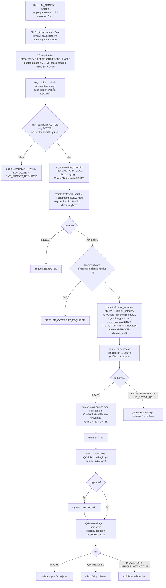

ดู sequence รายละเอียด: [UC-CAMP-01](use-cases/UC-CAMP-01/specification.md), [UC-CAMP-02](use-cases/UC-CAMP-02/specification.md), [UC-PHOTO-01](use-cases/UC-PHOTO-01/specification.md), [UC-REG-01](use-cases/UC-REG-01/specification.md), [UC-REG-02](use-cases/UC-REG-02/specification.md), [UC-QR-01](use-cases/UC-QR-01/specification.md), [UC-QR-02](use-cases/UC-QR-02/specification.md)

### 5.2 แก้ไขข้อมูลรถโดยตรง (maintenance) และยกเลิกรถ

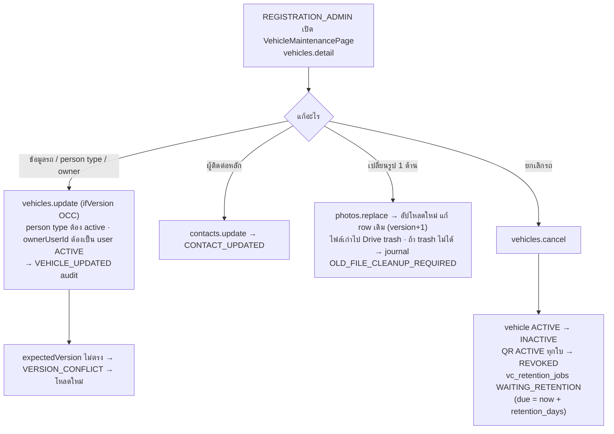

ดู [UC-VEH-02](use-cases/UC-VEH-02/specification.md), [UC-PHOTO-02](use-cases/UC-PHOTO-02/specification.md), [UC-RET-01](use-cases/UC-RET-01/specification.md)

### 5.3 คำขอเปลี่ยนแปลงจากเจ้าของรถ (change requests)

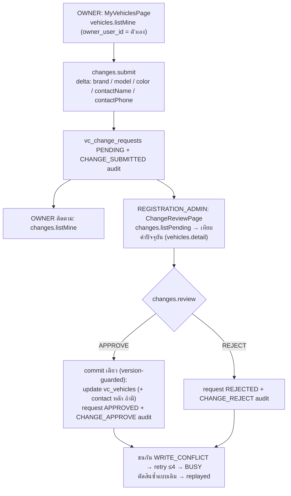

ดู [UC-OWNER-01](use-cases/UC-OWNER-01/specification.md)

### 5.4 Retention (ลบข้อมูลตามกำหนด)

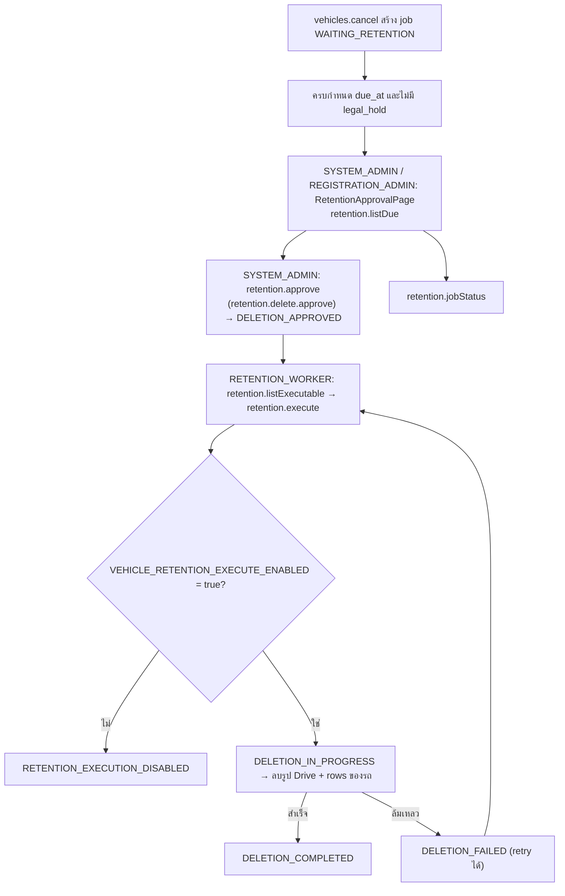

ดู [UC-RET-01](use-cases/UC-RET-01/specification.md), [UC-RET-02](use-cases/UC-RET-02/specification.md)

### 5.5 System reset (test / set-up, VC-ADR-039 — merged PR #224)

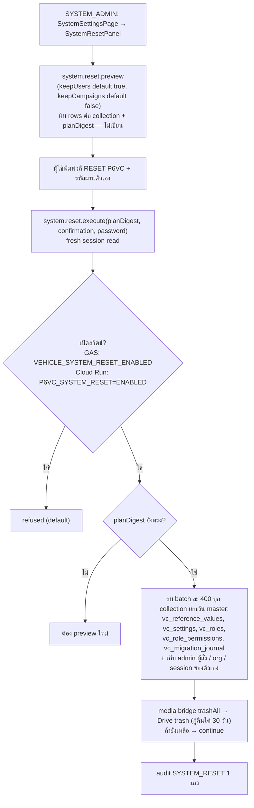

ดู [UC-ADMIN-03](use-cases/UC-ADMIN-03/specification.md)

---

## 6. State diagrams

### 6.1 Registration request (`vc_registration_requests.status`)

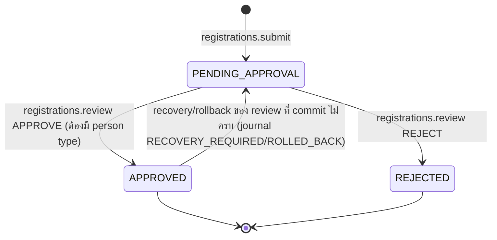

### 6.2 Vehicle (`vc_vehicles.status`)

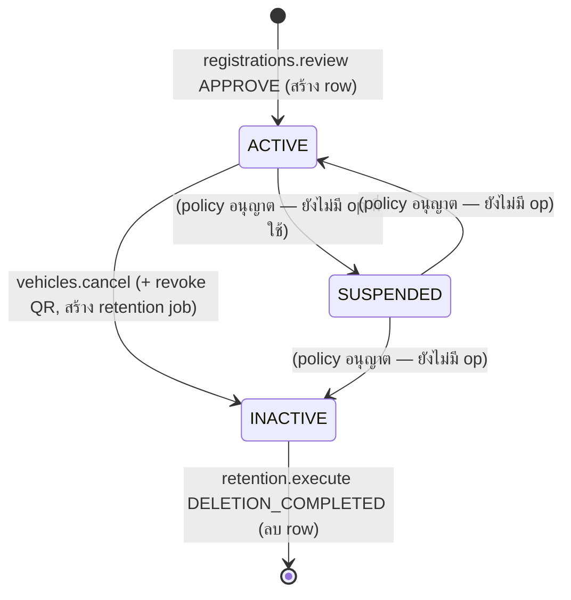

> `VehicleLifecycle.ALLOWED` ประกาศ `PENDING_APPROVAL`/`REJECTED`/`SUSPENDED` ด้วย แต่ในโค้ดปัจจุบัน row รถถูกสร้างเป็น `ACTIVE` ตอนอนุมัติเท่านั้น (สถานะรออนุมัติอยู่ที่ registration request) และไม่มี op ใดเปลี่ยนเป็น `SUSPENDED`

### 6.3 QR token (`vc_qr_tokens.status`)

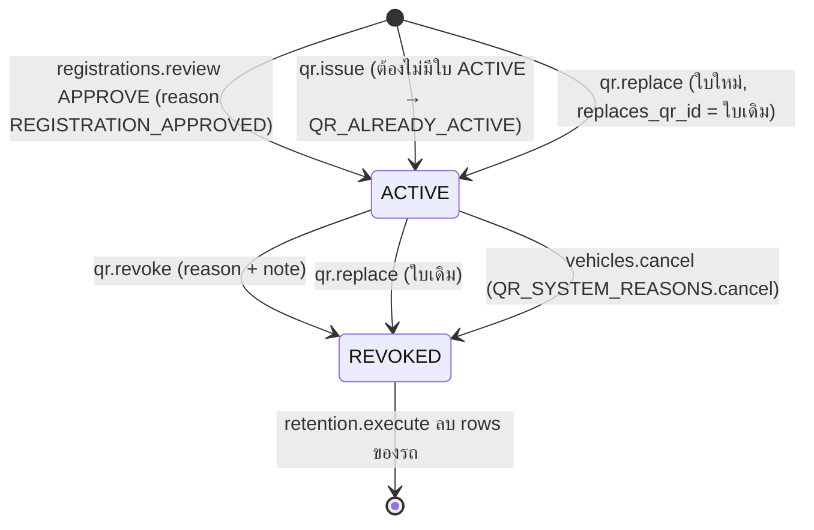

กติกา: รถหนึ่งคันมี QR `ACTIVE` ได้ไม่เกิน 1 ใบ (`MULTIPLE_ACTIVE_QR`); ทุกการเปลี่ยนต้องมี reason (VC-ADR-036, `QrReasonPolicy`); เก็บ `token_digest` (SHA-256) และตั้งแต่ 0.9.30 เก็บ `qr_token` เพื่อ export/พิมพ์ — ใบเก่าที่ไม่มี token จะได้ `REISSUE_NEEDED` จาก `qr.export`

### 6.4 สถานะอื่นที่เจอบ่อย

| Collection | สถานะ |
|---|---|
| `vc_change_requests` | `PENDING` → `APPROVED` / `REJECTED` |
| `vc_retention_jobs` | `WAITING_RETENTION` → `DELETION_APPROVED` → `DELETION_IN_PROGRESS` → `DELETION_COMPLETED` / `DELETION_FAILED` (→ execute ใหม่) |
| `vc_photo_staging` | `STAGED` → `CLAIMED` (submit) ; กลับเป็น `STAGED` ถ้า submit rollback |
| `vc_operation_journal` | `PREPARED` / `APPLIED` / `ROLLED_BACK` / `RECOVERY_REQUIRED` / `OLD_FILE_CLEANUP_REQUIRED` |

---

## 7. Data map

Schema ทั้งหมด (25 collections, field, key, ความสัมพันธ์) อยู่ที่ [`schema/database.schema.json`](../schema/database.schema.json) และภาพ ER ที่ [DATA_MODEL_ER_DIAGRAM_20261122.md](DATA_MODEL_ER_DIAGRAM_20261122.md) — ส่วนนี้บอกเฉพาะ **ใครอ่าน/เขียน** (ได้จากการ grep `store.*('vc_…')` และ `readAll/writeAll` ในแต่ละ module; R = read, W = insert/update/remove)

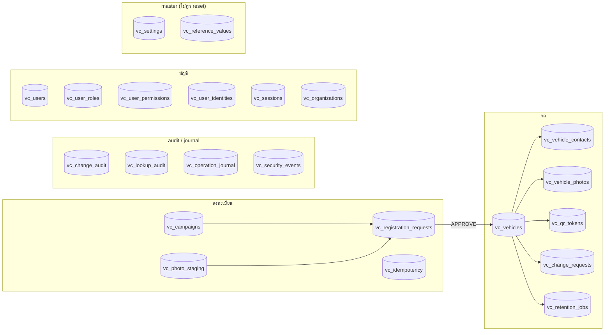

| Group ของ ops (module) | อ่าน (R) | เขียน (W) |
|---|---|---|
| `auth.*` + session (`IdentityOperations`, `SessionService`) | vc_users, vc_user_identities, vc_user_roles, vc_user_permissions, vc_sessions, vc_security_events, vc_settings | vc_sessions, vc_security_events, vc_user_identities (linkGoogle), vc_users (changePassword) |
| `users.*` (`IdentityOperations`) | vc_users, vc_user_roles, vc_organizations, vc_operation_journal, vc_change_audit | vc_users, vc_user_roles, vc_change_audit, vc_operation_journal (assignRoles), vc_sessions (revoke) |
| `system.config.*` (`AdministrationOperations` + sticker wrapper) | vc_settings | vc_settings, vc_change_audit |
| `organizations.*` | vc_organizations | vc_organizations, vc_change_audit |
| `campaigns.*` | vc_campaigns | vc_campaigns, vc_change_audit |
| `references.registration` | vc_reference_values, vc_organizations, vc_settings | — |
| `photos.upload` | vc_photo_staging (count) | vc_photo_staging + Drive |
| `registrations.submit` | vc_campaigns, vc_idempotency, vc_registration_requests, vc_organizations, vc_vehicles, vc_photo_staging, vc_settings | vc_registration_requests, vc_photo_staging, vc_campaigns (submitted_count), vc_idempotency, vc_operation_journal |
| `registrations.listPending/detail/photo` | vc_registration_requests, vc_settings (+ Drive read) | vc_change_audit (`REGISTRATION_PHOTO_VIEWED`) |
| `registrations.review` | vc_registration_requests, vc_operation_journal, vc_vehicles, vc_settings | vc_vehicles, vc_vehicle_contacts, vc_vehicle_photos, vc_qr_tokens, vc_registration_requests, vc_change_audit, vc_operation_journal |
| `vehicles.lookup/detail/list/listMine/history` (`VehicleView`, `Vehicle360`) | vc_vehicles, vc_vehicle_contacts, vc_vehicle_photos, vc_change_audit, vc_reference_values, vc_organizations, vc_registration_requests, vc_change_requests, vc_retention_jobs, vc_lookup_audit, vc_users, vc_campaigns, vc_settings | vc_lookup_audit |
| `vehicles.update`, `contacts.*` | vc_vehicles, vc_vehicle_contacts, vc_users, vc_settings | vc_vehicles, vc_vehicle_contacts, vc_change_audit, vc_lookup_audit (contacts.read) |
| `vehicles.cancel` | vc_vehicles, vc_qr_tokens, vc_settings (`retention_days`) | vc_vehicles, vc_qr_tokens, vc_retention_jobs, vc_change_audit |
| `vehicles.photo`, `photos.list/replace` | vc_vehicles, vc_vehicle_photos (+ Drive) | vc_lookup_audit (vehicles.photo), vc_vehicle_photos + vc_change_audit + Drive (replace), vc_operation_journal (cleanup ค้าง) |
| `changes.*` (`ChangeReviewOperation`) | vc_change_requests, vc_vehicles, vc_vehicle_contacts | vc_change_requests, vc_vehicles, vc_vehicle_contacts, vc_change_audit |
| `qr.resolve` | vc_qr_tokens, vc_vehicles (+ view reads) | vc_lookup_audit |
| `qr.issue/revoke/replace` | vc_vehicles, vc_qr_tokens | vc_qr_tokens, vc_change_audit |
| `qr.history` / `qr.export` | vc_qr_tokens, vc_vehicles, vc_users, vc_settings | — / vc_change_audit (`QR_EXPORTED`) |
| `retention.*` | vc_retention_jobs, vc_vehicles, vc_vehicle_photos | vc_retention_jobs, vc_vehicles + related rows (remove), Drive trash |
| `audit.query/export` | vc_lookup_audit, vc_change_audit | — |
| `system.reset.*` (`SystemResetOperations`) | ทุก collection ใน `DATABASE_SCHEMA` | remove ทุก collection ที่ไม่ใช่ master (ตาม option), Drive trashAll, vc_change_audit (`SYSTEM_RESET`) |

---

## 8. จะแก้ X ต้องแตะไฟล์ไหน

Template ที่ดีที่สุดสำหรับ "เพิ่ม API op" คือ PR #224 (`git show --stat 2fbf037`) ซึ่งเพิ่ม `system.reset.preview/execute`

### 8.1 เพิ่ม API op ใหม่ (checklist)

| # | ไฟล์ | สิ่งที่ต้องทำ |
|---|---|---|
| 1 | [`contracts/api-inventory.v1.json`](../contracts/api-inventory.v1.json) | เพิ่ม operation (`id`, `group`, `action`, `protected`, `requestSchemaRef`) + `definitions/requests/<op>` |
| 2 | [`contracts/api-permissions.v1.json`](../contracts/api-permissions.v1.json) | `requiredPermission`, `identitySource` |
| 3 | [`api/routes/GroupRoutes.js`](../backend/gas/src/api/routes/GroupRoutes.js) | เพิ่ม action ใน group (ถ้า group ใหม่ เพิ่ม key) |
| 4 | [`api/dto/OperationPayloadValidator.js`](../backend/gas/src/api/dto/OperationPayloadValidator.js) | `[required, optional]` field + type |
| 5 | [`application/use-cases/<Module>.js`](../backend/gas/src/application/use-cases/) | handler `'group.action': fn` (module ใหม่ → import ใน controller) |
| 6 | [`api/controllers/OperationController.js`](../backend/gas/src/api/controllers/OperationController.js) | `permissions` map (หรือ `publicOps`), `safeErrors` ถ้ามี error code ใหม่, `fresh` ถ้าต้องตรวจรหัสผ่าน, **ตัวเลข** `entries.length!==N`/`DTO_OPERATIONS.length!==N` |
| 7 | [`application/security/SessionService.js`](../backend/gas/src/application/security/SessionService.js) | ถ้า permission ใหม่ → ใส่ใน `ROLE_PERMISSIONS` |
| 8 | [`domain/policies/ApiInventoryGate.js`](../backend/gas/src/domain/policies/ApiInventoryGate.js) | ตัวเลข `declared.length === N` |
| 9 | [`api/groups/system/SystemGroup.js`](../backend/gas/src/api/groups/system/SystemGroup.js) + [`package.json`](../backend/gas/package.json) + `scripts/expected-live-version.json` | bump `backendVersion` |
| 10 | `backend/gas/tests/`: `api-inventory.test.mjs`, `api-wiring.test.mjs`, `actor-rbac-matrix.test.mjs` (ops × 5 roles), `actor-usecase-acceptance.test.mjs` + `acceptance-fixture.mjs`, `live-owner-dev-runner.test.mjs` | อัปเดตจำนวน op + เพิ่มกรณีทดสอบ RBAC |
| 11 | [`tools/p6vc-api-test-console/worker.mjs`](../../../tools/p6vc-api-test-console/worker.mjs) `FRONTEND_PAYLOAD_FIELDS` (+ `FRONTEND_PUBLIC_OPERATIONS`, `READ_ONLY_OPERATIONS` ถ้าเกี่ยว) + `worker.test.mjs` | ไม่งั้น SPA ได้ `OPERATION_NOT_ALLOWED`; จากนั้น `wrangler deploy` |
| 12 | [`docs/use-cases/catalog.json`](use-cases/catalog.json) + `use-cases/UC-*/specification.md` + `sequence.mmd` + [traceability-matrix.md](traceability-matrix.md) | ทุก op ต้องอยู่ใน UC (validator นับ `N/N unique v1 operations`) |
| 13 | [`scripts/validate-usecase-ssot.mjs`](../../../scripts/validate-usecase-ssot.mjs) | ตัวเลขจำนวน op ที่คาดไว้ |
| 14 | `backend/gas/scripts/run-live-owner-dev-regression.mjs` (และ `run-live-api-suite.mjs` ถ้าเกี่ยว) | live runner ครอบคลุม op ใหม่ |
| 15 | Frontend: `infrastructure/<area>/gas-*-repository.js` + `application/<area>/*-port.js` + feature/page + `frontend/tests/*.test.js` + `e2e/mock-api.js` | ถ้า UI ใช้ op นี้ |
| 16 | เอกสาร: [DECISION_LOG.md](DECISION_LOG.md) (ADR ถ้าเป็นการตัดสินใจ), [SCRIPT_PROPERTIES.md](SCRIPT_PROPERTIES.md) (ถ้ามีสวิตช์), **ไฟล์นี้ §3.2 / §4 / §7** | |

ตรวจ: `cd apps/vehicle-contact/backend/gas && npm run check` · `cd frontend && npm test` · `node scripts/validate-ssot.mjs` · `node scripts/validate-usecase-ssot.mjs` · `node --test tools/p6vc-api-test-console/worker.test.mjs`

### 8.2 งานที่พบบ่อยอื่น ๆ

| อยากแก้ | ไฟล์ที่ต้องแตะ |
|---|---|
| เพิ่มหน้า / route ใหม่ | `frontend/src/router/index.js` (path, `meta.requiredPermissions`), `pages/<X>Page.vue`, `features/<area>/use<X>.js`, `domain/navigation/menu-catalog.js` (ถ้ามีเมนู), `App.vue` (`provide` repository ใหม่), `application/<area>/*-port.js` (key + assert), `infrastructure/<area>/gas-*-repository.js`, `frontend/tests/`, `frontend/e2e/` |
| เพิ่ม/แก้ role หรือ permission | `SessionService.ROLE_PERMISSIONS`, `OperationController.permissions`, `contracts/api-permissions.v1.json`, `tests/actor-rbac-matrix.test.mjs`, `frontend/src/domain/identity/role-presentation.js`, router `requiredPermissions`, menu `permissionsAny` |
| เพิ่ม field ให้รถ / ลงทะเบียน | `schema/database.schema.json` (+ migration), `OperationPayloadValidator.js`, `VehicleOperations.js` (submit snapshot + review insert + update patch), `ChangeReviewOperation.js` ถ้าเจ้าของขอเปลี่ยนได้, `worker.mjs` allowlist field, FE intake/maintenance/detail, [DATA_MODEL_ER_DIAGRAM_20261122.md](DATA_MODEL_ER_DIAGRAM_20261122.md) |
| เพิ่ม collection ใหม่ | `schema/database.schema.json`, `contracts/firestore-indexes.v1.json` / `firestore-field-config.v1.json` (+ `scripts/ensure-firestore-indexes.mjs`), `SystemResetOperations.RESET_MASTER_TABLES` (ถ้าเป็น master), ER doc, §7 ของไฟล์นี้ |
| เปลี่ยน person type / สีสติกเกอร์ default | `domain/policies/StickerCategoryPolicy.js` (`DEFAULT_STICKER_CATEGORIES`); ค่าที่ใช้งานจริงแก้ใน UI ตั้งค่าระบบ (`vc_settings.sticker_categories`) ไม่ต้องแก้โค้ด; FE `domain/reference/sticker-categories.js` |
| เปลี่ยน layout การพิมพ์สติกเกอร์ | `frontend/src/domain/qr/sticker-layout.js`, `features/qr-governance/components/QrStickerSheet.vue`, `pages/QrPrintPage.vue` |
| เปลี่ยนสิ่งที่หน้าสแกน QR แสดง | `pages/QrStickerLandingPage.vue` (public), `pages/QrResolvePage.vue`, `features/vehicle-search/useQrResolve.js`, backend `VehicleOperations.resolveQr` + `VehicleView.js` |
| เพิ่มเหตุผล QR | `domain/policies/QrReasonPolicy.js`, FE `domain/reference/qr-reasons.js` |
| เพิ่มสวิตช์ config | `composition/RuntimeConfig.js`, `backend/cloudrun/runtime.mjs` (env → property), `.github/workflows/deploy-vehicle-cloudrun.yml` (`--set-env-vars`/vars), [SCRIPT_PROPERTIES.md](SCRIPT_PROPERTIES.md) |
| เปลี่ยน upstream / rollback ไป GAS | Worker var `P6VC_API_URL` (ว่าง = ใช้ GAS) ใน `wrangler.toml` + `wrangler deploy`; ดู [FIRESTORE_CUTOVER_ROLLBACK_RUNBOOK.md](FIRESTORE_CUTOVER_ROLLBACK_RUNBOOK.md) และ [CLOUD_RUN_SPIKE_AND_GAS_INCIDENT_20261125.md](CLOUD_RUN_SPIKE_AND_GAS_INCIDENT_20261125.md) |
| งาน media / Drive | `infrastructure/media/DrivePhotos.js` (GAS), `MediaBridgeServer.js` + `MediaBridgeSignature.js` (op ใหม่ต้องเพิ่มทั้งสองฝั่ง), `backend/cloudrun/media-bridge-client.mjs`, `tests/media-bridge.test.mjs` |
