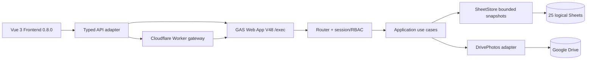

# P6 Vehicle Contact — World-Class Test Suite Master Plan

**Document ID:** P6VC-TEST-PLAN-001 | **Opened:** 2026-11-22 | **Classification:** ACTIVE TEST STRATEGY / AUTOMATION CONTRACT — not production approval.
**Baseline:** handoff PR **#111** (`main` `ad7630e`); QR PR **#112** (`main` `243deb2`); implementation/content PR **#110** (`bf3553d`). Runtime snapshot: GAS Web App **V48 / 0.9.1**, Frontend **0.8.0**, Worker `20180237-7441-481a-9540-e7ca2c9c79eb`.
**Authority:** [Current Delivery Status](CURRENT_DELIVERY_STATUS.md), [Live API Automation](LIVE_API_AUTOMATION.md), [Traceability Matrix](traceability-matrix.md), [Use-Case SSOT](use-cases/README.md), [ER Diagram](DATA_MODEL_ER_DIAGRAM_20261122.md), [api-inventory.v1.json](../contracts/api-inventory.v1.json), [Production Readiness Plan](PRODUCTION_READINESS_PLAN_20261121.md).

> **Owner authorization recorded (2026-11-22):** the Owner permits clearing Google Sheet data **for synthetic DEV test initialization**. This plan defines a safe, automatable, gated reset (§6). It does **not** authorize clearing real/production data, bypassing lifecycles, or self-approving security/PDPA/release. Execution of a destructive reset is a separate gated slice (§6.4).

## 1. Objective and quality bar

Every API operation, business workflow, pipeline and use case must be **automatable by any bot** (CI runner, local CLI, or another AI agent) with **deterministic, reproducible, machine-readable evidence**, while keeping human acceptance/security/release gates explicit. "World-class" here means alignment with recognized standards, full traceable coverage, measurable test effectiveness, and fail-closed safety — not a claim that production approval exists.

### 1.1 Standards adopted

| Standard / model | Application in P6VC |
|---|---|
| **ISO/IEC/IEEE 29119** (software testing) | Test process, documented test design, coverage criteria, traceability, evidence and reporting vocabulary used throughout this plan |
| **ISTQB** test design techniques | Equivalence partitioning, boundary-value analysis, decision tables, state-transition testing, use-case testing, error guessing (§8) |
| **OWASP ASVS v4.0.3 + OWASP Top 10 (2021)** | Security verification requirements for authN/authZ, session, crypto, injection, access control, logging (§9) |
| **Test pyramid (Cohn) + Google SRE test sizes** | Small/medium/large test sizing; fast offline base, fewer live/E2E tests (§4) |
| **Consumer-driven contract testing (Pact-style) + JSON Schema** | DTO/request/response contracts between Vue ↔ Worker ↔ GAS (§5, §8.4) — PROPOSED expansion |
| **Property-based + fuzz testing** | DTO validators, normalization, pagination, idempotency (§8.5) — PROPOSED (e.g. fast-check) |
| **Mutation testing** | Measure assertion strength, not just line coverage (§8.6) — PROPOSED (e.g. Stryker) |
| **Chaos / fault injection + restart recovery** | Partial-write, timeout, abort, restart convergence (§10) — partially delivered (B2/B2b) |
| **PDPA / privacy-by-design** | Data minimization, redaction, retention, legal hold; human DPO gate (§9.3) |

## 2. System under test



- **Datastore:** 25 logical Sheets, no FK/transactions/joins; logical relations enforced in GAS code. See [ER Diagram](DATA_MODEL_ER_DIAGRAM_20261122.md).
- **Trust boundary:** client roles never authoritative; server-verified session + per-operation permission; Worker fail-closed allowlist; GAS direct `/exec` still enforces RBAC.
- **Transport nuance:** the 72 authenticated live cases call **GAS directly**; the Worker is verified by 14 fail-closed edge probes + offline contract suite. This is **not** an all-through-Worker browser E2E claim.

## 3. Coverage contract (the invariant)

| Dimension | Required coverage | Current verified |
|---|---|---|
| API operations | **56/56** owned exactly once by a UC | 56/56 (live DEV + offline wiring) |
| Session-protected RBAC | **50 ops × 5 roles = 250 checks** + anonymous denial | 250 offline; live role negatives |
| Public entrances | 6 non-session routes (`system.health`, `auth.login`, `auth.googleLogin`, `campaigns.validate`, `photos.upload`, `registrations.submit`) | live public + campaign-token workflows |
| Use cases | **20 UCs**, each with spec + canonical `.mmd` | 20/20; validator-enforced |
| Live DEV suite | 11 public + 14 Worker + 72 authenticated = **97/97**, cleanup **7/7** | PASS (synthetic DEV, direct-GAS authenticated) |
| Frontend | unit/contract + a11y | **192/192** offline |
| Worker | gateway contract/security | **31/31** offline + 14 live |
| GAS offline | build + contract/security/persistence/recovery | `npm run check` PASS (55 modules) |

**Inventory flag nuance:** `api-inventory.v1.json` marks 53 `protected:true` / 3 false, but runtime session-protected = **50** because `auth.login`, `auth.googleLogin`, `photos.upload` are credential/campaign-token public entrances. Contract flags remain `PROPOSED_*` / `enabled:false` / `*Verified:false`; **live DEV success does not flip contract governance flags or imply production/security approval.**

## 4. Test pyramid and sizes

| Tier | Size | Scope | Environment | Secrets | Bot command |
|---|---|---|---|---|---|
| **L0 Static/contract** | small | SSOT links, UC/diagram parity, inventory/wiring, schema, line limits | offline | none | `node scripts/validate-ssot.mjs`, `node scripts/validate-usecase-ssot.mjs` |
| **L1 Unit/component** | small | domain policies, DTO validators, Vue components/composables, crypto vectors | offline (jsdom/fakes) | none | FE `vitest run`; GAS `node --test tests/*.mjs` |
| **L2 Integration (synthetic)** | medium | use-case services over in-memory Sheets-shaped repo + fake Drive; RBAC matrix; fault/restart | offline | none | GAS `npm run check` |
| **L3 Live DEV API** | large | published GAS + deployed Worker; 56 ops; synthetic writes + cleanup | live DEV | gated creds | `npm --prefix apps/vehicle-contact/backend/gas run test:live:full` |
| **L4 Browser/device UAT** | large | real browser journeys, physical Android/iOS QR, Drive privacy | live DEV + devices | reviewer | Playwright (PROPOSED) + named human reviewers |
| **L5 Production-scale/security/PDPA** | large | load/scale, real OIDC, destructive retention rehearsal, pen-test, DPO | staging/prod-like | approved | human-gated; D-E1/D5/B3/ADR ratification |

Rule: **L0–L2 run on every PR without secrets**; L3 is owner-gated synthetic DEV; L4–L5 require named humans. A bot may execute L0–L3 autonomously under the exact gates; it must **never** self-approve L4–L5.

## 5. Operation × use-case coverage matrix

Legend: **Now** = current evidence; **Add** = world-class expansion required (PROPOSED unless noted). Test design techniques in §8. Every operation must have: positive, negative-RBAC (5 roles + anonymous), DTO/validation, idempotency/replay (where mutating), fault/recovery (where multi-write), and audit assertion.

| Group | Operations (count) | Owning UCs | Now | Add |
|---|---|---|---|---|
| system | health, config.get, config.update (3) | ADMIN-03 | live public + auth; offline contract | JSON Schema CDC; settings concurrency; config redaction |
| auth | login, googleLogin, changePassword, logout, session, linkGoogle (6) | AUTH-01/02/03 | live login/session/logout; B4 constant-work; OIDC **negatives only** | real OIDC provider; lockout/race; session fixation/expiry property tests; password policy BVA |
| users | create, list, update, suspend, resetPassword, assignRoles (6) | ADMIN-01, AUTH-02 | live admin CRUD; **B2b assignRoles recovery (local WIP)** | B2b merge + restart-from-RECOVERY_REQUIRED; role-assignment audit dedup; >20 journal window |
| organizations | list, create, update, disable (4) | ADMIN-02 | live; **B1 cycle guard** | deep hierarchy property tests; disable cascade invariants |
| campaigns | create, list, validate, revoke (4) | CAMP-01/02 | live create/list/revoke; campaign-token validate | quota race under lock; expiry boundary; token digest collision |
| references | registration (1) | REG-01 | live catalog; reference-seed suites | ENFORCED orphan/cycle fuzz; catalog version drift |
| registrations | submit, listPending, detail, review, photo (5) | REG-01/02 | live submit+idempotent replay, review; **B2 retry reconciliation**; B2b review recovery (WIP) | B2b lifecycle-drift safety; pepper-rotation; REJECT restart; audit-write-failure |
| vehicles | lookup, detail, update, cancel, history, listMine, list (7) | VEH-01/02, OWNER-01, RET-01 | live; C2/C3/C6 FE; optimistic version | plate normalization property/fuzz; pagination BVA; cancel→retention invariant |
| contacts | read, update (2) | VEH-01/02 | live; permission-gated disclosure | E.164 BVA; primary-contact uniqueness; redaction |
| changes | submit, listPending, review, listMine (4) | OWNER-01 | live; C1/C4 FE; ownership server-checked | proposedDelta schema; concurrent review; ownership spoof fuzz |
| qr | resolve, issue, revoke, replace (4) | QR-01/02 | live token lifecycle; FE scanner 12 tests | **physical device gate**; token entropy; revoke/replace race; digest-only invariant |
| photos | upload, list, replace (3) | PHOTO-01/02, VEH-01 | live five-photo workflow; Drive signature/size/mime | EXIF stripping; slot overflow fuzz; Drive privacy/link-inheritance UAT |
| retention | listDue, approve, execute, jobStatus, listExecutable (5) | RET-01/02 | live lists; **execute DISABLED negative**; job-tracked retry | D5+B3 gated synthetic two-person/legal_hold rehearsal; scheduler/notification; **no real destructive test** |
| audit | query, export (2) | AUD-01 | live restricted query/export | immutability; redaction completeness; export PII leak fuzz |

**Total = 56 operations / 20 UCs.** The matrix is enforced by `scripts/validate-usecase-ssot.mjs` (each op exactly one owning UC; spec/diagram parity).

## 6. Test-data lifecycle: clear / init / reset (automatable, gated)

### 6.1 Principles
- **Synthetic DEV only.** Unique tagged fixtures; allowlisted synthetic plate prefixes (e.g. `ฑฆ99|DEV|TST|กข`). Never real PII, never production `ENFORCED`.
- **Schema preserved.** Reset clears *rows*, never headers/columns; schema drift fails closed.
- **Relational integrity preferred.** Retire via lifecycles so audit/retention/QR relations stay consistent.
- **Idempotent + cleanup.** Re-running init converges to the same fixture set; `finally` cleanup revokes/suspends/logs out; cleanup failure fails the run.
- **Restricted columns never logged.** Reports carry `secretsExposed:false`; no raw responses/PII/tokens.

### 6.2 Mode A — lifecycle-safe reset (DELIVERED, preferred)
Existing `.tmp/seed-dev-vehicles.mjs` (gitignored) runs **through the Worker**: retire synthetic vehicles via `vehicles.cancel`, revoke campaign, create N ACTIVE (1 contact / 5 photos / QR MATCH), verify lookup + registry, cleanup 2/2. Gate `RUN_SYNTHETIC_OWNER_DEV`, creds `P6VC_ADMIN_USER`/`P6VC_ADMIN_PASS`, `P6VC_SEED_COUNT` 1–20. Preserves relations; this is the default for re-initializing DEV.

### 6.3 Mode B — full synthetic truncate for clean init (PROPOSED, owner-authorized scope)
For a truly clean slate the Owner has authorized clearing Sheet data for test init. Design a bot-executable `reset-dev-data` that:
1. Requires exact gate **`P6VC_ALLOW_DEV_RESET=RUN_SYNTHETIC_DEV_RESET`** + admin creds + confirmed DEV spreadsheet ID.
2. Takes a **backup snapshot** (export) and writes a `vc_operation_journal` / `vc_migration_journal` recovery record before mutation.
3. Clears **only allowlisted synthetic rows** across the 25 tables (or full data rows in a confirmed disposable DEV sheet), **preserving headers/schema**; never touches `vc_migration_journal` history irreversibly without backup.
4. Re-seeds reference catalog + synthetic admin/fixtures via API (Mode A) so the system is immediately testable.
5. Runs the **25/25 Sheets display audit** (zero `#VALUE!`, zero repairs) and emits a sanitized JSON report.
6. Fails closed on any non-synthetic row, schema mismatch, or missing gate; aborts on SIGINT/SIGTERM with persisted evidence.

> Mode B is **not yet implemented**. It must be delivered as a gated, reviewed slice with injected-failure tests before any bot runs it. Until then, bots use Mode A.

### 6.4 Execution boundary
Clearing data is a **live mutation**. A bot may run Mode A under the existing synthetic-write gate. Mode B requires the new exact gate **and** per-run Owner authorization. Neither mode may run against production or real data. This plan records the authorization; it does not execute a destructive clear.

## 7. Bot-executable automation contract

### 7.1 Current commands (any bot, from repo root)
Offline (no secrets, deterministic):
```bash
node scripts/validate-ssot.mjs
node scripts/validate-usecase-ssot.mjs
npm --prefix apps/vehicle-contact/backend/gas run check
npm --prefix apps/vehicle-contact/frontend ci && npm --prefix apps/vehicle-contact/frontend test
node --test tools/p6vc-api-test-console/worker.test.mjs
node scripts/build-pages.mjs && node scripts/validate-ssot.mjs --built _site
```
Live DEV (gated, mutating, synthetic only):
```bash
# env: P6VC_GAS_EXEC_URL, P6VC_TEST_USERNAME, P6VC_TEST_PASSWORD,
#      P6VC_ALLOW_OWNER_DEV_WRITES=RUN_SYNTHETIC_OWNER_DEV
npm --prefix apps/vehicle-contact/backend/gas run test:live        # public+worker; auth optional
npm --prefix apps/vehicle-contact/backend/gas run test:live:full   # fails closed without creds/gate
```

### 7.2 Unified runner (PROPOSED)
Deliver `scripts/run-test-suite.mjs` as the single bot entrypoint:
- `--tier L0|L1|L2|L3|all` (default `L0-L2` offline; `L3` requires gate).
- Emits **machine-readable** `test-results/p6vc-suite.json` + **JUnit XML** for CI, plus a coverage matrix (op × UC × role × dimension) and `secretsExposed:false`.
- Deterministic exit codes: `0` pass, `1` assertion fail, `2` blocked-missing-gate, `3` cleanup fail.
- `--reset modeA|modeB` invokes §6 under the exact gate; never defaults to destructive.
- Persists evidence after every stage so an interrupted run leaves a trail; redacts all restricted fields.
- Any bot/AI can run it without human interaction at L0–L2; L3/reset require the documented env gates.

### 7.3 CI/CD gates (DELIVERED)
| Workflow | Trigger | Gate / secrets | Role |
|---|---|---|---|
| `validate-p6vc.yml` | pull_request + dispatch | none | L0–L2 on every PR (SSOT, FE, Worker, GAS check) |
| `deploy-pages-ssot.yml` | push main + dispatch | none (`pages:write`) | build + verify + deploy Pages |
| `deploy-vehicle-gas.yml` | **manual dispatch, main-only** | **`PUSH_VEHICLE_GAS`**, `P6VC_CLASPRC_JSON` | GAS source push + create-version (**not** Web App publication) |
| `p6vc-live-acceptance.yml` | **manual dispatch, owner-only** | mode confirmations (`RUN_FULL_API_SUITE`, etc.), protected test secrets | L3 live DEV acceptance |

**Deployment provenance rule:** record source SHA, GAS source version, published Web App version, Worker version and Pages build **separately**; probe health **and** a changed route after publication. Source push ≠ publication. A separately owner-authorized `clasp`/`wrangler` self-deploy path is limited to its approved scope.

## 8. Test design techniques (per dimension)

1. **Equivalence partitioning + BVA:** DTO fields, plate/province normalization, pagination `page/pageSize`, photo `size_bytes`, campaign quota, password length, E.164.
2. **Decision tables:** RBAC (role × permission × operation), campaign validity (status × window × quota), retention executability (status × approver × due × legal_hold).
3. **State-transition testing:** vehicle (PENDING→ACTIVE→INACTIVE), registration (PENDING_APPROVAL→APPROVED/REJECTED), photo (STAGED→CLAIMED), QR (ACTIVE→REVOKED/REPLACED), journal (PREPARED→APPLIED/ROLLED_BACK/RECOVERY_REQUIRED), retention job lifecycle.
4. **Consumer-driven contract + JSON Schema (PROPOSED):** publish request/response schemas; Vue/Worker/GAS each verify against the same contract; break detection on PR.
5. **Property-based + fuzz (PROPOSED):** normalization idempotence, pagination invariants, idempotency replay equality, DTO unknown-field rejection, reference-catalog orphan/cycle freedom.
6. **Mutation testing (PROPOSED):** Stryker on domain policies/validators; target mutation score threshold; kill surviving mutants with stronger assertions.
7. **Use-case testing:** each of the 20 UCs has a happy path + alternate/error flows traced to its `.mmd` and spec acceptance criteria.

## 9. Security and privacy verification (OWASP ASVS)

| ASVS area | P6VC verification | Status |
|---|---|---|
| V2 Authentication | PBKDF2 150k vectors, B4 constant-work unknown/inactive, lockout, initial-password change | delivered offline + live negatives |
| V3 Session | digest-only tokens, expiry/idle/revocation, fixation resistance | delivered; add property tests |
| V4 Access control | 250 RBAC checks, server-authoritative identity, spoof rejection, ownership checks | delivered; **security ratification OPEN** |
| V5 Validation | DTO allowlists, prototype-pollution denial, formula-injection safe text | delivered; add fuzz |
| V6 Crypto | HMAC pepper token derivation, digest-only storage, no plaintext secrets | delivered; **pepper-rotation test missing** (§10) |
| V7 Logging | redacted audit, `secretsExposed:false`, no PII in reports | delivered; add leak fuzz |
| V9 Communications | Worker origin/operation allowlist, fail-closed, CORS, TLS | delivered 14 live + 31 offline |
| V13 API | versioned envelope, unknown-route denial, size limits | delivered |

### 9.3 PDPA / privacy (human gate)
Data minimization, restricted-column redaction, retention schedule, `legal_hold`, Drive link-inheritance privacy, real-data prohibition. **DPO/controller sign-off remains OPEN**; automation cannot approve it.

## 10. Reliability, recovery and chaos

Delivered: B2 submit retry reconciliation; job-tracked retention retry; injected timeout/abort/restart (`journal-recovery.test.mjs`, 11 cases). **B2b durable journaling for `registrationReview`/`assignRoles` is local WIP (not merged)** and adds PREPARED-before-write + forward recovery + deterministic audit IDs + HMAC token replay.

### 10.1 Required new tests before B2b is trusted (from code review)
| Risk | Required test / fix |
|---|---|
| **Destructive rollback on lifecycle drift** | A stuck PREPARED journal + later `qr.replace/revoke`, `vehicles.cancel` or photo replacement must **finalize, not roll back** a terminal request; prove no resurrection of cancelled vehicles/revoked QRs |
| **Pepper rotation** | Post-rotation APPLIED replay fails closed; stale PREPARED + rotation must not silently re-issue a different token; add rotation test + runbook |
| **"One-time" token misnomer** | Any approver can replay and re-obtain plaintext; audit the retrying actor (not reuse prior actor); clarify semantics |
| **Limit-10 residue** | >10 partial rows leave residue → DUPLICATE_KEY → permanent RECOVERY_REQUIRED loop; test and bound cleanup |
| **Bounded scan is result-window only** | `SheetStore` still full-sheet reads (SCAN_LIMIT 10,000); journal/audit pruning absent; `ensure*Audit` full-scans; test >20 journals and frequently-edited users |
| **Restart from RECOVERY_REQUIRED** | Only PREPARED restart tested; add RECOVERY_REQUIRED restart, REJECT restart, roles compensation-failure→restart, audit-write-failure after terminal writes, corrupted `detail_json` |
| **Fixture/GAS derivation divergence** | Fixture `deriveSecret` is sha256, not HMAC; align fixture with real HMAC bridge and test parity |

### 10.2 Chaos expansion (PROPOSED)
Real GAS process-kill / Sheets-lock contention, Drive transient failures, Worker cold-start, network partition between Worker↔GAS; assert fail-closed + recovery runbook convergence. No real-data destructive chaos.

## 11. Performance and scale

- **Current:** bounded per-sheet snapshots; O(rows) scans are DEV-scale; `SCAN_LIMIT_EXCEEDED` at 10,000 rows.
- **PROPOSED:** load/latency tests at DEV volume (e.g. k6/autocannon against Worker/GAS), p95 latency budgets per operation, pagination stability under growth, lock-contention throughput.
- **Gate:** production volume requires **D-E1** (ratify bounded Sheets with caps/monitoring **or** approve indexed-store migration). DEV success is **not** scale approval.

## 12. Frontend, browser, device and accessibility

- **Delivered:** 192 offline unit/contract tests; `axe-core` present; QR scanner adapter cleanup tests (12).
- **PROPOSED:** Playwright browser E2E for C1–C4/C6 journeys + gallery/copy + QR resolve, run against reviewed Pages deployment; automated a11y assertions.
- **Human gates (cannot be automated away):** physical Android/iOS camera permission/switch/decode/teardown, real sticker/glare, Drive privacy/link-inheritance, business UAT sign-off.

## 13. Evidence, traceability and provenance

- Every test maps to **requirement → UC → operation → test ID** (traceability matrix + catalog).
- Reports: sanitized JSON (`test-results/*.json`, gitignored) + JUnit (PROPOSED) + CI Step Summary + 7-day artifact; `secretsExposed:false`.
- Provenance recorded separately: source SHA, GAS source version, Web App publication, Worker version, Pages build; execution-time `sourceCommit` distinguished from merge baseline.
- Historical reports remain evidence for their own date/SHA only; current counts supersede old counts without erasing history.

## 14. Quality gates and release sequence

1. PR: L0–L2 green (no secrets) — `validate-p6vc.yml`.
2. Merge to main: Pages build/verify/deploy — `deploy-pages-ssot.yml`.
3. Owner-gated L3 live DEV synthetic acceptance with exact confirmation + cleanup.
4. Human L4 browser/business/device acceptance; credential rotation.
5. Resolve D-E1/D3/D5/B3 + VC-ADR-014/015/017; PDPA/security review.
6. Release candidate from reviewed SHA; GAS push requires `PUSH_VEHICLE_GAS` (or approved clasp scope); publication owner-controlled; verify health + changed route.
7. **Named-human final release approval.** Until then: DEV release candidate at most.

## 15. Gap register (prioritized)

| # | Gap | Type | Gate |
|---|---|---|---|
| G1 | B2b merge + §10.1 safety tests (lifecycle-drift, pepper rotation, restart variants) | engineering | review + security |
| G2 | Unified bot runner + JUnit + coverage matrix (§7.2) | engineering | none |
| G3 | Mode B gated synthetic reset (§6.3) | engineering | per-run Owner gate |
| G4 | JSON Schema CDC + property/fuzz + mutation (§8) | engineering | none |
| G5 | Playwright browser E2E + a11y (§12) | engineering | reviewed Pages |
| G6 | Performance/scale tests + D-E1 decision (§11) | engineering + human | D-E1 |
| G7 | Physical Android/iOS QR acceptance | human/device | Owner reviewers |
| G8 | Real OIDC provider verification | human/integration | security |
| G9 | Destructive retention rehearsal (synthetic, two-person, legal_hold) | human-gated | D5 + B3; C5 blocked |
| G10 | PDPA/security/UAT/release sign-offs | human | named approvers |

## 16. Owner actions

1. Confirm whether to proceed with **Mode B** clean-reset implementation (gated) or keep **Mode A** lifecycle-safe reset as default.
2. Assign named Android/iOS reviewers for physical QR acceptance after reviewed Pages deployment.
3. Ratify D-E1 (scale), D5+B3 (retention) and VC-ADR-014/015/017 as applicable; schedule PDPA/security/UAT/release sign-offs.
4. Authorize each live mutation/reset run with the exact gate phrase; keep credentials in gitignored env/protected secrets only.

## 17. Reproduce (offline, no secrets)

```bash
node scripts/validate-ssot.mjs
node scripts/validate-usecase-ssot.mjs
npm --prefix apps/vehicle-contact/backend/gas run check
npm --prefix apps/vehicle-contact/frontend ci && npm --prefix apps/vehicle-contact/frontend test
node --test tools/p6vc-api-test-console/worker.test.mjs
```

**Exclusions:** this plan does not approve production, flip contract governance flags, enable destructive retention, or substitute for physical-device/browser/business UAT or PDPA/security/release sign-off. All such gates remain OPEN until named-human approval exists.