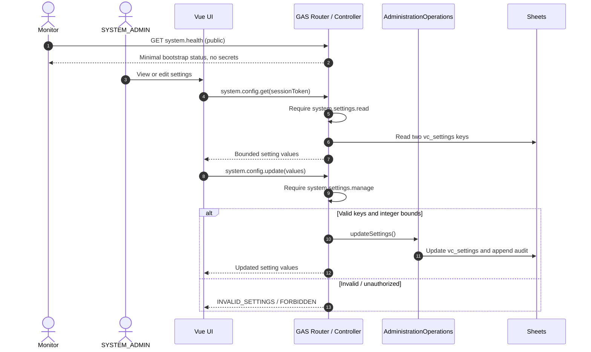

# UC-ADMIN-03 — System settings and public health check
**Status:** LIVE_DEV_API_SCOPE_VERIFIED; BROWSER_UAT_AND_PRODUCTION_GATES_OPEN
**Actor:** SYSTEM_ADMIN / anonymous monitor (health only)

## 1. Authority and scope
- Business baseline: [Approved requirements](../../APPROVED_REQUIREMENTS_BASELINE_R01_R26.md).
- API operations: `system.health`, `system.config.get`, `system.config.update` (API v1 JSON envelope, GAS POST except public health GET).
- Implementation: `backend/gas/src/api/routes/Router.js`, `backend/gas/src/application/use-cases/AdministrationOperations.js`; server permission source `backend/gas/src/api/controllers/OperationController.js`.
- Diagram source: [sequence.mmd](sequence.mmd) (Mermaid, reviewed alongside spec).

## 2. Preconditions
Public health may be checked without credentials; settings require a server-verified SYSTEM_ADMIN session.

## 3. Successful outcome / postconditions
Health returns minimal status; settings allow idle_timeout_minutes (1–480) and retention_days (1–3650), audit writes.

## 4. Failure and alternate paths
Unauthorized get/update, unsupported keys, invalid integer ranges are denied; health must not disclose secrets.

## 5. Persistence / external side effects
- `vc_settings`
- `vc_change_audit`

## 6. Acceptance trace
- Test case IDs: `LIVE-01`, `LIVE-02`, `ACTOR-01`, `MATRIX-00`.
- Executable evidence references: `backend/gas/tests/actor-rbac-matrix.test.mjs`.
- Aggregate PR #110 / bf3553d live DEV evidence covers 56/56 API operations (97/97 checks); it does not prove every business branch, external provider/device behavior, destructive retention execution, browser/business UAT or production approval.
- FE status: **WIRED_IN_SOURCE / LIVE_API_VERIFIED / BROWSER_UAT_OPEN** for delivered System Admin settings screens; public health is also live-smoke verified.

## 7. Development notes / explicit gaps
Health is a special public route in Router, not one of the 50 session-protected RBAC operations (5 roles × 50 = 250 checks).

## 8. Approval conditions
Traceability check PASS; frontend API adapter request/response and errors match backend v1; auth/default-deny and negative tests demonstrated; staging execution evidence linked to SHA; remaining discrepancies dispositioned by ADR.

**Evidence classification:** Source-reviewed implementation model plus scoped live DEV API evidence (GAS V48, backend 0.9.1). It is NOT browser/business UAT, destructive retention execution, real OIDC-provider or physical-QR acceptance, PDPA/security signoff, or production release approval. Runtime discrepancies require decision-log disposition and PR review.

## 9. GitHub Mermaid Preview

