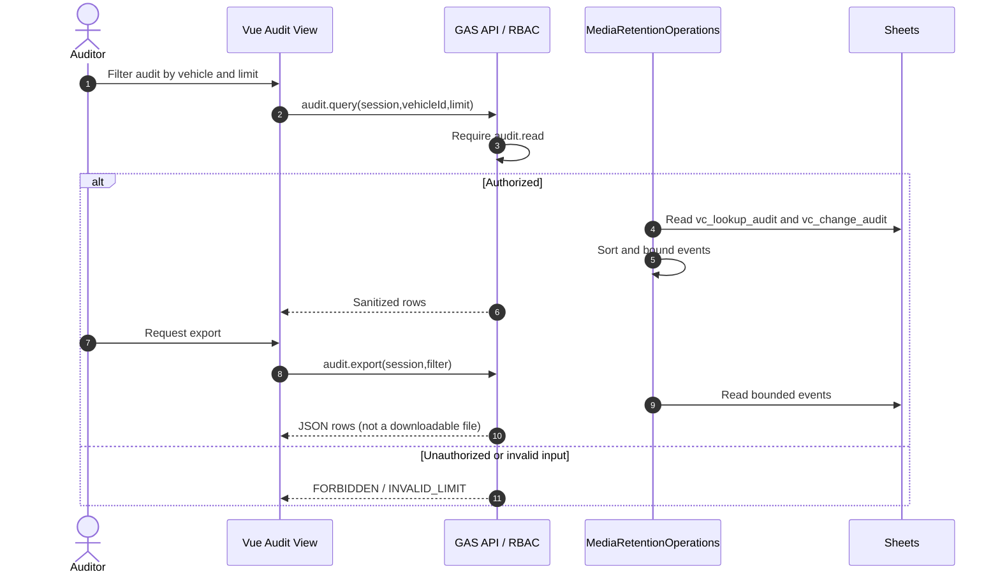

# UC-AUD-01 — Restricted lookup/change audit query and JSON export
**Status:** LIVE_DEV_API_SCOPE_VERIFIED; BROWSER_UAT_AND_PRODUCTION_GATES_OPEN
**Actor:** SYSTEM_ADMIN / explicitly granted audit.read

## 1. Authority and scope
- Business baseline: [Approved requirements](../../APPROVED_REQUIREMENTS_BASELINE_R01_R26.md).
- API operations: `audit.query`, `audit.export` (API v1 JSON envelope, GAS POST except public health GET).
- Implementation: `backend/gas/src/application/use-cases/MediaRetentionOperations.js`; server permission source `backend/gas/src/api/controllers/OperationController.js`.
- Diagram source: [sequence.mmd](sequence.mmd) (Mermaid, reviewed alongside spec).

## 2. Preconditions
Active server session and audit.read permission; optional vehicleId scoped filter and bounded limit.

## 3. Successful outcome / postconditions
Read vc_lookup_audit + vc_change_audit, combine and sort by timestamp; export JSON structure with capped rows.

## 4. Failure and alternate paths
Unauthorized actor, malformed limit or revoked session denied; never include raw tokens/passwords or unredacted secrets.

## 5. Persistence / external side effects
- `vc_lookup_audit`
- `vc_change_audit`

## 6. Acceptance trace
- Test case IDs: `ACTOR-06`, `TC-RBAC-02`, `MATRIX-02`.
- Executable evidence references: `backend/gas/tests/actor-usecase-acceptance.test.mjs`.
- Aggregate PR #110 / bf3553d live DEV evidence covers 56/56 API operations (97/97 checks); it does not prove every business branch, external provider/device behavior, destructive retention execution, browser/business UAT or production approval.
- FE status: **NOT_WIRED**; design must align Vue 3, Pinia, Router and API adapter per Master Web Blueprint.

## 7. Development notes / explicit gaps
Current audit exporter returns JSON DTO (not a downloadable file). Audit append-only immutability and independent retention need further verification.

## 8. Approval conditions
Traceability check PASS; frontend API adapter request/response and errors match backend v1; auth/default-deny and negative tests demonstrated; staging execution evidence linked to SHA; remaining discrepancies dispositioned by ADR.

**Evidence classification:** Source-reviewed implementation model plus scoped live DEV API evidence (GAS V48, backend 0.9.1). It is NOT browser/business UAT, destructive retention execution, real OIDC-provider or physical-QR acceptance, PDPA/security signoff, or production release approval. Runtime discrepancies require decision-log disposition and PR review.

## 9. GitHub Mermaid Preview

