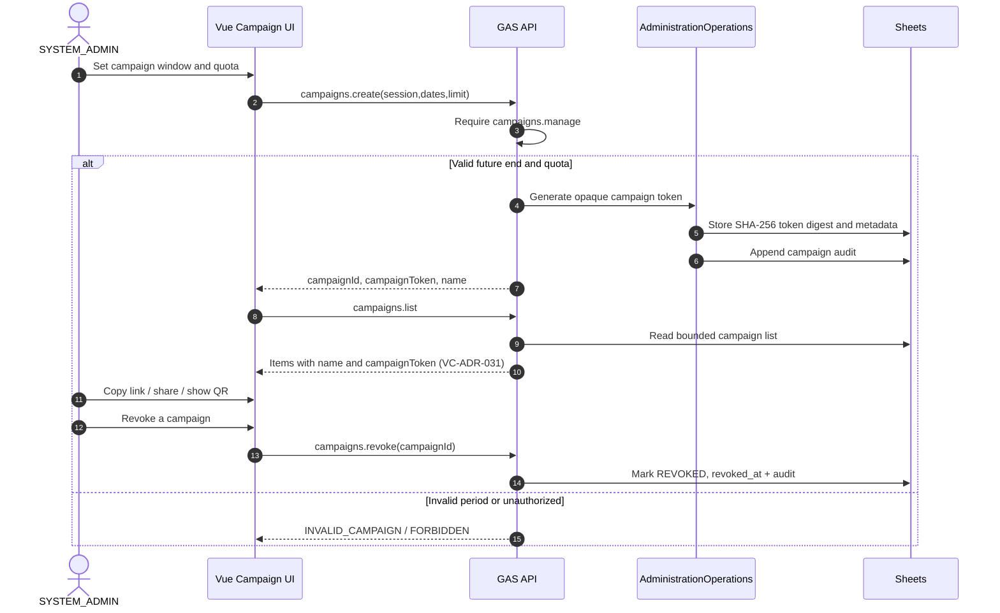

# UC-CAMP-01 — Create, list and revoke registration campaigns
**Status:** LIVE_DEV_API_SCOPE_VERIFIED; BROWSER_UAT_AND_PRODUCTION_GATES_OPEN
**Actor:** SYSTEM_ADMIN

## 1. Authority and scope
- Business baseline: [Approved requirements](../../APPROVED_REQUIREMENTS_BASELINE_R01_R26.md).
- API operations: `campaigns.create`, `campaigns.list`, `campaigns.revoke` (API v1 JSON envelope, GAS POST except public health GET).
- Implementation: `backend/gas/src/application/use-cases/AdministrationOperations.js`; server permission source `backend/gas/src/api/controllers/OperationController.js`.
- Diagram source: [sequence.mmd](sequence.mmd) (Mermaid, reviewed alongside spec).

## 2. Preconditions
Authenticated System Admin with campaigns.manage; request includes start/end and submission limit.

## 3. Successful outcome / postconditions
Store campaign token digest (lookup), the shareable code and an optional name (VC-ADR-031), schedule window and max quota; campaign admins can copy the code / registration link (`#/register?c=<code>`) / QR at any time from `campaigns.list`; revoke invalidates subsequent use.

## 4. Failure and alternate paths
Invalid period/capacity, name over 120 characters, non-admin creation or listing, reuse of revoked token denied. Campaigns created before 0.9.20 have no stored code (unrecoverable): the UI says to create a new campaign.

## 5. Persistence / external side effects
- `vc_campaigns`
- `vc_change_audit`

## 6. Acceptance trace
- Test case IDs: `ACTOR-02`, `ACTOR-ADR031`, `EDGE-04`, `EDGE-05`; FE `campaign-share-adr031`.
- Executable evidence references: `backend/gas/tests/actor-usecase-acceptance.test.mjs`.
- Aggregate PR #110 / bf3553d live DEV evidence covers 56/56 API operations (97/97 checks); it does not prove every business branch, external provider/device behavior, destructive retention execution, browser/business UAT or production approval.
- FE status: **WIRED_IN_SOURCE / LIVE_API_VERIFIED / BROWSER_UAT_OPEN** for delivered System Admin campaign screens.

## 7. Development notes / explicit gaps
VC-ADR-031 (owner 2026-11-25): the campaign code is not a secret and stays copyable; keep it out of logs/analytics. The share link carries it in the hash fragment (never sent as Referer). Leaked link → revoke + create a new campaign.

## 8. Approval conditions
Traceability check PASS; frontend API adapter request/response and errors match backend v1; auth/default-deny and negative tests demonstrated; staging execution evidence linked to SHA; remaining discrepancies dispositioned by ADR.

**Evidence classification:** Source-reviewed implementation model plus scoped live DEV API evidence (GAS V48, backend 0.9.1). It is NOT browser/business UAT, destructive retention execution, real OIDC-provider or physical-QR acceptance, PDPA/security signoff, or production release approval. Runtime discrepancies require decision-log disposition and PR review.

## 9. GitHub Mermaid Preview

