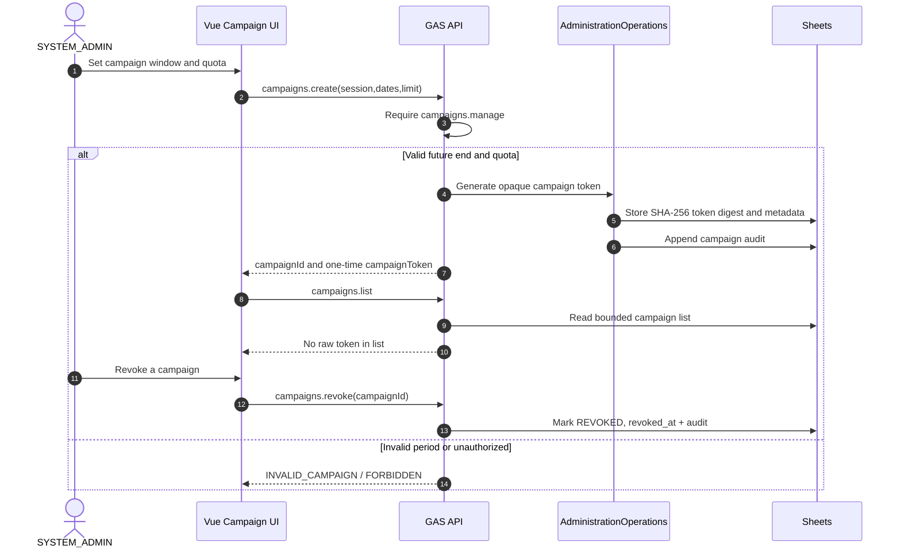

# UC-CAMP-01 — Create, list and revoke registration campaigns
**Status:** DESIGN_BASELINED_FROM_SOURCE; LIVE_GAS_ACCEPTANCE_PENDING
**Actor:** SYSTEM_ADMIN

## 1. Authority and scope
- Business baseline: [Approved requirements](../../APPROVED_REQUIREMENTS_BASELINE_R01_R26.md).
- API operations: `campaigns.create`, `campaigns.list`, `campaigns.revoke` (API v1 JSON envelope, GAS POST except public health GET).
- Implementation: `backend/gas/src/application/use-cases/AdministrationOperations.js`; server permission source `backend/gas/src/api/controllers/OperationController.js`.
- Diagram source: [sequence.mmd](sequence.mmd) (Mermaid, reviewed alongside spec).

## 2. Preconditions
Authenticated System Admin with campaigns.manage; request includes start/end and submission limit.

## 3. Successful outcome / postconditions
Store campaign token digest, schedule window and max quota; return raw token once to Admin; revoke invalidates subsequent use.

## 4. Failure and alternate paths
Invalid period/capacity, non-admin creation, reuse of revoked token denied.

## 5. Persistence / external side effects
- `vc_campaigns`
- `vc_change_audit`

## 6. Acceptance trace
- Test case IDs: `ACTOR-02`, `EDGE-04`, `EDGE-05`.
- Executable evidence references: `backend/gas/tests/actor-usecase-acceptance.test.mjs`.
- Passing tests for source paths do not automatically prove all cases of this UC. Real GAS Editor and authenticated staging HTTP remain separate release gates.
- FE status: **NOT_WIRED**; design must align Vue 3, Pinia, Router and API adapter per Master Web Blueprint.

## 7. Development notes / explicit gaps
Raw campaign token is returned only at creation; do not put in logs, analytics or referrer-bearing links.

## 8. Approval conditions
Traceability check PASS; frontend API adapter request/response and errors match backend v1; auth/default-deny and negative tests demonstrated; staging execution evidence linked to SHA; remaining discrepancies dispositioned by ADR.

**Evidence classification:** Diagram is a source-reviewed implementation model, NOT proof of successful real GAS HTTP integration or production release. Runtime discrepancies must be recorded in decision log and revised via PR.

## 9. GitHub Mermaid Preview

