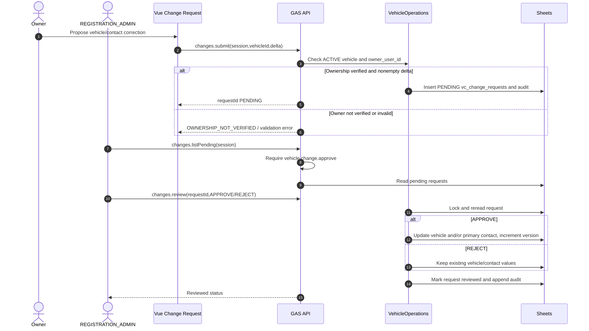

# UC-OWNER-01 — Owner proposes a change; Registration Admin approves
**Status:** DESIGN_BASELINED_FROM_SOURCE; LIVE_GAS_ACCEPTANCE_PENDING
**Actor:** OWNER (submit) / REGISTRATION_ADMIN (review)

## 1. Authority and scope
- Business baseline: [Approved requirements](../../APPROVED_REQUIREMENTS_BASELINE_R01_R26.md).
- API operations: `changes.submit`, `changes.listPending`, `changes.review` (API v1 JSON envelope, GAS POST except public health GET).
- Implementation: `backend/gas/src/application/use-cases/VehicleOperations.js`; server permission source `backend/gas/src/api/controllers/OperationController.js`.
- Diagram source: [sequence.mmd](sequence.mmd) (Mermaid, reviewed alongside spec).

## 2. Preconditions
Owner account authenticated and linked to ACTIVE vehicle via owner_user_id, or has explicit vehicle.update; Admin has vehicle.change.approve.

## 3. Successful outcome / postconditions
Store proposed_delta PENDING with audit; review APPROVE patches authorized vehicle/contact fields and audit; REJECT leaves current vehicle data unchanged.

## 4. Failure and alternate paths
Unverified ownership, empty change, invalid contact phone, unauthorized approver or already-reviewed request denied.

## 5. Persistence / external side effects
- `vc_change_requests`
- `vc_vehicles`
- `vc_vehicle_contacts`
- `vc_change_audit`

## 6. Acceptance trace
- Test case IDs: `ACTOR-04`, `GAS-FLOW.OWNER_PROPOSE`, `GAS-FLOW.REG_APPROVE_CHANGE`.
- Executable evidence references: `backend/gas/tests/actor-usecase-acceptance.test.mjs`.
- Passing tests for source paths do not automatically prove all cases of this UC. Real GAS Editor and authenticated staging HTTP remain separate release gates.
- FE status: **NOT_WIRED**; design must align Vue 3, Pinia, Router and API adapter per Master Web Blueprint.

## 7. Development notes / explicit gaps
Anonymous owner verification/claim procedure is NOT implemented. Existing Owner change submit derives identity from server session; campaign token alone does not grant owner edit.

## 8. Approval conditions
Traceability check PASS; frontend API adapter request/response and errors match backend v1; auth/default-deny and negative tests demonstrated; staging execution evidence linked to SHA; remaining discrepancies dispositioned by ADR.

**Evidence classification:** Diagram is a source-reviewed implementation model, NOT proof of successful real GAS HTTP integration or production release. Runtime discrepancies must be recorded in decision log and revised via PR.

## 9. GitHub Mermaid Preview

