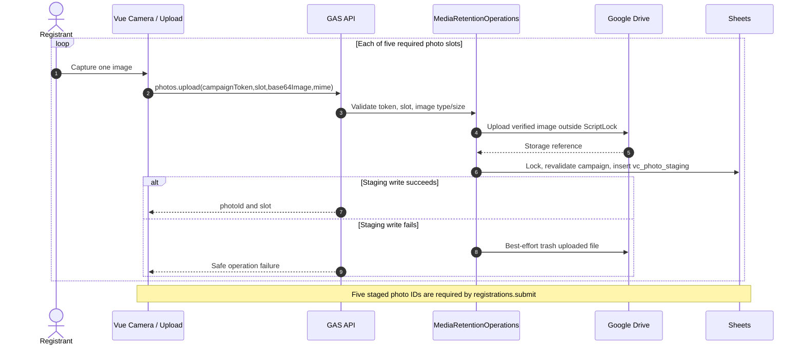

# UC-PHOTO-01 — Upload five staged vehicle photos
**Status:** DESIGN_BASELINED_FROM_SOURCE; LIVE_GAS_ACCEPTANCE_PENDING
**Actor:** Anonymous registrant with valid campaign

## 1. Authority and scope
- Business baseline: [Approved requirements](../../APPROVED_REQUIREMENTS_BASELINE_R01_R26.md).
- API operations: `photos.upload` (API v1 JSON envelope, GAS POST except public health GET).
- Implementation: `backend/gas/src/application/use-cases/MediaRetentionOperations.js`; server permission source `backend/gas/src/api/controllers/OperationController.js`.
- Diagram source: [sequence.mmd](sequence.mmd) (Mermaid, reviewed alongside spec).

## 2. Preconditions
Active campaign token; image JPEG/PNG/WebP with allowed signature, MIME and size; five slots FRONT, REAR, LEFT, RIGHT, FRONT_ANGLE.

## 3. Successful outcome / postconditions
Create Drive file and vc_photo_staging metadata; return photoId/slot for subsequent registration.submit.

## 4. Failure and alternate paths
Invalid MIME/signature/slot, revoked campaign, staging quota or failed Sheet write triggers safe failure and best-effort Drive trash.

## 5. Persistence / external side effects
- `vc_campaigns`
- `vc_photo_staging`

## 6. Acceptance trace
- Test case IDs: `ACTOR-03`, `EDGE-01`, `EDGE-08`, `EDGE-10`, `GAS-FLOW.MEDIA_FRONT`.
- Executable evidence references: `backend/gas/tests/actor-usecase-acceptance.test.mjs`.
- Passing tests for source paths do not automatically prove all cases of this UC. Real GAS Editor and authenticated staging HTTP remain separate release gates.
- FE status: **WIRED_IN_SOURCE / LIVE_ACCEPTANCE_PENDING**; five-slot native file inputs, bounded client mapping and Cloudflare large-payload validation are recorded in [FE-REGISTRATION-INTAKE-01 evidence](../../FRONTEND_FE_REGISTRATION_INTAKE_01_EVIDENCE_20261120.md).

## 7. Development notes / explicit gaps
Upload occurs before acquiring Sheets lock; if cleanup trash fails an orphan may remain and needs reconciliation. Parent-folder Anyone-with-link exposure is an accepted risk in approved requirements.

## 8. Approval conditions
Traceability check PASS; frontend API adapter request/response and errors match backend v1; auth/default-deny and negative tests demonstrated; staging execution evidence linked to SHA; remaining discrepancies dispositioned by ADR.

**Evidence classification:** Diagram is a source-reviewed implementation model, NOT proof of successful real GAS HTTP integration or production release. Runtime discrepancies must be recorded in decision log and revised via PR.

## 9. GitHub Mermaid Preview

