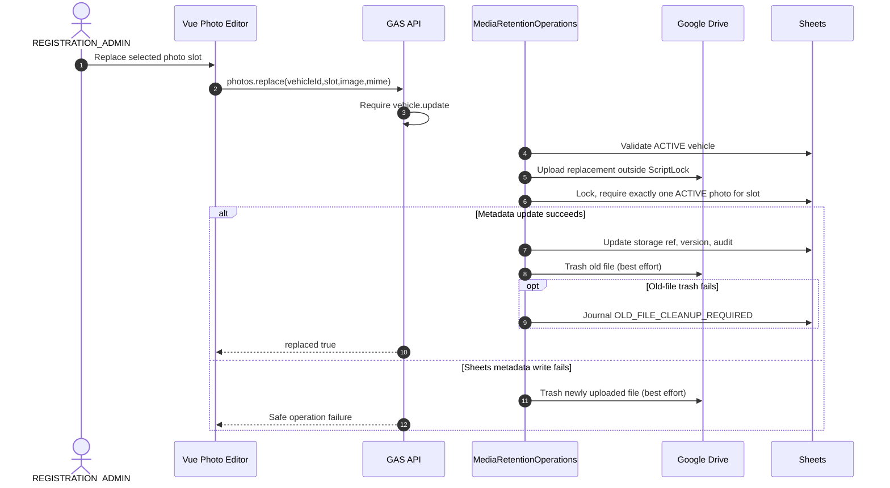

# UC-PHOTO-02 — List or replace a registered vehicle photo
**Status:** LIVE_DEV_API_SCOPE_VERIFIED; BROWSER_UAT_AND_PRODUCTION_GATES_OPEN
**Actor:** REGISTRATION_ADMIN (replace) / STAFF (read via UC-VEH-01)

## 1. Authority and scope
- Business baseline: [Approved requirements](../../APPROVED_REQUIREMENTS_BASELINE_R01_R26.md).
- API operations: `photos.replace` (API v1 JSON envelope, GAS POST except public health GET).
- Implementation: `backend/gas/src/application/use-cases/MediaRetentionOperations.js`; server permission source `backend/gas/src/api/controllers/OperationController.js`.
- Diagram source: [sequence.mmd](sequence.mmd) (Mermaid, reviewed alongside spec).

## 2. Preconditions
ACTIVE vehicle; permitted admin, existing exactly one ACTIVE photo row for chosen slot; valid replacement PNG/JPEG/WebP.

## 3. Successful outcome / postconditions
Upload new file to Drive outside lock, swap metadata under lock, audit; trash old file after persistence.

## 4. Failure and alternate paths
Invalid slot/MIME, missing photo row, Drive upload error; on failed Sheet write trash new file best-effort; failed old-file cleanup journals follow-up.

## 5. Persistence / external side effects
- `vc_vehicle_photos`
- `vc_vehicles`
- `vc_operation_journal`
- `vc_change_audit`

## 6. Acceptance trace
- Test case IDs: `ACTOR-05`, `GAS-FLOW.REPLACE_PHOTO`.
- Executable evidence references: `backend/gas/tests/actor-usecase-acceptance.test.mjs`.
- Aggregate PR #110 / bf3553d live DEV evidence covers 56/56 API operations (97/97 checks); it does not prove every business branch, external provider/device behavior, destructive retention execution, browser/business UAT or production approval.
- FE status: **WIRED_IN_SOURCE / LIVE_API_VERIFIED / BROWSER_UAT_OPEN** for C3 photo replacement; browser/device media and Drive privacy acceptance remain open.

## 7. Development notes / explicit gaps
Listing is covered by UC-VEH-01 as photos.list; outside-app Drive folder link access is an approved privacy risk that must be tested in UAT.

## 8. Approval conditions
Traceability check PASS; frontend API adapter request/response and errors match backend v1; auth/default-deny and negative tests demonstrated; staging execution evidence linked to SHA; remaining discrepancies dispositioned by ADR.

**Evidence classification:** Source-reviewed implementation model plus scoped live DEV API evidence (GAS V48, backend 0.9.1). It is NOT browser/business UAT, destructive retention execution, real OIDC-provider or physical-QR acceptance, PDPA/security signoff, or production release approval. Runtime discrepancies require decision-log disposition and PR review.

## 9. GitHub Mermaid Preview

