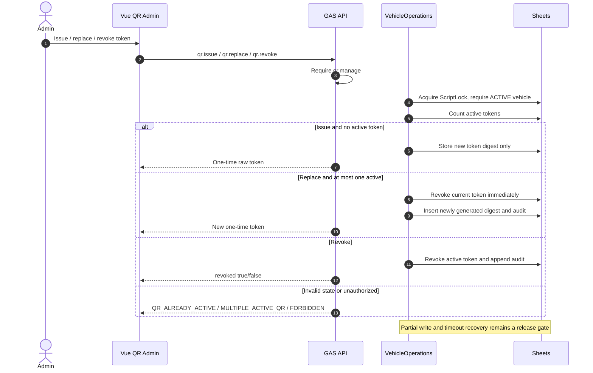

# UC-QR-02 — Issue, revoke and rotate vehicle QR token
**Status:** DESIGN_BASELINED_FROM_SOURCE; LIVE_GAS_ACCEPTANCE_PENDING
**Actor:** REGISTRATION_ADMIN / SYSTEM_ADMIN with qr.manage

## 1. Authority and scope
- Business baseline: [Approved requirements](../../APPROVED_REQUIREMENTS_BASELINE_R01_R26.md).
- API operations: `qr.issue`, `qr.revoke`, `qr.replace` (API v1 JSON envelope, GAS POST except public health GET).
- Implementation: `backend/gas/src/application/use-cases/VehicleOperations.js`; server permission source `backend/gas/src/api/controllers/OperationController.js`.
- Diagram source: [sequence.mmd](sequence.mmd) (Mermaid, reviewed alongside spec).

## 2. Preconditions
Authenticated actor with qr.manage; vehicle ACTIVE and at most one ACTIVE QR.

## 3. Successful outcome / postconditions
Issue opaque token only if none active; rotate revokes old then creates new digest; revoke fails closed for older QR, audit mutations.

## 4. Failure and alternate paths
Two active QR conflict, issue with existing token, inactive vehicle, unauthorized mutation blocked.

## 5. Persistence / external side effects
- `vc_qr_tokens`
- `vc_vehicles`
- `vc_change_audit`

## 6. Acceptance trace
- Test case IDs: `ACTOR-04`, `EDGE-06`, `GAS-FLOW.ROTATE_QR`.
- Executable evidence references: `backend/gas/tests/actor-usecase-acceptance.test.mjs`.
- Passing tests for source paths do not automatically prove all cases of this UC. Real GAS Editor and authenticated staging HTTP remain separate release gates.
- FE status: **NOT_WIRED**; design must align Vue 3, Pinia, Router and API adapter per Master Web Blueprint.

## 7. Development notes / explicit gaps
Under Sheets lock old QR is revoked and new one inserted. If GAS times out between writes, recovery must handle state; no claim of ACID.

## 8. Approval conditions
Traceability check PASS; frontend API adapter request/response and errors match backend v1; auth/default-deny and negative tests demonstrated; staging execution evidence linked to SHA; remaining discrepancies dispositioned by ADR.

**Evidence classification:** Diagram is a source-reviewed implementation model, NOT proof of successful real GAS HTTP integration or production release. Runtime discrepancies must be recorded in decision log and revised via PR.

## 9. GitHub Mermaid Preview

