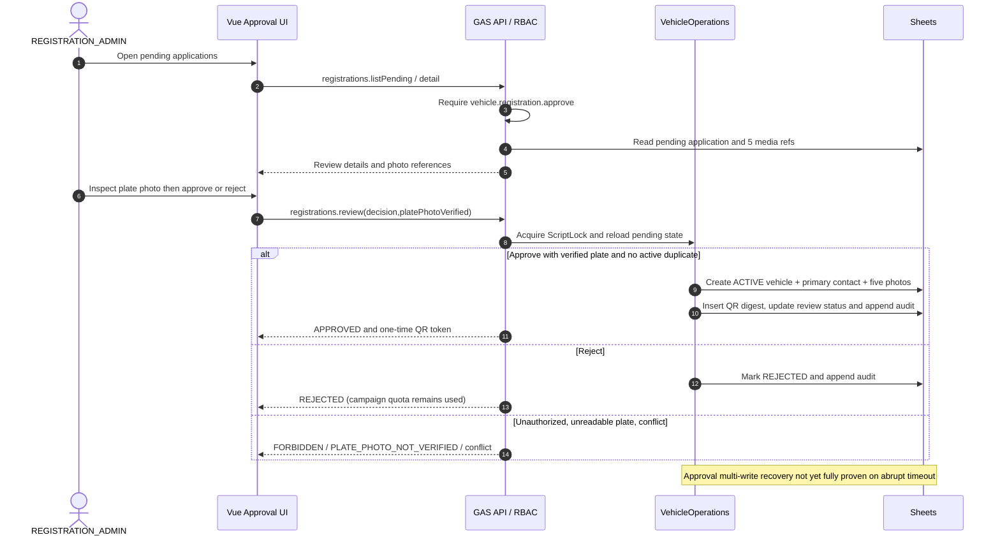

# UC-REG-02 — Administrator review, approval or rejection of vehicle registration
**Status:** DESIGN_BASELINED_FROM_SOURCE; LIVE_GAS_ACCEPTANCE_PENDING
**Actor:** REGISTRATION_ADMIN

## 1. Authority and scope
- Business baseline: [Approved requirements](../../APPROVED_REQUIREMENTS_BASELINE_R01_R26.md).
- API operations: `registrations.listPending`, `registrations.detail`, `registrations.review` (API v1 JSON envelope, GAS POST except public health GET).
- Implementation: `backend/gas/src/application/use-cases/VehicleOperations.js`; server permission source `backend/gas/src/api/controllers/OperationController.js`.
- Diagram source: [sequence.mmd](sequence.mmd) (Mermaid, reviewed alongside spec).

## 2. Preconditions
Registration request exists as PENDING_APPROVAL; Registration Admin has vehicle.registration.approve; readable plate photo manually verified for APPROVE.

## 3. Successful outcome / postconditions
APPROVE creates ACTIVE vehicle, one primary contact, five active photo records, QR token digest and audit; REJECT only updates request and audit.

## 4. Failure and alternate paths
Insufficient approval permission, unreadable plate, duplicate active vehicle, already-reviewed request denied; mid-approval Sheets failure needs reconciliation.

## 5. Persistence / external side effects
- `vc_registration_requests`
- `vc_vehicles`
- `vc_vehicle_contacts`
- `vc_vehicle_photos`
- `vc_qr_tokens`
- `vc_change_audit`

## 6. Acceptance trace
- Test case IDs: `ACTOR-03`, `EDGE-02`, `GAS-FLOW.APPROVE`.
- Executable evidence references: `backend/gas/tests/actor-usecase-acceptance.test.mjs`.
- Passing tests for source paths do not automatically prove all cases of this UC. Real GAS Editor and authenticated staging HTTP remain separate release gates.
- FE status: **NOT_WIRED**; design must align Vue 3, Pinia, Router and API adapter per Master Web Blueprint.

## 7. Development notes / explicit gaps
The backend checks platePhotoVerified boolean supplied by admin session; actual human visual verification is outside code and requires UAT. Current approve path performs multiple Sheets writes without full durable compensation.

## 8. Approval conditions
Traceability check PASS; frontend API adapter request/response and errors match backend v1; auth/default-deny and negative tests demonstrated; staging execution evidence linked to SHA; remaining discrepancies dispositioned by ADR.

**Evidence classification:** Diagram is a source-reviewed implementation model, NOT proof of successful real GAS HTTP integration or production release. Runtime discrepancies must be recorded in decision log and revised via PR.

## 9. GitHub Mermaid Preview

