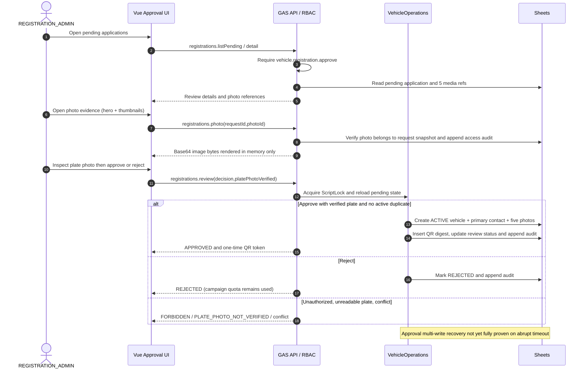

# UC-REG-02 — Administrator review, approval or rejection of vehicle registration
**Status:** LIVE_DEV_API_SCOPE_VERIFIED; BROWSER_UAT_AND_PRODUCTION_GATES_OPEN
**Actor:** REGISTRATION_ADMIN

## 1. Authority and scope
- Business baseline: [Approved requirements](../../APPROVED_REQUIREMENTS_BASELINE_R01_R26.md).
- API operations: `registrations.listPending`, `registrations.detail`, `registrations.review`, `registrations.photo` (API v1 JSON envelope, GAS POST except public health GET).
- Implementation: `backend/gas/src/application/use-cases/VehicleOperations.js`; photo evidence read `backend/gas/src/application/use-cases/MediaRetentionOperations.js` via `backend/gas/src/infrastructure/media/DrivePhotos.js`; server permission source `backend/gas/src/api/controllers/OperationController.js`.
- Diagram source: [sequence.mmd](sequence.mmd) (Mermaid, reviewed alongside spec).

## 2. Preconditions
Registration request exists as PENDING_APPROVAL; Registration Admin has vehicle.registration.approve; readable plate photo manually verified for APPROVE.

## 3. Successful outcome / postconditions
APPROVE creates ACTIVE vehicle, one primary contact, five active photo records, QR token digest and audit; REJECT only updates request and audit.

## 4. Failure and alternate paths
Insufficient approval permission, unreadable plate, duplicate active vehicle, already-reviewed request denied; mid-approval Sheets failure needs reconciliation.

## 5. Persistence / external side effects
- `vc_registration_requests`
- `vc_vehicles`
- `vc_vehicle_contacts`
- `vc_vehicle_photos`
- `vc_qr_tokens`
- `vc_change_audit`

## 6. Acceptance trace
- Test case IDs: `ACTOR-03`, `EDGE-02`, `GAS-FLOW.APPROVE`.
- Executable evidence references: `backend/gas/tests/actor-usecase-acceptance.test.mjs`.
- Aggregate PR #110 / bf3553d live DEV evidence covers 56/56 API operations (97/97 checks); it does not prove every business branch, external provider/device behavior, destructive retention execution, browser/business UAT or production approval.
- FE status: **WIRED_IN_SOURCE / LIVE_API_VERIFIED / BROWSER_UAT_OPEN**; route, queue, detail, pagination, explicit approve/reject confirmation and Cloudflare DTO allowlist are recorded in [FE-REGISTRATION-ADMIN-01 evidence](../../FRONTEND_FE_REGISTRATION_ADMIN_01_EVIDENCE_20261120.md).

## 7. Development notes / explicit gaps
The backend checks the `platePhotoVerified` boolean supplied by the admin session; actual human visual verification requires business UAT. **Residual B2b:** registration approval (and `users.assignRoles`) still performs multiple Sheets writes without durable journaling/automatic recovery; preserve the manual recovery runbook and do not claim B2 closed this gap. Photo evidence is fetched one image at a time via `registrations.photo` (request-snapshot ownership check plus access audit); the frontend renders bytes in memory only and never caches them in browser storage.

## 8. Approval conditions
Traceability check PASS; frontend API adapter request/response and errors match backend v1; auth/default-deny and negative tests demonstrated; staging execution evidence linked to SHA; remaining discrepancies dispositioned by ADR.

**Evidence classification:** Source-reviewed implementation model plus scoped live DEV API evidence (GAS V48, backend 0.9.1). It is NOT browser/business UAT, destructive retention execution, real OIDC-provider or physical-QR acceptance, PDPA/security signoff, or production release approval. Runtime discrepancies require decision-log disposition and PR review.

## 9. GitHub Mermaid Preview

