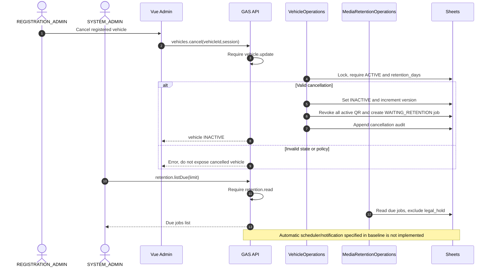

# UC-RET-01 — Cancel vehicle and list retention work due
**Status:** DESIGN_BASELINED_FROM_SOURCE; LIVE_GAS_ACCEPTANCE_PENDING
**Actor:** REGISTRATION_ADMIN (cancel) / SYSTEM_ADMIN (due list)

## 1. Authority and scope
- Business baseline: [Approved requirements](../../APPROVED_REQUIREMENTS_BASELINE_R01_R26.md).
- API operations: `vehicles.cancel`, `retention.listDue` (API v1 JSON envelope, GAS POST except public health GET).
- Implementation: `backend/gas/src/application/use-cases/VehicleOperations.js`, `backend/gas/src/application/use-cases/MediaRetentionOperations.js`; server permission source `backend/gas/src/api/controllers/OperationController.js`.
- Diagram source: [sequence.mmd](sequence.mmd) (Mermaid, reviewed alongside spec).

## 2. Preconditions
Vehicle ACTIVE; Registration Admin has vehicle.update; retention_days configured; due listing requires retention.read.

## 3. Successful outcome / postconditions
Mark vehicle INACTIVE, revoke ACTIVE QR tokens, create WAITING_RETENTION job; later due list excludes legal holds.

## 4. Failure and alternate paths
Unauthorized cancel, missing policy, already inactive vehicle, legal hold or not-due jobs excluded from due list.

## 5. Persistence / external side effects
- `vc_vehicles`
- `vc_qr_tokens`
- `vc_retention_jobs`
- `vc_settings`
- `vc_change_audit`

## 6. Acceptance trace
- Test case IDs: `ACTOR-06`, `EDGE-07`, `GAS-FLOW.CANCEL`.
- Executable evidence references: `backend/gas/tests/actor-usecase-acceptance.test.mjs`, `backend/gas/tests/acceptance-failures.test.mjs`.
- Passing tests for source paths do not automatically prove all cases of this UC. Real GAS Editor and authenticated staging HTTP remain separate release gates.
- FE status: **NOT_WIRED**; design must align Vue 3, Pinia, Router and API adapter per Master Web Blueprint.

## 7. Development notes / explicit gaps
Baseline envisions DELETION_PENDING_APPROVAL + notification trigger; current implementation creates WAITING_RETENTION and lists due jobs but does not implement the notification scheduler. Explicit gap.

## 8. Approval conditions
Traceability check PASS; frontend API adapter request/response and errors match backend v1; auth/default-deny and negative tests demonstrated; staging execution evidence linked to SHA; remaining discrepancies dispositioned by ADR.

**Evidence classification:** Diagram is a source-reviewed implementation model, NOT proof of successful real GAS HTTP integration or production release. Runtime discrepancies must be recorded in decision log and revised via PR.

## 9. GitHub Mermaid Preview

