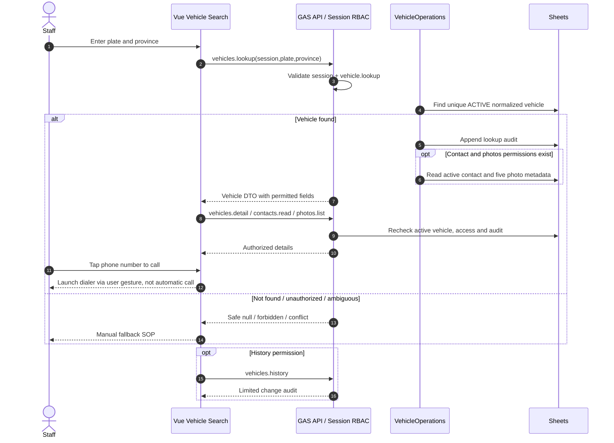

# UC-VEH-01 — Authorized cross-org plate search, details and contact/photo disclosure
**Status:** DESIGN_BASELINED_FROM_SOURCE; LIVE_GAS_ACCEPTANCE_PENDING
**Actor:** STAFF / REGISTRATION_ADMIN with permissions

## 1. Authority and scope
- Business baseline: [Approved requirements](../../APPROVED_REQUIREMENTS_BASELINE_R01_R26.md).
- API operations: `vehicles.lookup`, `vehicles.detail`, `vehicles.history`, `contacts.read`, `photos.list` (API v1 JSON envelope, GAS POST except public health GET).
- Implementation: `backend/gas/src/application/use-cases/VehicleOperations.js`, `backend/gas/src/application/use-cases/MediaRetentionOperations.js`; server permission source `backend/gas/src/api/controllers/OperationController.js`.
- Diagram source: [sequence.mmd](sequence.mmd) (Mermaid, reviewed alongside spec).

## 2. Preconditions
Valid server session; permissions vehicle.lookup, vehicle.contact.read, vehicle.photos.read and optionally vehicle.history.read; vehicle ACTIVE.

## 3. Successful outcome / postconditions
Search normalized Thai plate+province across organizations; show permitted contact and 5 photo references with lookup audit; allow user-initiated phone dial.

## 4. Failure and alternate paths
Unknown/inactive vehicle, missing permission, revoked session or ambiguous active duplicate fail safely; don't expose public contact directory.

## 5. Persistence / external side effects
- `vc_vehicles`
- `vc_vehicle_contacts`
- `vc_vehicle_photos`
- `vc_lookup_audit`
- `vc_change_audit`

## 6. Acceptance trace
- Test case IDs: `ACTOR-03`, `ACTOR-04`, `GAS-AUTH-LOOKUP.STAFF`, `GAS-AUTH-CONTACT.READ`.
- Executable evidence references: `backend/gas/tests/actor-usecase-acceptance.test.mjs`.
- Passing tests for source paths do not automatically prove all cases of this UC. Real GAS Editor and authenticated staging HTTP remain separate release gates.
- FE status: **NOT_WIRED**; design must align Vue 3, Pinia, Router and API adapter per Master Web Blueprint.

## 7. Development notes / explicit gaps
Approved business baseline permits immediate contact/5-photo visibility to authorized staff, no reason prompt. Images may be link-accessible outside app because of shared parent folder risk.

## 8. Approval conditions
Traceability check PASS; frontend API adapter request/response and errors match backend v1; auth/default-deny and negative tests demonstrated; staging execution evidence linked to SHA; remaining discrepancies dispositioned by ADR.

**Evidence classification:** Diagram is a source-reviewed implementation model, NOT proof of successful real GAS HTTP integration or production release. Runtime discrepancies must be recorded in decision log and revised via PR.

## 9. GitHub Mermaid Preview

